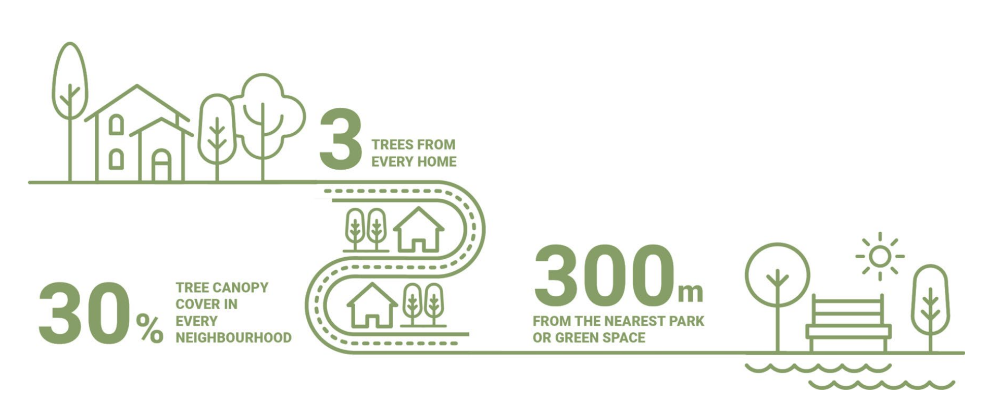

# Introduzione

Il rapporto ha lo scopo di fornire al Comune di Spoleto un quadro conoscitivo aggiornato e un insieme di indirizzi operativi per rafforzare la rete ecologica comunale, con particolare attenzione all'ambito urbano, dove la pressione insediativa è maggiore e le opportunità di intervento più concrete.
A tal fine il rapporto persegue cinque obiettivi specifici.

Il primo è ridefinire la suddivisione del territorio in Unità Funzionali, superando il disallineamento tra le precedenti Unità di Paesaggio e i confini amministrativi di frazioni e località, così da disporre di ambiti coerenti sul piano ecologico e riconoscibili su quello amministrativo.
Il secondo è valutare struttura e connettività del paesaggio in ciascuna unità, mediante la Morphological Spatial Pattern Analysis e le metriche di frammentazione, individuando serbatoi di habitat, corridoi e aree critiche.
Il terzo è caratterizzare le infrastrutture verdi e blu dell'unità urbana, pubbliche e private, e condurre una verifica preliminare della regola 3-30-300 come riferimento di vivibilità e sostenibilità.
Il quarto è coinvolgere la cittadinanza come interlocutrice e non come semplice destinataria di informazioni, attraverso il walkshop svolto lungo la Greenway della Valle Spoletana e il relativo sondaggio, anche in prospettiva di future campagne di citizen science.
Il quinto è tradurre analisi e percezioni in indirizzi per la gestione e la progettazione, dalla riqualificazione dell'area di Piazza d'Armi alla gestione ecologica dei prati urbani, fino alle linee guida per il comparto terrestre e a un'ipotesi di pianificazione sistematica della conservazione con Marxan.

Il rapporto è organizzato in tre parti.
La prima descrive le metodologie adottate, la seconda presenta i risultati del quadro conoscitivo, dell'analisi del sistema verde e blu e del sondaggio, la terza raccoglie gli indirizzi di gestione e progettazione.
Il testo si rivolge a un pubblico di tecnici, amministratori e studiosi, e per questo le parti più tecniche sono accompagnate da sintesi interpretative.
Molte delle indicazioni hanno carattere preliminare o programmatico e vanno intese come supporto alle decisioni e non come prescrizioni, nell'intento di costruire con il Comune un percorso condiviso e verificabile nel tempo.

## La rete ecologica

## Inquadramento: la rete ecologica

L'obiettivo primario di una rete ecologica è consentire la mobilità delle specie e lo scambio di individui e geni tra popolazioni che occupano aree di habitat spazialmente distinte [@battisti2004].
Anche a scala comunale la rete può essere schematizzata in quattro elementi: nodi (*core areas*), zone cuscinetto, *stepping stones* e corridoi.

I nodi sono aree sufficientemente estese da sostenere nel lungo periodo una popolazione, in genere con elevata ricchezza di specie e presenza di specie rare.
Ne sono esempio i siti Natura 2000, ma anche un bosco o un'area umida ben conservati.
Le zone cuscinetto circondano i nodi e li proteggono dalle pressioni esterne con un'azione di filtro, e spesso coincidono con fasce ecotonali ricche di specie.
Le *stepping stones* sono frammenti di habitat troppo piccoli per ospitare popolazioni stabili, ma importanti come punti intermedi: riducono i rischi dello spostamento in una matrice frammentata e offrono risorse e rifugio.
Possono essere boschetti isolati o stagni, ma anche elementi semi-naturali o artificiali, come giardini urbani e aiuole fiorite.
I corridoi, infine, sono elementi lineari come corsi d'acqua, fasce boscate, siepi e filari, che favoriscono la biopermeabilità del territorio e riducono la frammentazione.
Differiscono per ampiezza, geometria, struttura verticale e composizione floristica della vegetazione, gradualità degli ecotoni e interazione con gli ecosistemi circostanti, e da queste caratteristiche dipende la loro efficacia.

Questo schema è alla base della lettura del territorio proposta nel rapporto.
Le classi della *Morphological Spatial Pattern Analysis* ne forniscono una controparte operativa: le aree *Core* corrispondono ai nodi, l'*Edge* alle fasce di transizione, le *Islet* alle *stepping stones* e i *Bridge*, i *Loop* e i *Branch* ai diversi tipi di corridoio.
Nell'ambito urbano, dove i nodi sono pochi, il ruolo di *stepping stones* è affidato a elementi del verde pubblico e privato come giardini, siepi e aiuole.

L'analisi strutturale va integrata con indicatori ambientali e biologici.
A livello di habitat si possono valutare il valore ecologico, che esprime la qualità di un biotopo, e la fragilità ambientale, legata alla vulnerabilità e al disturbo delle attività umane \[ @angelini2009\].
A livello di comunità la biodiversità si descrive con la ricchezza specifica e l'*evenness*, da cui derivano gli indici di diversità e dominanza come Shannon e Simpson [@magurran2004].
Sono gli strumenti con cui potranno essere letti i dati del monitoraggio entomologico alla Spoletosfera, una volta completate le determinazioni.

Non esistono reti universali né scale uniche.
Ogni strategia di conservazione deve definire obiettivi di riferimento che ne orientino struttura, scala e priorità, adattandole al contesto ambientale, sociale ed economico.
La progettazione deve inoltre considerare la posizione degli elementi di naturalità rispetto alle trasformazioni previste, perché il paesaggio è dinamico: cambia per l'espansione urbana, per l'evoluzione delle colture e l'abbandono delle aree collinari e montane, e per le scelte della pianificazione.

Nell'ambito comunale gli obiettivi della rete ecologica possono essere riassunti in:

- sviluppare un sistema di connessioni che consideri insieme patrimonio naturale e culturale e mantenga o ripristini una naturalità diffusa degli spazi rurali e urbani;
- ridurre la frammentazione e gli effetti dell'insularizzazione per le popolazioni animali, anche con misure normative negli strumenti urbanistici ordinari;
- rafforzare la naturalità del territorio rimuovendo o attenuando le barriere, in particolare per mitigare gli impatti delle grandi infrastrutture;
- sostenere un programma organico del verde urbano e periurbano, coerente con le esigenze naturalistiche ai margini di infrastrutture e insediamenti.

## Il verde urbano

È noto che le aree urbane concentrano la maggior parte della popolazione mondiale e sono tra i contesti più esposti agli effetti dei cambiamenti climatici.
In tali contesti, in particolare quelli dell’area mediterranea, sono evidenti soprattutto gli effetti negativi legati all’isola di calore urbana e alle ondate di calore [@konijnendijk2023].
Ad esempio si stima che nell’estate 2024 siano morte per cause attribuibili al caldo 62.775 persone in 32 paesi europei, con l’Italia come paese più colpito (oltre 19.000 decessi) [@janos2025].

Alberi e spazi verdi urbani sono ampiamente riconosciuti come soluzioni basate sulla natura (NBS) che consentono di affrontare queste criticità, con contributi documentati alla salute pubblica, all’adattamento climatico, alla riduzione dell’inquinamento, alla conservazione della biodiversità e alla regolazione delle acque [@ferrari2019; @gill2007; @tzoulas2007promoting; @pukowiec-kurda2022; @islam2012; @aronson2017biodiversity].
Tuttavia l’accesso a tali benefici non sempre è distribuito in modo uguale, ma anzi molto frequentemente la porzione di popolazione che include i più vulnerabili vive in quartieri con minore copertura arborea, con un minor numero di spazi verdi e in condizioni di temperature più elevate durante la stagione calda [cfr. @rigolon2016; @mcdonald2021].

In risposta all’esigenza di linee guida semplici e basate sull’evidenza nel 2021 è stata proposta una sorta di regola per il verde urbano, denominata regola “3–30–300” che fissa tre soglie per ogni residente [@konijnendijk2023].
In sostanza, affinché un contesto urbano possa dirsi verde, salubre e resiliente è necessario che per ogni residente ci siano almeno tre alberi “ben sviluppati” visibili dalla casa, dalla scuola e dal luogo di lavoro (soglia 3).
Inoltre, è richiesto che in ogni quartiere della città ci sia una copertura arborea complessiva non inferiore al 30% (soglia 30) e che ogni residente non si trovi a più di 300 m dal più vicino spazio di verde pubblico (soglia 300) (Fig. \@ref(fig:modello330300)).

```{r modello330300, fig.cap="Schema della regola 3-30-300. Da UNECE (2022).", out.width='\\linewidth', fig.align='center', echo=FALSE}

```

È interessante notare che queste tre soglie corrispondono a tre modalità distinte di esposizione alla natura: i) vedere la natura, ii) vivere in mezzo al verde e iii) usufruirne a scopo ricreativo e rigenerativo.
Queste soglie non sono arbitrarie, ma si fondano su evidenze empiriche consolidate nella letteratura scientifica.
Ad esempio, il valore del 30% di verde per ogni quartiere trova riscontro negli studi di Astell-Burt e Feng, che associano a tale soglia maggiori benefici per salute, sonno e salute mentale [@feng2017], mentre i 300 m coincidono con la raccomandazione dell’Ufficio regionale europeo dell’OMS per uno spazio verde di estensione almeno pari a un ettaro [@worldhealthorganization2017].
Ovviamente questa regola è una linea guida “volontaria”, da applicare con attenzione al contesto locale: tessuti urbani densi o con caratteri storici, congiuntamente a ulteriori fattori culturali, possono rendere difficile e inadeguata l’applicazione letterale delle soglie; la regola tuttavia resta un valido orientamento per una proiezione sostenibile dello sviluppo del tessuto urbano e periurbano.

\<!-
- \## Agenda urbana e progetto lifeIMAGINE