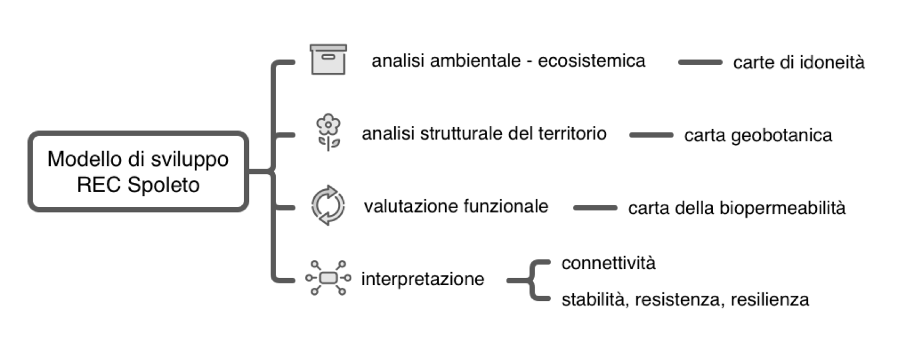

# Metodologie

## Approccio metodologico generale

Dal punto di vista metodologico, il piano delle attività è stato condotto sempre in accordo con lo schema concettuale di seguito riportato e già presentato nel 2025 che definisce le principali fasi del lavoro (Fig. \@ref(fig:modelloRECSpoleto)).

```{r modelloRECSpoleto, fig.cap="Modello di sviluppo attività.", out.width='\\linewidth', fig.align='center', echo=FALSE}

```

In particolare, in continuità con quanto già impostato in precedenza, sono stati sviluppati nuovi elaborati e approfondimenti analitici orientati all'analisi della struttura e connettività ecologica del paesaggio mediante l'applicazione congiunta della Morphological Spatial Pattern Analysis (MSPA) e delle metriche di frammentazione spaziale.
Questa nuova interpretazione tiene conto del passaggio delle precedenti Unità di Paesaggio (UdP) alle nuove Unità Funzionali (UF).
Inoltre, è stata sviluppata una valutazione delle infrastrutture verdi e blu dell'unità urbana, ponendo come base per la verifica preliminare dei criteri di vivibilità e sostenibilità del territorio la regola 3–30–300.

## Suddivisione del territorio in unità funzionali {#sec-UF}

La definizione di unità territoriali rappresenta un passo fondamentale nella pianificazione territoriale.
Come previsto nell'Art.32 del TITOLO IV delle Norme Tecniche di Attuazione del Piano Regolatore Generale - Parte Strutturale, il Paesaggio Comunale attualmente si articola in 14 Unità di Paesaggio in coerenza con le Unità del Sistema Paesaggistico proposte nell'ambito del PTCP.
L'analisi dell'attuale configurazione delle Unità di Paesaggio (UdP) ha evidenziato un disallineamento con i confini amministrativi consolidati.
In previsione della programmazione del nuovo PRG, si intende superare tale elemento di criticità attraverso l'individuazione di nuove unità di suddivisione del territorio, denominate Unità Funzionali (UF).

### Approccio metodologico e basi dati

L'approccio metodologico adottato per la definizione delle nuove UF, persegue due obiettivi principali: i) garantire una coerenza amministrativa che si basa sull'allineamento delle UF con i confini esistenti delle frazioni e località e ii) assicurare l'identificazione di ambiti territoriali che presentino caratteristiche paesaggistiche ed ecologico-funzionali il più possibile omogenee.
Tale metodologia ha quindi come obiettivo la continuità dell'organizzazione amministrativa esistente e la suddivisione del territorio in ambiti funzionali che mantengano una propria identità e riconoscibilità.

I supporti informativi di cui si è tenuto conto nel processo di formulazione di questa prima proposta per le UF sono:

- unità di paesaggio
- carta delle macroaree
- carta delle frazioni e località
- modello di elevazione digitale del terreno
- carta CORINE Land Cover (vers. 2018)
- carta geobotanica e uso del suolo aggiornata nell'ambito delle attività per lo sviluppo della rete ecologica comunale
- carta della rete idrografica comunale
- carta dei bacini idrografici

Per l'individuazione delle UF come base di partenza è stata utilizzata la carta delle UdP che già identifica ambiti territoriali coerenti e riconoscibili.
Questi ambiti sono stati successivamente estesi o contratti in funzione della carta delle frazioni e località, che ha guidato la rimodellazione dei confini.
Per garantire coerenza amministrativa si è cercato di assegnare ogni frazione a un'unica UF.
Tale assegnazione univoca non è stata tuttavia sempre possibile e pertanto alcuni casi dovranno essere oggetto di ulteriore analisi e approfondimento.

In particolare le frazioni di:

- Bazzano superiore (2)
- Cerqueto (2)
- Morro (2)
- Perchia (2)
- Pompagnano (2)
- Poreta (2)
- San Venanzo (2)
- Sant'Angelo in Mercole (2)
- Silvignano (2)

attualmente ricadono in due unità funzionali e nel caso di:

- Eggi (3)

si arriva a tre diverse UF.

Per l'assegnazione di ciascuna località a un'unità funzionale è stato adottato il seguente approccio metodologico:

- quando il poligono di una località ricadeva interamente all'interno di una UdP, l'assegnazione alla rispettiva UF è stata diretta.
- nei casi in cui il poligono della località insisteva su più UdP, per l'assegnazione alla relativa UF sono state considerate le sue caratteristiche altitudinali, geobotaniche e di uso del suolo.

Infine, per garantire una maggiore coerenza funzionale, sono state considerate anche le macroaree urbane.
Nella collocazione delle località all'interno delle UF si è tenuto conto di questo aspetto, privilegiando l'aggregazione delle porzioni urbanizzate al fine di concentrare in poche unità omogenee i sistemi insediativi più consolidati.

## Analisi della struttura e della connettività del paesaggio (MSPA ed Effective Mesh Size)

L'indagine sulla struttura e sulla connettività del paesaggio è stata condotta integrando i principi della Morphological Spatial Pattern Analysis (MSPA)[@vogt2025] con le metriche di frammentazione spaziale elaborate da [@jaeger2000].
L'analisi è stata eseguita disaggregando le porzioni territoriali in base alle Unità Funzionali del territorio spoletino.
Ciò per confrontare direttamente l'assetto ecologico dei diversi ambiti, ma anche per supportare la pianificazione delle azioni prioritarie necessarie per ciascuna unità con l'obiettivo finale di incrementare la permeabilità della matrice territoriale complessiva e rafforzare l'efficenza della rete ecologica comunale.

È ampiamente consolidato, infatti, come la pianificazione territoriale in ambito urbano e periurbano richieda un approccio integrato, in grado di valorizzare la diversità ambientale a tutela della biodiversità locale.
L'eterogeneità degli habitat costituisce il presupposto fondamentale per garantire condizioni idonee alle specie autoctone e preservare la continuità dei corridoi ecologici [@battisti2004; @vilenica2020].

In questo contesto, la metodologia MSPA offre il vantaggio di sintetizzare la complessità del mosaico paesaggistico in un modello concettuale articolato su due componenti chiave:

- Sistema degli Habitat: che rappresenta il nucleo ad alto valore ecologico e conservazionistico, derivante dall'integrazione tra le diverse categorie geobotaniche e coperture del suolo. In altri termini, questo sistema costituisce l'insieme dei tasselli ad elevata idoneità in grado di supportare le funzioni vitali delle specie target e favorirne gli spostamenti.
- Matrice di Background: che comprende le porzioni di territorio con finalità produttive a prevalente impronta antropica, o a minore naturalità, caratterizzate da condizioni ambientali generalmente subottimali. Essa agisce da spazio di transizione e tendenzialmente presenta una limitata capacità di supporto diretto per la fauna locale.

L'applicazione di questo schema concettuale permette di contestualizzare le metriche morfologiche MSPA (Core, Bridge, Islet, Edge, ecc.) all'interno di un quadro interpretativo coerente e aiutare i processi della pianificazione indirizzandoli verso l'individuazione delle aree prioritarie per la conservazione e quelle mirate alla deframmentazione e potenziamento della connettività ecologica.

Per questa sintesi basata sulle Unità Funzionali spoletine, le categorie MSPA sono state aggregate in 7 macro-categorie morfologiche fondamentali:

1.  Core: le aree interne e contigue della matrice naturale, con ruolo primario di serbatoio di biodiversità e habitat biologico principale.
2.  Islet: piccoli frammenti isolati e discontinui di habitat naturale che non raggiungono la dimensione minima di area core.
3.  Perforation: i margini e i varchi interni alle aree *Core*, generati da discontinuità della copertura vegetale.
4.  Edge: la fascia di transizione e margine esterno che delimita le aree *Core* verso il background o la matrice antropizzata.
5.  Loop: corridoi o elementi lineari che collegano un'area *Core* a se stessa (corridoi interni o di auto-connessione), incluse le variazioni di margine e perforazione (*Loop in Edge*, *Loop in Perforation*).
6.  Bridge: elementi lineari e corridoi strutturali che collegano due o più aree *Core* distinte, rappresentando la spina dorsale della connettività ecologica funzionale.
7.  Branch: corridoi lineari o bracci che dipartono da un'area *Core* ma terminano a fondo cieco, senza connettersi ad altri elementi. [Queste porzione evidenziano connessioni interrotte che se opportunamente riconosciute e valorizzate potrebbero fornire con interventi minimi un grado di connettività molto superiore.]

Per ciascuna Unità Funzionale e per ciascuna delle 7 macro-categorie MSPA sono state calcolate tre metriche chiave:

1.  Area Totale: espressa in ettari (ha), rappresenta l'estensione complessiva occupata da ciascuna tipologia MSPA all'interno dell'unità funzionale.
2.  Numero di Patches: indica il conteggio totale di poligoni/frammenti distinti appartenenti a ciascuna categoria. Questo valore è rilevante poiché il rapporto tra *Area Totale* e *Numero di Patches* esprime la dimensione media degli elementi del mosaico paesaggistico.
3.  Effective Mesh Size: definita secondo la formulazione di [@jaeger2000], calcola la dimensione utile di maglia ed è un indicatore di connettività e integrità del paesaggio:

$$S_{eff} = \frac{\sum_{i=1}^{n} A_i^2}{A_{tot\_unita}}$$

Dove:

- $A_i$ è la superficie del singolo poligono (patch) appartenente a una determinata classe MSPA.
- $A_{tot\_unita}$ è la superficie complessiva dell'Unità Funzionale di riferimento.

Per l'interpretazione del significato ecologico dell'indice di Effective Mesh Size - $S_{eff}$ occorre tenere presente che a parità di superficie totale occupata da una categoria, un valore di Effective Mesh Size ($S_{eff}$) più elevato indica una maggiore continuità spaziale e aggregazione dei tasselli (bassa frammentazione).
Al contrario, un valore di $S_{eff}$ molto basso riflette una forte polverizzazione dell'habitat in frammenti di ridotte dimensioni, aumentando la probabilità di isolamento ecologico.

## Analisi del sistema verde e blu urbano

L'indagine ha preso in esame la composizione e l'organizzazione spaziale dei sistemi verdi e blu che caratterizzano il territorio comunale di Spoleto, utilizzando come base conoscitiva il tematismo del verde pubblico e privato, comprensivo delle infrastrutture blu.

Attraverso questo studio, finalizzato a descrivere estensione, distribuzione, livello di continuità e relazioni funzionali e spaziali tra le diverse componenti, vengono definiti gli elementi strutturali necessari per condurre una valutazione preliminare del grado di conformità del contesto urbano rispetto ai parametri della regola 3–30–300.

Per approfondire la configurazione, il ruolo funzionale e le caratteristiche generali di tali componenti, è stata eseguita un’analisi di paesaggio basata sugli indicatori del pacchetto landscapemetrics (BIBLIO).

Tale libreria riprende le metriche storicamente implementate in FRAGSTAT [\@mcgarigalFragstatHelp2015] e ne estende le potenzialità per un utilizzo multipiattaforma. Nell’ambito di questa relazione sono state considerate le seguenti metriche, risultate particolarmente efficaci per una descrizione analitica dell’assetto generale dell’area.

Elenco delle variabili landscapemetrics esaminate:

- LPI (Largest Patch Index): Misura la percentuale del paesaggio occupata dalla patch più estesa appartenente a una determinata classe. È un indicatore di dominanza e continuità spaziale. Nel caso delle infrastrutture verdi, un LPI elevato suggerisce la presenza di un grande nucleo verde capace di sostenere funzioni ecologiche rilevanti.
- Superficie Mediana (Median Patch Area): Rappresenta la dimensione della patch che divide la distribuzione in due metà: il 50% delle patch è più piccolo e il 50% è più grande. Fornisce una misura robusta della dimensione tipica delle patch, meno influenzata dai valori estremi rispetto alla superficie media.
- PD (Patch Density): Numero di patch presenti per unità di superficie (solitamente per 100 ha). È una delle metriche più utilizzate per valutare il livello di frammentazione del paesaggio. Va sempre interpretata insieme alle dimensioni delle patch.
- AI (Aggregation Index): Misura il grado con cui le celle o le patch della stessa classe risultano spazialmente aggregate. Descrive quanto gli elementi della stessa classe tendano a formare blocchi continui anziché essere distribuiti in modo frammentato.
- COHESION (Patch Cohesion Index): Misura il grado di connessione fisica delle patch appartenenti a una stessa classe. È particolarmente utile per comprendere se gli habitat o le infrastrutture verdi mantengono una continuità funzionale su scala territoriale. Nel contesto urbano, valori molto elevati possono indicare che numerosi elementi verdi, pur frammentati, risultano comunque parte di una rete spazialmente connessa.
- CONTAG (Contagion Index): Misura il grado di aggregazione complessiva delle classi presenti nel paesaggio considerando tutte le tipologie di copertura. Descrive la configurazione generale del paesaggio e il livello di mescolamento tra le diverse classi.
- CLUMPY (Clumpiness Index): Valuta quanto una classe sia aggregata rispetto a una distribuzione casuale. È una misura molto efficace per confrontare il grado di aggregazione tra classi con abbondanze molto differenti.
- CORE (Core Area): Misura la superficie situata oltre una determinata distanza dal margine della patch (edge depth). È una metrica fondamentale per valutare la qualità ecologica delle aree verdi, poiché molte specie e funzioni ecosistemiche richiedono habitat interni protetti dalle perturbazioni provenienti dall'esterno.
- ENN (Euclidean Nearest Neighbor Distance): Misura la distanza lineare tra una patch e la patch più vicina appartenente alla stessa classe. È una delle metriche più utilizzate per valutare la connettività potenziale. Non misura l'effettiva connessione ecologica, ma la vicinanza spaziale tra elementi dello stesso tipo.

==[da integrare: criteri adottati per la verifica preliminare della regola 3–30–300 (aree di verde pubblico di estensione prossima a 1 ha, buffer di 300 m)]==

## Approccio all'analisi del territorio con Marxan

==[prima bozza in fase di completamento]==

## Attività di divulgazione e CS

==[da redigere: impianto metodologico della campagna di citizen science e del sondaggio]==
