---
editor_options:
  markdown:
    wrap: sentence
  chunk_output_type: console
output: pdf_document
---

# Risultati

## Quadro conoscitivo di base

### Schede descrittive delle Unità Funzionali

L'applicazione della metodologia descritta in sezione \@ref(sec-UF) ha permesso di ridefinire l'assetto del territorio comunale, superando il disallineamento strutturale tra le precedenti Unità di Paesaggio e i confini amministrativi consolidati.
Il processo di integrazione dei supporti informativi ha condotto all'individuazione della nuova configurazione in Unità Funzionali (UF).
Di seguito vengono presentati i risultati dell'elaborazione per ciascuna Unità Funzionale, evidenziandone le sue caratteristiche principali.

#### UF Alto collinare montana dell'Appennino (19)

> Superficie: 131.6 km\^2
>
> Range altitudinale: 270 - 1328 m s.l.m.
>
> Quota mediana: 729 m s.l.m.

```{r UFAppennino, fig.cap="Unità Funzionale Alto collinare montana dell'Appennino. Elaborazione cartografica C. Arcangeli.", out.width='\\linewidth', fig.align='center', echo=FALSE}
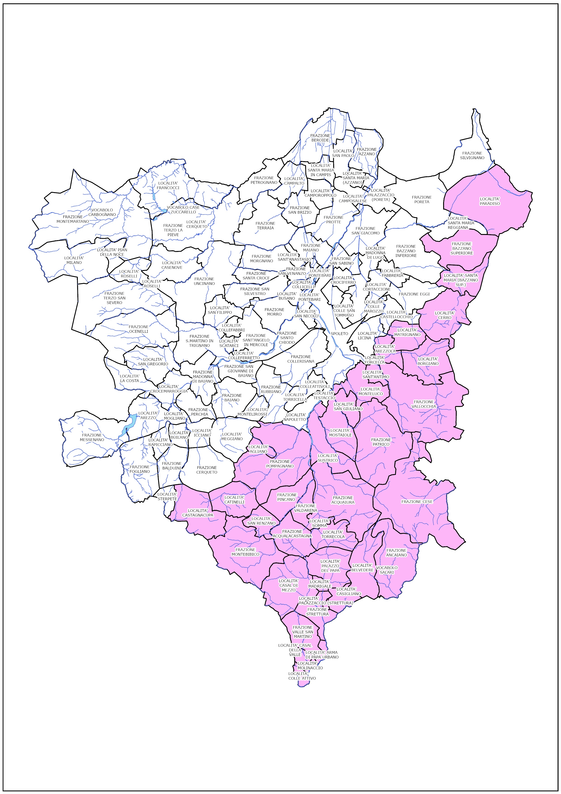
```

Questa unità funzionale potenzialmente raccoglie 16 frazioni e 3 località.

```         
FRAZIONE ACQUAIURA
FRAZIONE ACQUALACASTAGNA
FRAZIONE ANCAIANO
FRAZIONE BAZZANO SUPERIORE (BAZZANO SUPERIORE, SANTA MARIA)
FRAZIONE CERQUETO (CATINELLI, CASTAGNACUPA)
FRAZIONE CESE
FRAZIONE EGGI (MATRIGNANO, CERRO)
FRAZIONE MONTEBIBICO
FRAZIONE PATRICO
FRAZIONE PINCANO
FRAZIONE POMPAGNANO (POMPAGNANO, AGLIANO)
FRAZIONE SILVIGNANO
FRAZIONE STRETTURA
FRAZIONE VALDARENA
FRAZIONE VALLE SAN MARTINO
FRAZIONE VALLOCCHIA
LOCALITA' MONTELUCO
LOCALITA' SAN GIULIANO
LOCALITA' SANT'ANTIMO
```

#### UF Alto collinare montana dei Monti Martani (3)

> Superficie: 41.6 km\^2
>
> Range altitudinale: 345 - 1103 m s.l.m.
>
> Quota mediana: 608 m s.l.m.

```{r UFMMartani, fig.cap="Unità Funzionale Alto collinare montana dei Monti Martani. Elaborazione cartografica C. Arcangeli.", out.width='\\linewidth', fig.align='center', echo=FALSE}
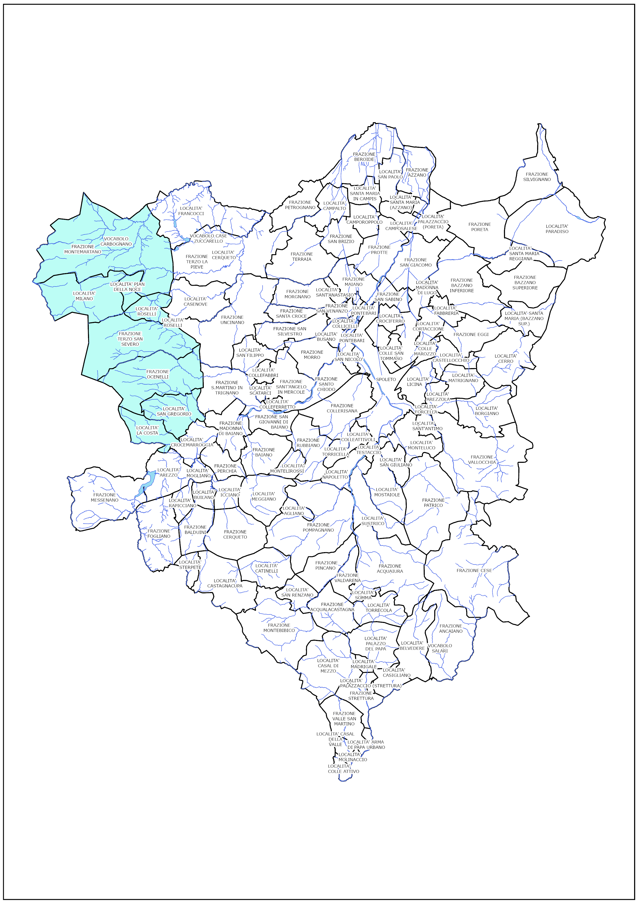
```

Questa unità funzionale potenzialmente si compone di 3 frazioni.

```         
FRAZIONE MONTEMARTANO
FRAZIONE OCENELLI
FRAZIONE TERZO SAN SEVERO
```

#### UF Collinare di Meggiano (12)

> Superficie: 26.8 km\^2
>
> Range altitudinale: 340 - 876 m s.l.m.
>
> Quota mediana: 541 m s.l.m.

```{r UFCollinareMeggiano, fig.cap="Unità Funzionale Collinare di Meggiano. Elaborazione cartografica C. Arcangeli.", out.width='\\linewidth', fig.align='center', echo=FALSE}
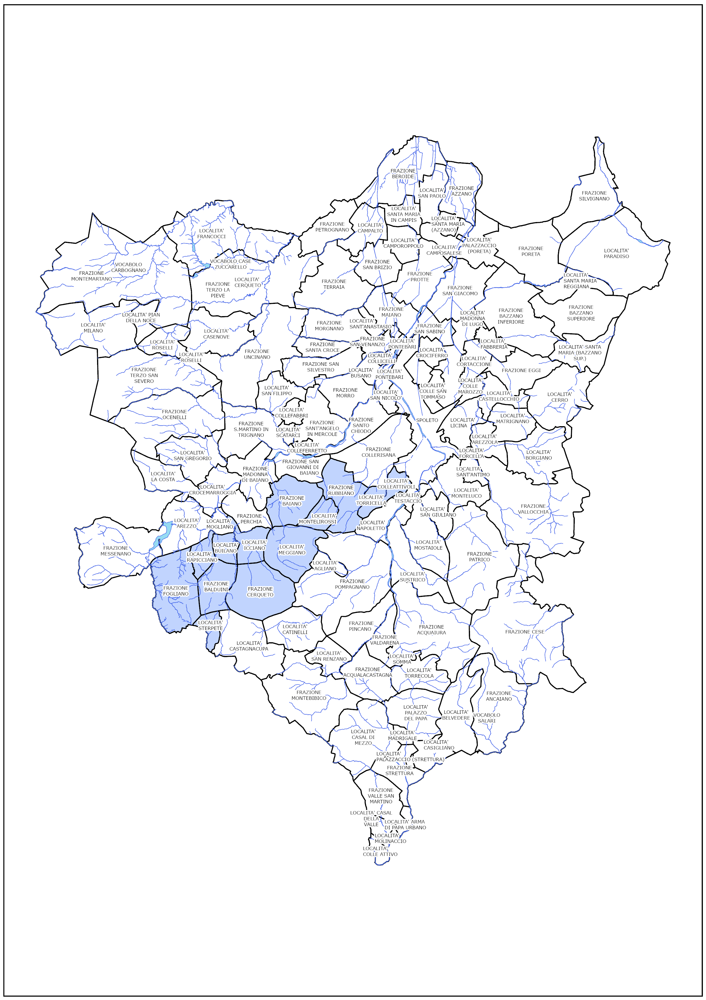
```

Questa unità funzionale potenzialmente raccoglie 8 frazioni e 2 località.

```         
FRAZIONE BAIANO
FRAZIONE BALDUINI
FRAZIONE CERQUETO (CERQUETO)
FRAZIONE FOGLIANO
FRAZIONE MESSENANO
FRAZIONE PERCHIA (ICCIANO)
FRAZIONE POMPAGNANO (MEGGIANO)
FRAZIONE RUBBIANO
LOCALITA' COLLEATTIVOLI
LOCALITA' TORRICELLA
```

#### UF Collinare - fascia olivata (8)

> Superficie: 24.4 km\^2
>
> Range altitudinale: 247 - 1000 m s.l.m.
>
> Quota mediana: 362 m s.l.m.

```{r UFCollinareOlivata, fig.cap="Unità Funzionale Collinare - fascia olivata. Elaborazione cartografica C. Arcangeli.", out.width='\\linewidth', fig.align='center', echo=FALSE}
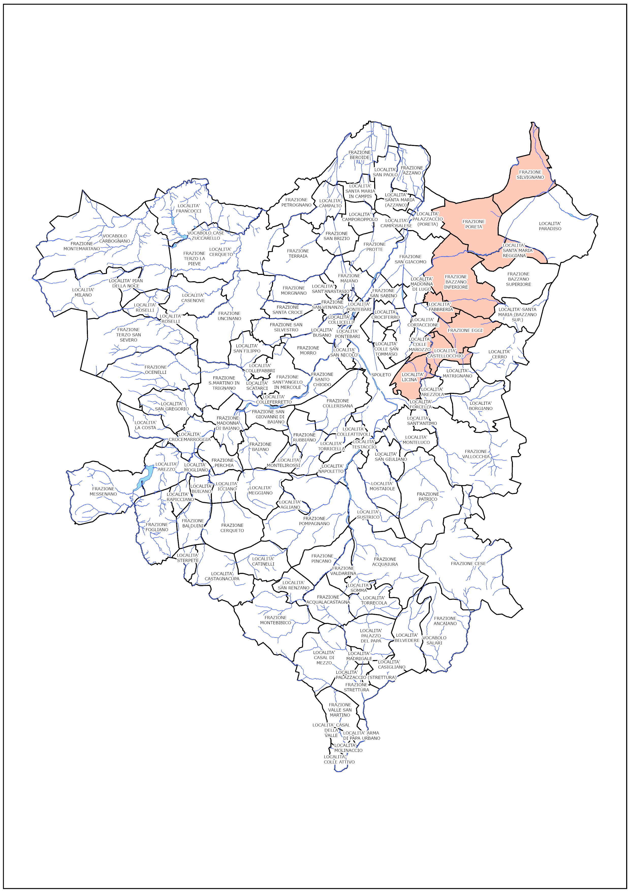
```

Questa unità funzionale potenzialmente raccoglie 5 frazioni e 2 località.

```         
FRAZIONE BAZZANO INFERIORE
FRAZIONE BAZZANO SUPERIORE (SANTA MARIA REGGIANA)
FRAZIONE EGGI (FABBRERIA, EGGI, CASTELLOCCHIO, COLLE MAROZZO)
FRAZIONE PORETA (PORETA)
FRAZIONE SILVIGNANO
LOCALITA' FORCELLA
LOCALITA' LICINA
```

#### UF Collinare dei Monti Martani (10)

> Superficie: 43.7 km\^2
>
> Range altitudinale: 238 - 527 m s.l.m.
>
> Quota mediana: 337 m s.l.m.

```{r UFCollinareMMartani, fig.cap="Unità Funzionale Collinare dei Monti Martani. Elaborazione cartografica C. Arcangeli.", out.width='\\linewidth', fig.align='center', echo=FALSE}
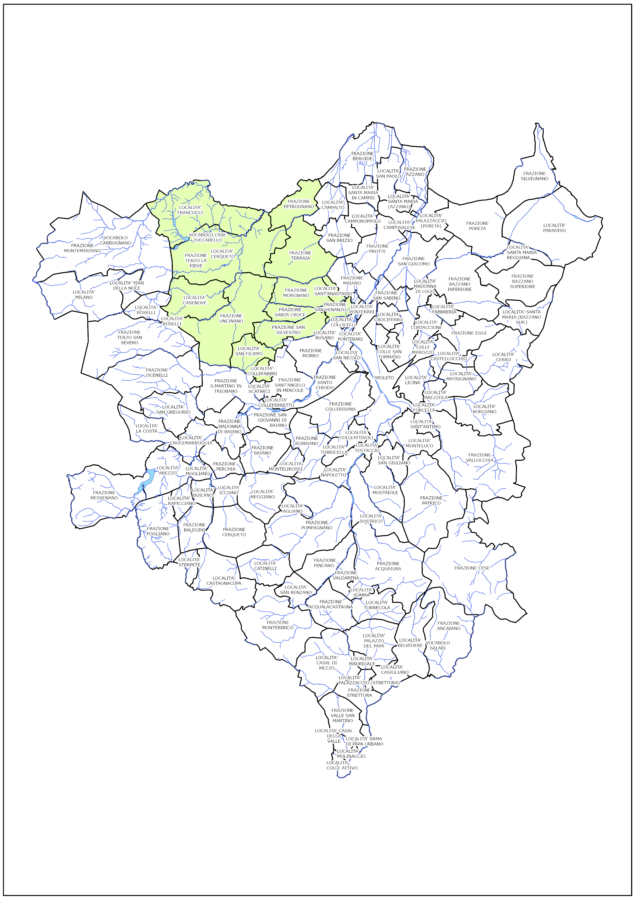
```

Questa unità funzionale potenzialmente si compone di 10 frazioni.

```         
FRAZIONE MORGNANO
FRAZIONE PETROGNANO
FRAZIONE SAN SILVESTRO
FRAZIONE SAN VENANZO (SANT'ANASTASIO, SAN VENANZO)
FRAZIONE SANT'ANGELO IN MERCOLE (COLLEFABBRI, SAN FILIPPO)
FRAZIONE SANTA CROCE
FRAZIONE TERRAIA
FRAZIONE TERZO LA PIEVE
FRAZIONE TERZO SAN SEVERO
FRAZIONE UNCINANO
```

#### UF di pianura e di Valle del T. Marroggia (15)

> Superficie: 58.6 km\^2
>
> Range altitudinale: 222 - 752 m s.l.m.
>
> Quota mediana: 275 m s.l.m.

```{r UFValle, fig.cap="Unità Funzionale di pianura e di Valle del T. Marroggia. Elaborazione cartografica C. Arcangeli.", out.width='\\linewidth', fig.align='center', echo=FALSE}
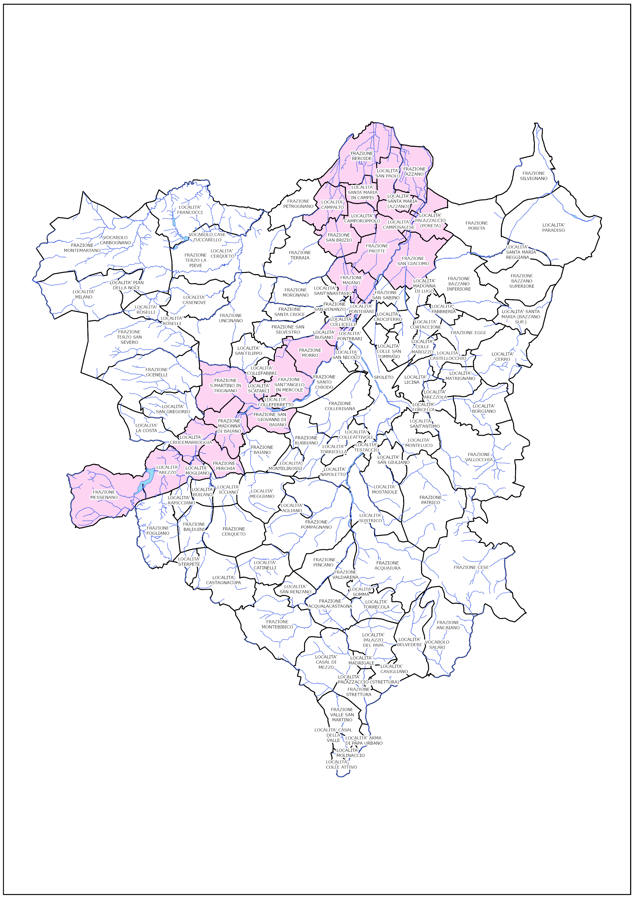
```

Questa unità funzionale potenzialmente si compone di 15 frazioni.

```         
FRAZIONE AZZANO
FRAZIONE BEROIDE
FRAZIONE MADONNA DI BAIANO
FRAZIONE MAIANO
FRAZIONE MESSENANO
FRAZIONE MORRO (BUSANO, MORRO)
FRAZIONE PERCHIA (PERCHIA, MOGLIANO, CROCEMARROGGIA)
FRAZIONE PORETA (PALAZZACCIO)
FRAZIONE PROTTE
FRAZIONE S.MARTINO IN TRIGNANO
FRAZIONE SAN BRIZIO
FRAZIONE SAN GIACOMO
FRAZIONE SAN GIOVANNI DI BAIANO
FRAZIONE SAN VENANZO (MALFONDO, PONTEBARI, COLLICELLI)
FRAZIONE SANT'ANGELO IN MERCOLE (SCATARCI, COLLEFERRETTO, SANT'ANGELO IN MERCOLE)
```

#### Urbana (6)

> Superficie: 23 km\^2
>
> Range altitudinale: 245 - 651 m s.l.m.
>
> Quota mediana: 300 m s.l.m.

```{r UFUrbana, fig.cap="Unità Funzionale Urbana. Elaborazione cartografica C. Arcangeli.", out.width='\\linewidth', fig.align='center', echo=FALSE}
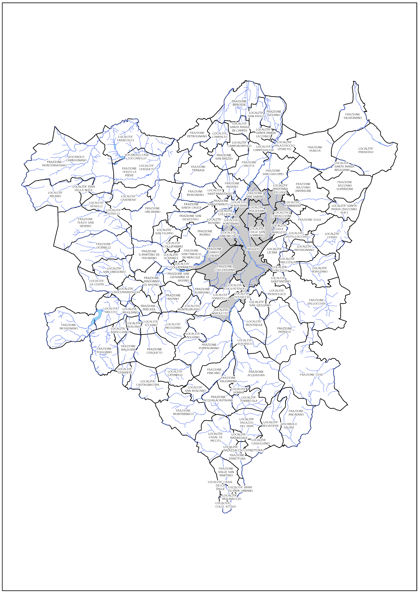
```

Questa unità funzionale potenzialmente si compone di 5 frazioni, 2 località e il nucleo della città di Spoleto.

```         
FRAZIONE COLLERISANA
FRAZIONE EGGI (CORTACCIONE)
FRAZIONE MORRO (SAN NICOLO')
FRAZIONE SAN SABINO
FRAZIONE SANTO CHIODO
LOCALITA' NAPOLETTO
LOCALITA' TESTACCIO
SPOLETO
```


## Connettività per Unità Funzionali (MSPA)

La valutazione della struttura e della connettività del paesaggio, ottenuta combinando la metodologia MSPA e gli indici di frammentazione [@jaeger2000a], è presentata di seguito con specifico riferimento alle Unità Funzionali.
L'approccio disaggregato rende possibile un confronto puntuale tra le condizioni ecologiche dei diversi contesti, ponendosi come base conoscitiva per orientare gli interventi finalizzati all'incremento della permeabilità territoriale e di salvaguardia della biodiversità (Fig. \@ref(fig:mspaUnitaFunzionali)).
Per ciascuna unità sono stati considerati anche gli aspetti demografici legati alla popolazione residente e al numero dei nuclei familiari (Fig. \@ref(fig:mapPopolazione)).

```{r mspaUnitaFunzionali, fig.cap='Riclassificazione del territorio comunale secondo il metodo MSPA e ripartizione in unità funzionali.', out.width='\\linewidth', fig.align='center', echo=FALSE}
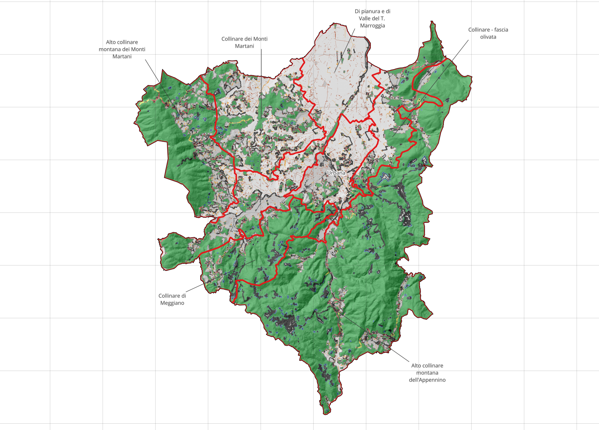
```

```{r mapPopolazione, fig.cap='Popolazione residente (gradiente di colore) e numero di nuclei familiari (in numero) per frazione e località.', out.width='\\linewidth', fig.align='center', echo=FALSE}
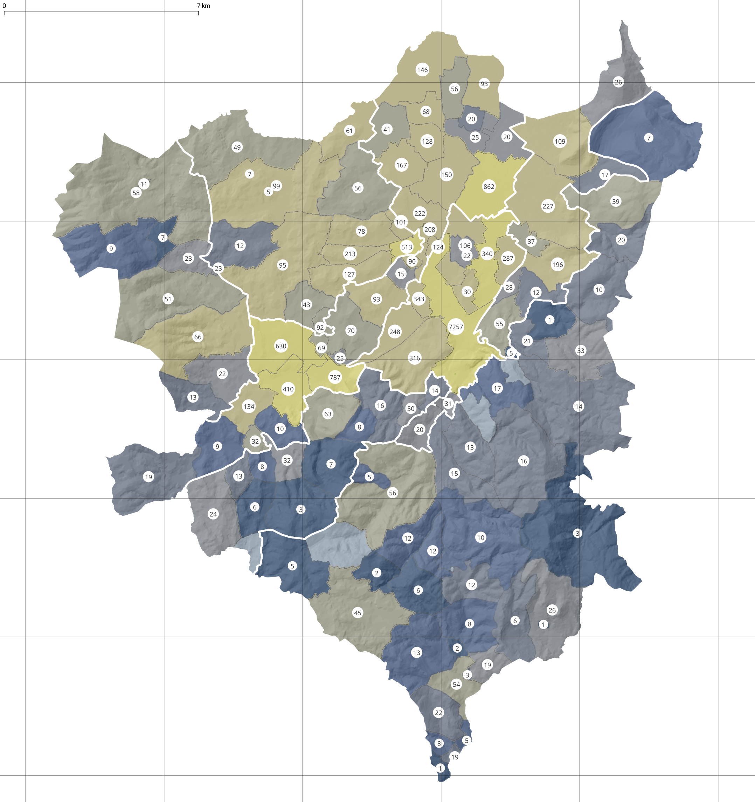
```

### Aree Montane e Dorsali Appenniniche (UF Alto collinare montana dell'Appennino e Alto collinare montana dei Monti Martani)

In queste unità come era atteso sono presenti i valori di gran lunga più elevati di Area Totale e Effective Mesh Size per la classe *Core* (Fig. \@ref(fig:mspaUnitaFunzionaliMontana))(Tab. \@ref(tab:tabMSPAMontano)).

```{r echo=F, warnings=F}
library(tidyverse)
mspa <- read.csv('input/risultatiMSPA_raggruppati.csv')
mspa %>%
  filter(
    UNITA_FUNZ == "Alto collinare montana dei Monti Martani" |
      UNITA_FUNZ == "Alto collinare montana dell'Appennino"
  ) %>%
  select(-1) %>%
  knitr::kable(digits = 2)
```

: (#tab:tabMSPAMontano) Risultati analisi MSPA per le Aree Montane e Dorsali Appenniniche.

Queste unità presentano i valori di gran lunga più elevati di Area Totale e Effective Mesh Size per la classe *Core*.
Questo evidenzia un paesaggio a matrice prevalentemente naturale, dove l'habitat è continuo e poco frammentato.
Inoltre, l’elevato valore di Mesh size superiore a 400 nei *Core* conferma che le aree core non sono solo estese, ma strutturate in macro-blocchi compatti, ideali per la conservazione della biodiversità ad ampio raggio.

Riguardo le Componenti di Margine e i Corridoi, i valori di *Bridge* ed *Edge* mostrano un'estensione significativa ma un $S_{eff}$ contenuto rispetto ai *Core*, indicando che la matrice boschiva è continua e presenta margini esterni ben definiti senza eccessiva perforazione interna.

```{r mspaUnitaFunzionaliMontana, fig.cap="Carta geobotanica e analisi MSPA delle unità funzionali Alto collinare montana dell'Appennino e Alto collinare montana dei Monti Martani", out.width='\\linewidth', fig.align='center', echo=FALSE}
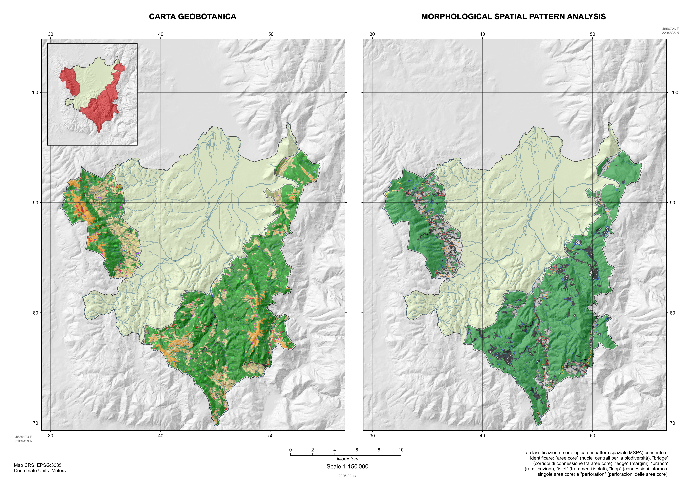
```

Complessivamente la popolazione che insiste in queste aree rappresenta meno del 5% del totale con una densità molto bassa pari a circa 10 $ab/km^2$ (Tab. \@ref(tab:popMontano)).

| UNITA_FUNZ                               |  POP | Pop% | FAM | Fam% |  Dens |
|:-----------------------------------------|-----:|-----:|----:|-----:|------:|
| Alto collinare montana dei Monti Martani |  595 | 1.61 | 283 | 1.65 | 14.29 |
| Alto collinare montana dell'Appennino    | 1122 | 3.03 | 561 | 3.26 |  8.52 |

: (#tab:popMontano) Popolazione residente, numero di famiglie e densita abitativa.

### Fasce di Transizione Pedemontane e Collinari (UF Collinare fascia olivata, Collinare dei Monti Martani, Collinare di Meggiano)

In queste aree l'area *Core* si riduce notevolmente a favore di una maggiore presenza proporzionale di *Edge*, *Branch*, *Loop* e *Bridge* (Figg. \@ref(fig:mspaUnitaFunzionaliOlivata); \@ref(fig:mspaUnitaFunzionaliCollinare); Tab x).
Infatti, la presenza diffusa di *Bridge* e *Branch* testimonia una rete di siepi, formazioni ripariali e lembi boschivi interconnessi con la matrice agricola/olivicola.
Tuttavia, il basso valore di $S_{eff}$ segnala che tali elementi sono frequentemente suddivisi in brevi tratti, vulnerabili all'effetto margine e all'interruzione di continuità.
Inoltre, la presenza di *Perforation* evidenzia l'effetto dell'attività antropica o dell'uso agricolo che penetra all'interno dei margini boschivi residui.

```{r mspaUnitaFunzionaliOlivata, fig.cap="Carta geobotanica e analisi MSPA dell'unità funzionale Collinare fascia olivata", out.width='\\linewidth', fig.align='center', echo=FALSE}
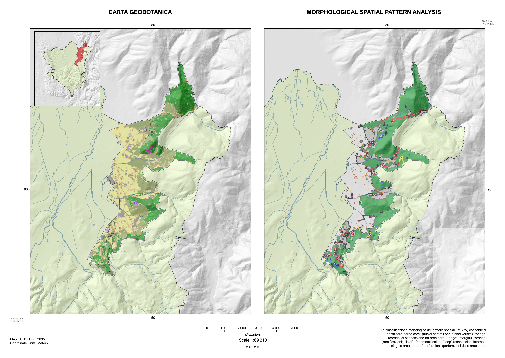
```

```{r mspaUnitaFunzionaliCollinare, fig.cap="Carta geobotanica e analisi MSPA delle unità funzionali Collinare dei Monti Martani, Collinare di Meggiano", out.width='\\linewidth', fig.align='center', echo=FALSE}
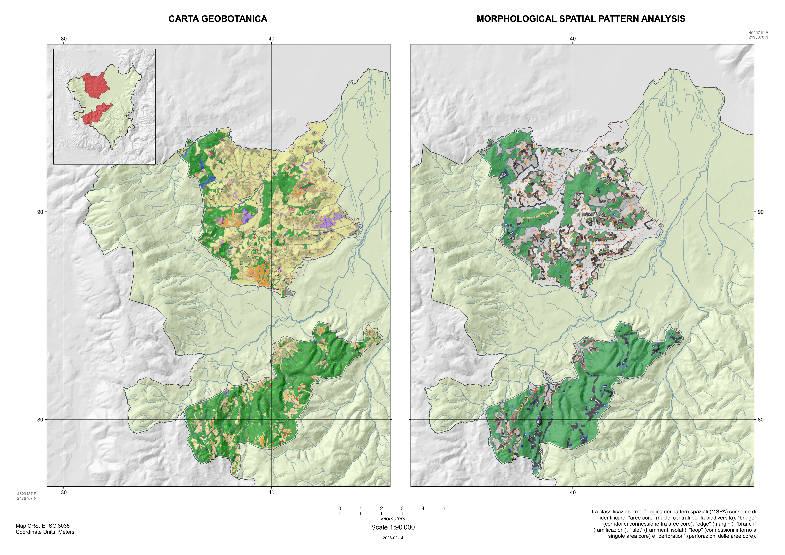
```

Complessivamente la popolazione che insiste in queste aree ammonta a 5513 unità, pari a 2507 famiglie, con una densità abitativa media di 58 $ab/km^2$ (Tab. \@ref(tab:popCollinare)).

| UNITA_FUNZ                  |  POP | Pop% |  FAM | Fam% |  Dens |
|:----------------------------|-----:|-----:|-----:|-----:|------:|
| Collinare - fascia olivata  | 1502 | 4.06 |  712 | 4.14 | 61.47 |
| Collinare dei Monti Martani | 3561 | 9.62 | 1551 | 9.02 | 81.48 |
| Collinare di Meggiano       |  450 | 1.22 |  244 | 1.42 | 16.80 |

: (#tab:popCollinare) Popolazione residente, numero di famiglie e densita abitativa.

### Area di pianura e di valle (UF di pianura e di Valle del T. Marroggia)

In quest'area si osserva una presenza marcata della classe *Islet* (piccole patches isolate) unitamente a significativi valori di *Bridge* rappresentati dai corridoi fluviali e dal reticolo idrografico minore (Fig. \@ref(fig:mspaUnitaFunzionaliValle); Tab.
x).
Nonostante l'Area Totale per *Bridge* o *Islet* sia rilevante, il relativo $S_{eff}$ è decisamente basso.
Ciò dimostra che la connettività ecologica in fondo valle è affidata a corridoi stretti e frammentati, fortemente condizionati dalla pressione delle infrastrutture e dell'urbanizzazione.

```{r mspaUnitaFunzionaliValle, fig.cap="Carta geobotanica e analisi MSPA dell'unità funzionale di pianura e di Valle del T. Marroggia", out.width='\\linewidth', fig.align='center', echo=FALSE}
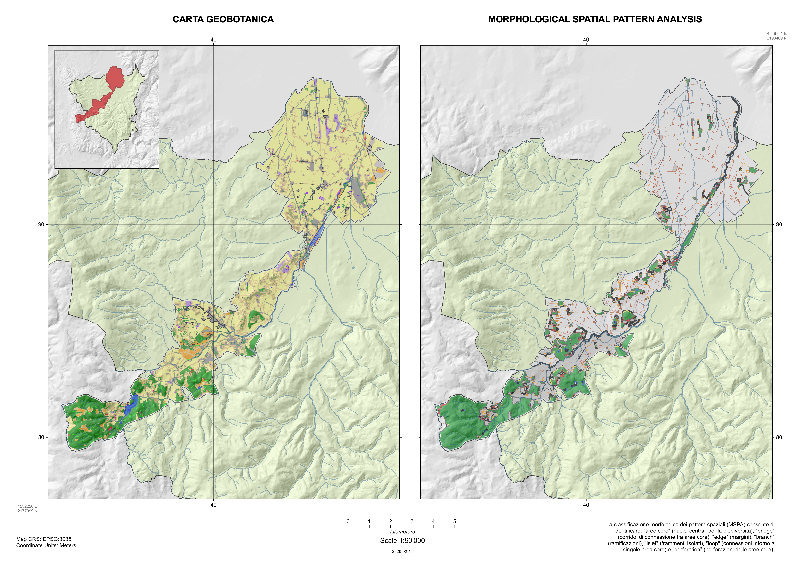
```

In questa unità la densità abitativa è in linea con la media nazionale, con una frazione percentuale di popolazione pari al 30% (Tab. \@ref(tab:popValle)).

| UNITA_FUNZ                             |   POP |  Pop% |  FAM |  Fam% |   Dens |
|:---------------------------------------|------:|------:|-----:|------:|-------:|
| Di pianura e di Valle del T. Marroggia | 11098 | 29.97 | 4847 | 28.18 | 189.47 |

: (#tab:popValle) Popolazione residente, numero di famiglie e densita abitativa.

### Ambito Urbano / Antropizzato (UF Urbana)

Come atteso, l’area *Core* in questa UF è poco rappresentata.
Prevalgono elementi isolati (*Islet*) e i corridoi a fondo cieco (*Branch*) (Fig. \@ref(fig:mspaUnitaFunzionaliUrbana); Tab x).
L'Effective Mesh Size assume i valori più bassi dell'intero territorio comunale per quasi tutte le categorie ecologiche funzionali, confermando una matrice urbana poco permeabile al movimento della fauna con un basso livello di continuità degli habitat naturali.

```{r mspaUnitaFunzionaliUrbana, fig.cap="Carta geobotanica e analisi MSPA dell'unità funzionale urbana.", out.width='\\linewidth', fig.align='center', echo=FALSE}
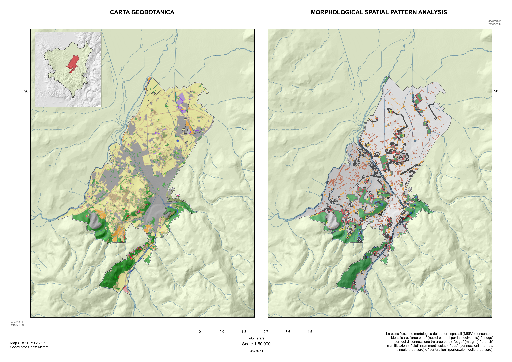
```

In questa porzione di territorio si concentra la metà della popolazione residente nel comune, con una densità abitativa di oltre 800 $ab/km^2$.

| UNITA_FUNZ |   POP |  Pop% |  FAM |  Fam% |   Dens |
|:-----------|------:|------:|-----:|------:|-------:|
| Urbana     | 18701 | 50.50 | 9000 | 52.33 | 812.01 |

### Sintesi del confronto tra le Unità Funzionali

In sostanza, il confronto tra le Unità Funzionali evidenzia una qualche forma di polarizzazione del territorio:

1.  Unità Montane: Funzionano da serbatoi di connettività (*Source*) caratterizzati da elevate dimensioni della maglia utile ($S_{eff}$) e grandi blocchi *Core*, con una pressione insediativa molto bassa.
2.  Unità Collinari e di fondo valle: Funzionano da vettori di transizione e corridoi ecologici (*Stepping stones* e *Bridges*), essenziali per il collegamento comunale e anche di scala regionale, ma soggetti a elevato rischio di frammentazione strutturale e funzionale, anche in relazione alla popolazione residente.
3.  Ambito Urbano: Rappresenta il contesto a maggior grado di criticità ecologica e isolamento, con una densità abitativa molto elevata. La rete ecologica residua in ambito urbano si fonda quasi esclusivamente su piccole chiazze isolate (Islet) e bracci ciechi (Branch), evidenziando la necessità prioritario-gestionale di interventi di deframmentazione e re-infrastrutturazione verde (es. corridoi urbani, stepped stepping stones e forestazione urbana) per mantenere un minimo livello di permeabilità ecologica e offrire spazi di rigenerazione per la popolazione.

## Composizione e struttura del sistema verde e blu

### Estensione e composizione

Come anticipato nelle premesse metodologiche, lo studio ha previsto una valutazione puntuale delle infrastrutture verdi e blu, tenendo conto sia della componente privata che pubblica.
La mappa della loro distribuzione spaziale complessiva è riportata in figura \@ref(fig:verdeSpoleto).

```{r verdeSpoleto, fig.cap="Carta del verde (pubblico in tonalità scura e privato in tonalità più chiara) e del reticolo fluviale. Sullo sfondo in sovrapposizione la mappa MSPA sfumata. Il confine dell'unità funzionale urbana è evidenziato in rosso.", out.width='\\linewidth', fig.align='center', echo=FALSE}
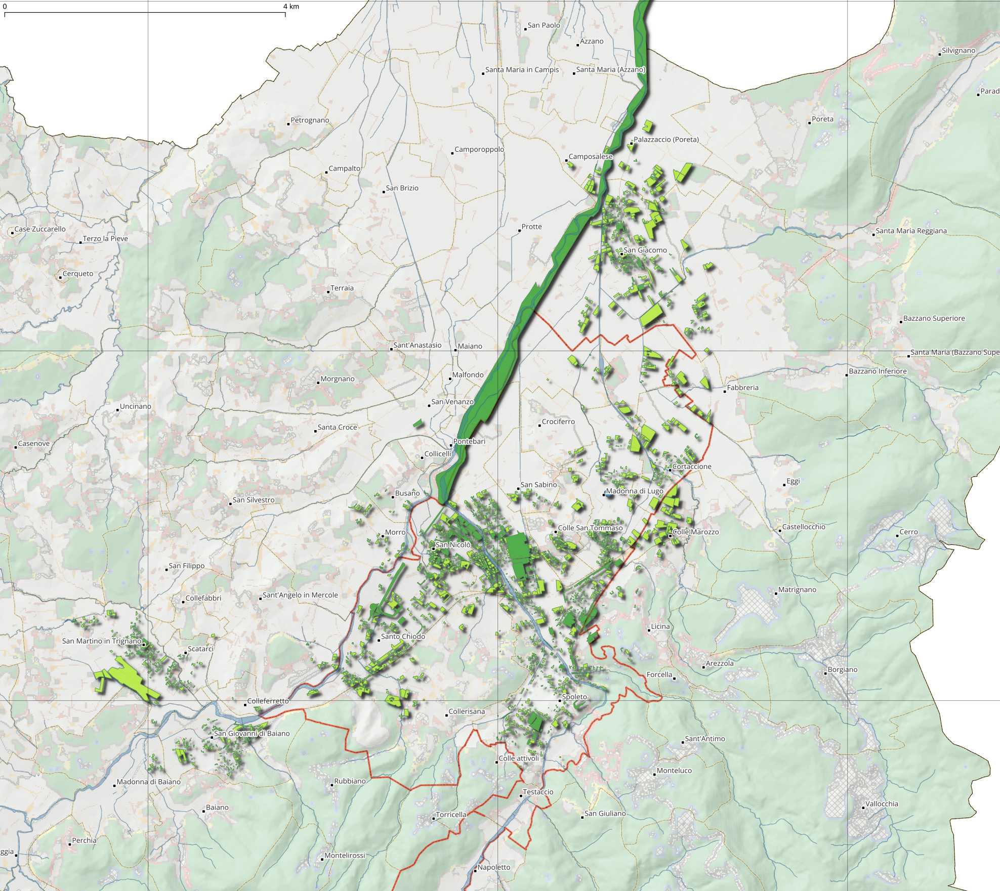
```

Focalizzando l’attenzione alla sola area urbana, definita secondo il modello delle unità funzionali (cfr. capitolo unità funzionali) e per la quale si dispone di una cartografia sufficientemente dettagliata e accurata nella rappresentazione degli elementi del verde, si nota che la composizione degli elementi delle infrastrutture verdi e blu occupano una superficie totale di quasi 200 ha. Tale valore corrisponde a circa il 8.4% del territorio in esame.
Nella ripartizione tra verde pubblico/privato e aree blu la componente privata rappresenta il 61% del totale e il blu solamente il 7.5% (\@ref(tab:verdeBase)).[^1]

[^1]: L'analisi condotta mediante rasterizzazione della cartografia vettoriale mette in evidenza una lieve riduzione delle superfici rispetto ai valori originari.
    Tale differenza è piuttosto contenuta e imputabile alla trasformazione su maglia 5x5 m e alla successiva applicazione del limite dell'area di studio corrispondente all’unità funzionale urbana.
    Le differenze risultano contenute per il verde privato e per le componenti blu, mentre sono più evidenti per il verde pubblico, caratterizzato da numerosi elementi di piccola dimensione e geometrie articolate.

| componente | proprieta | n_poligoni | area_ha |   PLAND |
|:-----------|:----------|-----------:|--------:|--------:| 
| blu        | pubblico  |         19 |   14.5  |  0.63 % |
| verde      | privato   |       1171 |  118.0  |  5.12 % |
| verde      | pubblico  |        255 |   60.4  |  2.62 % |
| **Totale** | \-        |       1445 |  192.9  |  8.37 % |

: (#tab:verdeBase) Metriche della composizione del verde urbano e strutture blu per tipologia.

Complessivamente la mosaicatura di queste infrastrutture si compone di 1445 poligoni, la maggior parte dei quali assimilabili al verde privato (81%).

Dal punto di vista strutturale si osserva che le componenti verdi sono organizzate in un elevato numero di patch di piccole dimensioni, distribuite all'interno della matrice urbana, e caratterizzate da una superficie media di 0.13 ha.

#### Configurazione spaziale e connettività

L’indice LPI corrispondente al Largest Patch Index raggiunge un valore pari a 91.8 %, indicando che la matrice territoriale dominante, costituita da infrastrutture grigie e da terreni agricoli, occupa gran parte della superficie totale.
In altre parole, come era atteso, il paesaggio risulta fortemente controllato dalla matrice urbana e dai seminativi che costituiscono lo sfondo all'interno del quale si distribuiscono gli elementi verdi e blu (Fig. \@ref(fig:rasterVerde)).

```{r rasterVerde, fig.cap="Carta del verde (pubblico in tonalità brillante e privato in tonalità più scura) e delle infrastrutture blu nel formato raster.", out.width='\\linewidth', fig.align='center', echo=FALSE}
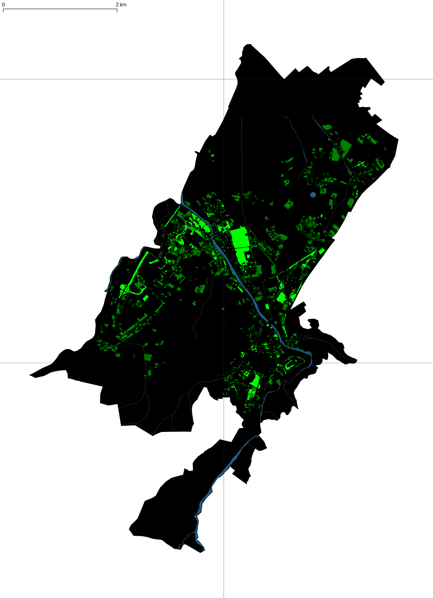
```

La superficie mediana delle patch di verde privato ($400~m^2$) è generalmente superiore a quella del verde pubblico ($50~m^2$), suggerendo una maggiore presenza di nuclei vegetati continui all'interno delle proprietà private (Tab. \@ref(tab:verdePatches)).
Nel verde pubblico e nei corsi d’acqua più della metà delle patch non supera tre celle (circa $50~m^2$), e nel blu lo stesso vale per circa tre quarti delle patch.
Nel privato la mediana è 16 celle (circa $400~m^2$) e il terzo quartile 46 celle (circa $1100~m^2$).
La patch tipica del privato è dunque molto più grande di quella pubblica.
In aggiunta, la superficie pubblica si presenta organizzata in modo molto diverso: si concentrata in pochi patch grandi accompagnati da molti micro-patch (Fig. \@ref(fig:boxplotVerde)).


|classe         | n_patch| area_totale_ha| mediana_mq|  q1_mq|   q3_mq| max_ha|
|:--------------|-------:|--------------:|----------:|------:|-------:|------:|
|blu_pubblico   |     173|          14.54|      49.99|  24.99|   74.98|   9.00|
|verde_privato  |     905|         116.17|     399.91| 149.97| 1149.75|   3.62|
|verde_pubblico |     568|          57.04|      49.99|  24.99|  299.94|   9.34|

: (#tab:verdePatches) Metriche della composizione del verde urbano per tipologia.

```{r boxplotVerde, fig.cap="Boxplot della dimensione delle patch rasterizzate scomposte in verde pubblico, privato e componente blu.", out.width='\\linewidth', fig.align='center', echo=FALSE}
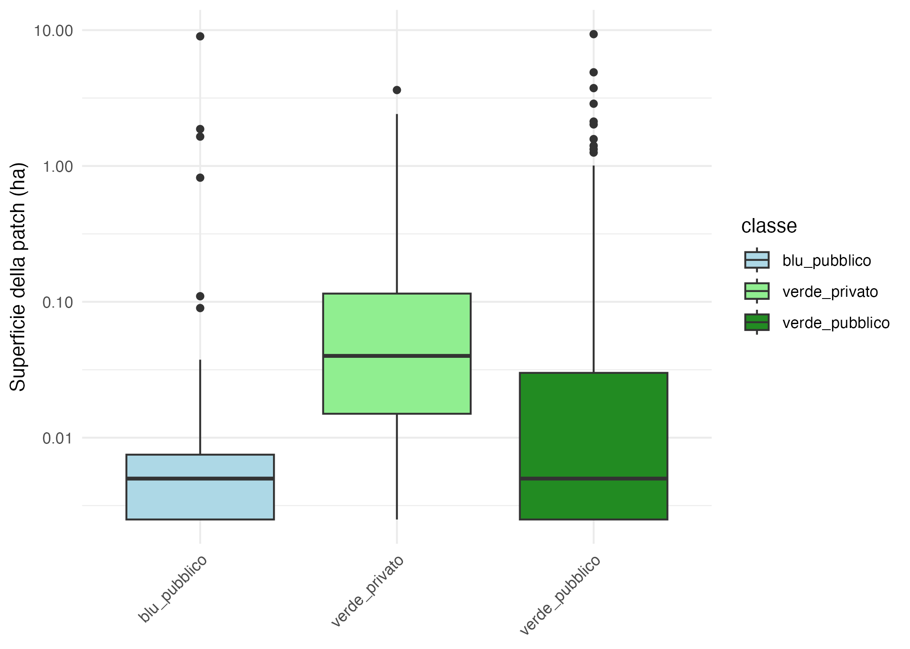
```

Nonostante questo assetto lasci prefigurare un elevato livello di frammentazione con una densità di patch di circa 76 ogni 100 ha (PD=75.85), le metriche di contiguità (AI = 97), aggregazione (CONTAG = 82) e coesione (COHESION = 99.9) mostrano valori elevati, indicando che le diverse componenti mantengono un livello significativo di continuità spaziale (Tab. \@ref(tab:paesaggio)).

|metric   |   value|
|:--------|-------:|
|AI       |   96.86|
|AREA_MN  |    1.32|
|COHESION |   99.90|
|CONTAG   |   82.15|
|LPI      |   91.79|
|NP       | 1756.00|
|PD       |   75.85|

: (#tab:paesaggio) Metriche della struttura del paesaggio complessivo.

Ciò a testimoniare una distribuzione delle classi organizzata in nuclei spazialmente riconoscibili piuttosto che in elementi completamente dispersi.
Questo suggerisce che il sistema del verde urbano, pur articolato in molteplici elementi, conserva una discreta capacità di funzionare come rete ecologica diffusa.
Purtroppo, le infrastrutture blu risultano quantitativamente marginali rispetto alle superfici verdi, ma contribuiscono comunque alla diversificazione del mosaico generale fornendo un importante supporto per la connettività complessiva del sistema.
È inoltre da notare che nel processo di rasterizzazione su maglia 5x5 m gli elementi di natura blu vengono suddivisi in numerosi nuclei distinti.
Conseguentemente, il numero di patch raster non rappresenta il numero di elementi realmente cartografati, ma il numero di porzioni che possono essere considerate funzionalmente connesse all'interno del mosaico paesaggistico.

Come anticipato il verde privato rappresenta la componente più estesa e diffusa (CA), caratterizzata da un elevato numero di patch di dimensioni medio-piccole, con la presenza di alcuni nuclei di superficie rilevante che contribuiscono in modo significativo alla dotazione complessiva di copertura vegetale (Tab. \@ref(tab:strati).

|strato           |    AI|     CA| CLUMPY| COHESION| ENN   | MESH| CPLAND|
|:----------------|-----:|------:|------:|--------:|------:|----:|------:|
|verde_privato    | 80.17| 117.76|   0.79|    90.92|  21.41| 0.04|   0.49|
|verde_pubblico   | 83.72|  57.21|   0.83|    92.95|  18.15| 0.07|   0.63|
|blu_pubblico     | 84.77|  14.54|   0.85|    96.82|  21.20| 0.04|   0.06|
|verde_totale     | 81.47| 174.18|   0.80|    92.12|  17.56| 0.11|   1.14|
|verde_blu_totale | 82.04| 187.75|   0.80|    93.65|  17.05| 0.19|   1.22|

: (#tab:strati) Metriche della struttura del paesaggio per strati.

Al contrario, il verde pubblico mostra una configurazione differente: presenta anch'esso numerose piccole patch isolate derivanti da superfici lineari o marginali, ma sono presenti anche aree di grandi dimensioni che svolgono un ruolo centrale nella struttura complessiva del sistema.
In generale l’analisi delle metriche a livello di patch conferma che la maggior parte delle unità presenta valori di core area prossimi a zero, indicando che le dimensioni sono spesso insufficienti a contenere una porzione interna non influenzata dall'effetto margine.
Infatti, solo le patch di dimensioni maggiori conservano aree centrali significative e possono quindi svolgere funzioni ecologiche più stabili e strutturate.

Le distanze tra patch (ENN) risultano generalmente contenute e inferiori ai 25 m per gran parte degli elementi (21.4 m nel verde privato; 18.2 m nel verde pubblico), suggerendo una buona prossimità spaziale tra le aree appartenenti alla stessa classe.
Tuttavia alcune patch mostrano valori sensibilmente più elevati, evidenziando situazioni di isolamento locale che possono ridurre la connettività funzionale del sistema.
Esaminando nel dettaglio anche gli indici AI, CLUMPY e COHESION emerge un quadro per cui il territorio appare contemporaneamente molto frammentato dal punto di vista numerico, ma relativamente connesso dal punto di vista spaziale.
Resta invece limitata la disponibilità di aree centrali effettivamente schermate dagli effetti di margine, che rappresentano meno del 2% della superficie territoriale nel caso del sistema verde-blu complessivo (CPLand).

Sebbene le metriche di aggregazione e coesione evidenzino una buona continuità all'interno delle singole componenti, l'analisi dei contatti mostra che le diverse tipologie di infrastruttura verde e blu interagiscono poco tra loro (Tab. \@ref(tab:contatti)).

|strato da/a    | matrice| blu_pubblico| verde_privato| verde_pubblico|
|:--------------|-------:|------------:|-------------:|--------------:|
|matrice        |   98.39|         0.09|          1.09|           0.43|
|blu_pubblico   |   13.55|        83.66|          2.25|           0.55|
|verde_privato  |   19.86|         0.28|         79.65|           0.20|
|verde_pubblico |   16.11|         0.14|          0.41|          83.34|

: (#tab:contatti) Matrice dei contatti tra strati.

Le patch tendono infatti a confinare prevalentemente con elementi della stessa classe e, in misura secondaria, con la matrice territoriale circostante.
In particolare, le adiacenze tra verde privato e verde pubblico rappresentano una quota trascurabile dei contatti complessivi (\< 0.5%), mentre una parte consistente dei bordi delle patch è in contatto con la matrice territoriale (20,0% per il verde privato, 16% per il verde pubblico e quasi il 14% per il blu pubblico).
Tale configurazione evidenzia una limitata integrazione tra i diversi sottosistemi ecologici e una forte esposizione agli ambienti circostanti.
Ne deriva un sistema caratterizzato da una buona coerenza interna dei singoli sottosistemi, ma da una limitata integrazione spaziale tra verde pubblico, verde privato e componenti blu.

#### Dotazione per frazione e località

Disaggregando le informazioni sulla base della ripartizione dell’unità funzionale Urbana in frazioni e località emergono chiare differenze nella dotazione locale delle infrastrutture verdi e blu (Tab. \@ref(tab:verdeFraz)).
Le maggiori coperture si osservano a San Nicolò (18.3%) e Spoleto (15.6%), mentre Crociferro, San Sabino e Collerisana presentano dotazioni di verde sensibilmente inferiori (\<3%).
Indici di copertura intermedi compresi tra l’8 e il 13% si osservano a Santo Chiodo, Cortaccione, Colle San Tommaso e Madonna di Lugo.
Differenziando l’analisi per componente pubblica-privata, emerge che in molte zone il verde è quasi esclusivamente privato.
A Santo Chiodo il verde pubblico è circa il 3.4% della superficie, contro un 9.1% di quello privato.
Analoga situazione si osserva a San Nicolò (4.9% contro 13.1%).
Il nucleo di Spoleto si distingue invece per l'elevato numero di patch (NP=878) e per il ruolo rilevante del verde pubblico, configurandosi come il sistema più articolato e diversificato (Tab. \@ref(tab:metricheFraz)).
I livelli di AI (80.6%) e COHESION (91.3) risultano tra i più bassi osservati (solo San Nicolò presenta un AI inferiore), coerentemente con l’elevata frammentazione, pur indicando il mantenimento di un buon livello di continuità funzionale all’interno di questa unità (COHESION > 90).
Le patch più grandi si ritrovano invece a Cortaccione (LPI=2.72%) e San Nicolò (2.31%), seguite da Colle San Tommaso (1.92%), Santo Chiodo (1.83%) e Spoleto (1.60%).

| NOME                        |  Blue | Privato | Pubblico |   TOT |  Sup% |
|:----------------------------|------:|--------:|---------:|------:|------:|
| FRAZIONE COLLERISANA        |  1.26 |    9.88 |     0.00 | 11.14 |  2.50 |
| FRAZIONE SAN SABINO         |  0.67 |    4.28 |     0.00 |  4.95 |  2.44 |
| FRAZIONE SANTO CHIODO       |  0.35 |   18.78 |     7.08 | 26.22 | 12.64 |
| LOCALITA' COLLE SAN TOMMASO |  0.00 |    7.83 |     0.00 |  7.83 |  8.60 |
| LOCALITA' CORTACCIONE       |  1.09 |   14.56 |     0.00 | 15.65 | 11.92 |
| LOCALITA' CROCIFERRO        |  0.56 |    0.10 |     0.00 |  0.66 |  0.76 |
| LOCALITA' MADONNA DI LUGO   |  2.04 |   20.24 |     0.17 | 22.45 |  8.57 |
| LOCALITA' SAN NICOLO'       |  0.23 |   10.29 |     3.83 | 14.34 | 18.30 |
| SPOLETO                     | 15.39 |   42.27 |    36.81 | 94.47 | 15.57 |

: (#tab:verdeFraz) Superfici di verde pubblico e privato (ha) e relativa frazione percentuale.

|plot_id           | PLAND|    CA|  NP| AREA_MN| ENN   | COHESION|    AI|  LPI|
|:-----------------|-----:|-----:|---:|-------:|------:|--------:|-----:|----:|
|SAN NICOLO'       | 17.79| 14.18|  97|    0.15|  14.49|    93.51| 79.39| 2.31|
|SPOLETO           | 14.00| 85.91| 878|    0.10|  15.45|    91.33| 80.60| 1.60|
|SANTO CHIODO      | 12.48| 26.27| 149|    0.18|  19.48|    93.41| 81.26| 1.83|
|CORTACCIONE       | 10.96| 14.59|  67|    0.22|  22.41|    93.20| 87.15| 2.72|
|COLLE SAN TOMMASO |  8.72|  8.08|  49|    0.16|  27.56|    93.39| 81.72| 1.92|
|MADONNA DI LUGO   |  6.66| 17.71| 135|    0.13|  20.81|    90.96| 82.22| 0.43|
|COLLERISANA       |  1.47|  6.59|  38|    0.17|  67.88|    92.60| 87.14| 0.34|
|SAN SABINO        |  0.85|  1.76|  11|    0.16|  27.75|    90.16| 85.10| 0.40|
|CROCIFERRO        |  0.16|  0.14|   2|    0.07|  45.00|    82.18| 89.00| 0.11|

: (#tab:metricheFraz) Indicatori di struttura per frazioni e località.


==\[Nota sul Laghetto dei Longobardi\]

### Verifica regola 3–30–300

Interpretando questi dati analitici in chiave regola 3-30-300, appare chiaro che, nel contesto urbano, il nucleo cittadino riveste la maggiore importanza per densità di popolazione ed è quello che offre le maggiori possibilità di raggiungere gli obiettivi della regola.
Dal punto di vista cartografico non è possibile accertare se venga soddisfatta la componente 3 (almeno tre alberi visibili da ogni abitazione), poiché ciò richiederebbe un censimento puntuale di tutte le alberature e il calcolo di tutti i coni di vista.
Tuttavia, la presenza di un patrimonio verde diffuso e di una buona copertura arborea nel nucleo urbano lascia ipotizzare che questa soglia sia, almeno in buona parte, soddisfatta: la situazione, sotto questo profilo, non appare critica.

Rispetto alla componente 30 (almeno il 30% di copertura arborea per quartiere), appare evidente che tutte le frazioni sono piuttosto lontane dalla soglia.
Solo Spoleto e San Nicolò superano il 15% (ossia la metà di quanto previsto per ogni quartiere), mentre nei restanti casi, in cui la densità abitativa è decisamente più bassa, andrebbero condotte valutazioni che tengano conto anche degli aspetti vocazionali delle aree, quali la presenza di superfici agricole, boschive o naturali, per le quali l’applicazione rigida della soglia del 30% potrebbe non essere appropriata.
Nell'ambito del poligono strettamente urbano (Fig. \@ref(fig:verdePubblicoSpoleto)), appaiono cruciali le aree verdi di: a) complesso areale di Piazza d’Armi e del campo di Atletica leggera, b) Villa Redenta e c) dell’area del Parco di Chico Mendez e della Spoleto Sfera (Fig. \@ref(fig:verdePubblicoSpoleto)).

```{r verdePubblicoSpoleto, fig.cap="Carta del verde pubblico e della rete fluviale. In evidenza: 1) il complesso verde di Piazza d'Armi, 2) Villa Redenta e 3) il Parco Chico Mendez e la Spoleto Sfera.", out.width='\\linewidth', fig.align='center', echo=FALSE}
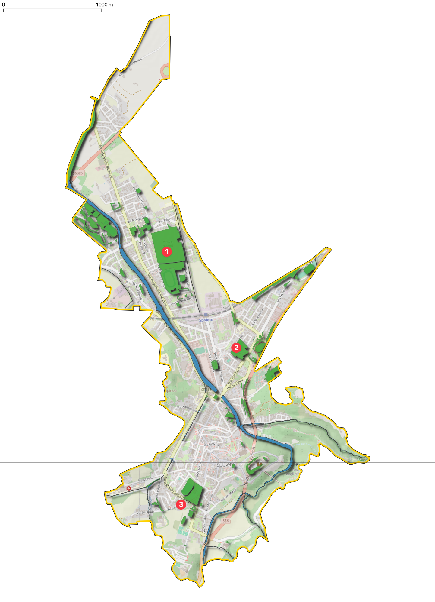
```

A queste tre macro aree si aggiunge una porzione a sviluppo lineare adiacente il tracciato ferroviario in prossimità delle vie Primo Maggio e Tre Settembre e il corridoio blu del torrente Tessino.
In nessuna delle altre unità urbane sono presenti superfici di verde pubblico di dimensione vicina all’ettaro, se non a Santo Chiodo in un’area a sviluppo lineare prossimale alla strada statale 685 delle Tre Valli Umbre.
Riportando un buffer di 300 m intorno a queste aree si comprende la centralità e la grande rilevanza assunta dal corridoio fluviale del Torrente Tessino (Figg. \@ref(fig:rulebuf300); \@ref(fig:rulebuf300NT)).
Tale elemento incrementa notevolmente la quota di territorio destinata alla connettività e alla funzionalità ambientale (l’estensione passa infatti da 260 a 700 ha, interessando circa il 30% dell’unità urbana) e si configura come il naturale corridoio di collegamento della zona urbana verso la Greenway Valle Spoletana.
Analogamente, un ruolo di rilievo viene assunto anche dalla zona umida nota come “Pozzaccheri” o laghetto dei Longobardi, che è l’unico elemento di questo tipo presente nella località di Madonna di Lugo e rappresenta di fatto l’unica area umida e con caratteristiche di naturalità per la popolazione residente entro la soglia dei 300 m.
Al di fuori delle aree così individuate, la quota di popolazione che non dispone di uno spazio verde di dimensioni adeguate a una distanza percorribile a piedi risulta invece consistente, e ciò conferma come la componente 300 della regola sia, allo stato attuale, quella meno soddisfatta nelle frazioni a minore densità e più lontane dal nucleo cittadino.

```{r rulebuf300, fig.cap="In rosso buffer di 300 m intorno alle aree verdi urbane di natura pubblica.", out.width='\\linewidth', fig.align='center', echo=FALSE}
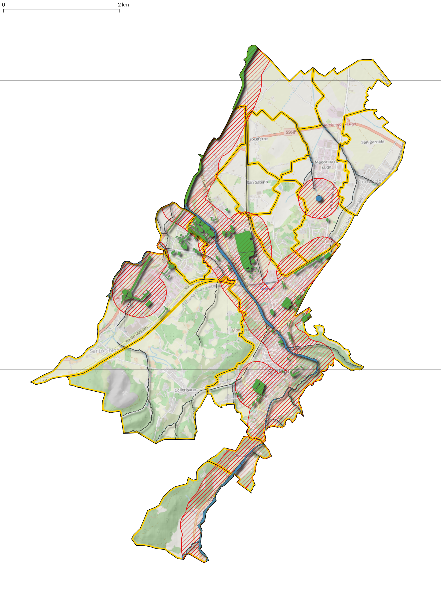
```

```{r rulebuf300NT, fig.cap="In rosso buffer di 300 m intorno alle aree verdi urbane di natura pubblica senza l'inclusione del corridoio fluviale del torrente Tessino.", out.width='\\linewidth', fig.align='center', echo=FALSE}
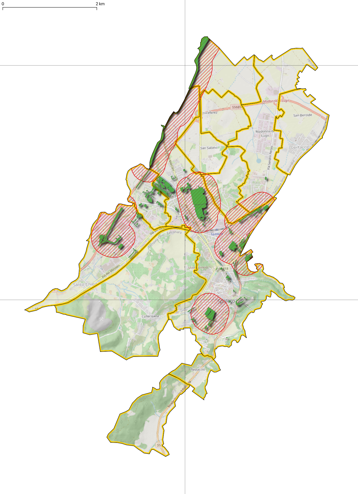
```

## Risultati del sondaggio del Walkshop alla Greenway

Il 3 ottobre 2026 lungo la Greenway della Valle Spoletana in attuazione del presente studio si è tenuto un evento organizzato dal Comune di Spoleto insieme al Dipartimento di Chimica, Biologia e Biotecnologie dell'Università degli Studi di Perugia intitolato "Walkshop lungo il Tessino e la Marroggia".

L'evento è iniziato la mattina e subito dopo l'accoglienza è stata richiesta la prima compilazione del form “Vivere la Natura a Spoleto”.
Lungo il percorso del Tessino e del Marroggia, i partecipanti sono stati coinvolti in un'attività di osservazione e conoscenza condivisa, fornendo un contributo attivo che è proseguito con la seconda fase di rilevazione dati.
In entrambi i casi le domande hanno toccato le stesse nove tematiche, ma con formulazioni e scale diverse.
Il questionario “pre” è stato utilizzato per raccogliere alcune informazioni sul partecipante (età, genere, occupazione, località di residenza, frequenza d'uso dell'area e tempo che vi trascorre) e proporre nove domande con risposta con punteggio da 1 («per nulla») a 5 («moltissimo»).

Elenco domande della prima compilazione (pre):

1.  Quanto si sente legato alla natura e vicino alle tematiche ambientali?

2.  Quanto si sente felice e/o sereno quando trascorre del tempo qui?

3.  Quanto contribuisce alla sua salute fisica frequentare la Greenway?

4.  Quanto quest’area naturale la aiuta a rigenerarsi, concentrarsi e rilassarsi?

5.  Quanto questo spazio rappresenta per lei un punto di ritrovo, socializzazione e incontro?

6.  Quest’area naturale può essere un “rifugio climatico” (luogo per ripararsi e trovare sollievo durante le ondate di calore intenso)?

7.  Quanto è importante la Greenway nella sua vita quotidiana?

8.  Quanto ritiene questa area importante per l'identità e lo sviluppo degli spoletini?

9.  Consiglierebbe ad altri, suoi parenti-amici-conoscenti e non, di frequentare la Greenway?

Le domande servivano per descrivere la situazione abituale e la percezione che i partecipanti avevano prima dell’incontro. Successivamente, il questionario post ha proposto domande finalizzate a rilevare il cambiamento percepito, attraverso risposte di tipo sì/no: per esempio se, dopo il walkshop, il partecipante si sentisse più sereno o se ritenesse possibile l’utilizzo della Greenway come rifugio climatico.

Hanno risposto al questionario pre 47 persone e al post 41. La fascia di età più numerosa è stata quella da 46–65 anni (38%), seguita da 26–45 e oltre 65 (23% ciascuna) e da sotto i 25 anni (15%).
Le donne hanno rappresentato il 55% del campione. Considerando l’aspetto lavorativo i dipendenti pubblici (34%) sono stati i più numerosi, seguiti dagli studenti (21%) e i pensionati (19%) (Fig. \@ref(fig:campione) ).
Il 26% degli intervistati è residente a Spoleto e il 70% in altre località, tra frazioni e comuni vicini, ma anche più lontani (tra cui Perugia, Foligno e Roma). Il 36% ha dichiarato di frequentare l'area raramente o per la prima volta, il 32% una volta al mese, il 17% ogni settimana e il 15% ogni giorno.
Il 23% ha indicato di trascorrervi meno di 30 minuti, il 55% tra 45 e 60 minuti e il 17% oltre un'ora (Fig. \@ref(fig:campione)).

```{r campione, fig.cap="Informazioni sulle caratteristiche dei partecipanti", out.width='\\linewidth', fig.align='center', echo=FALSE}
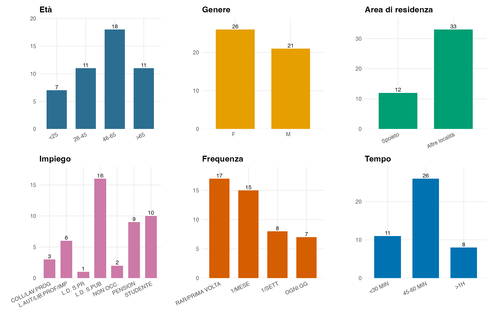
```

Per l’analisi delle risposte al questionario, per ogni domanda sono stati calcolati frequenze, media, mediana e quota di risposte con punteggi alti (Tab. \@ref(tab:questionario)).

|item |  n| media|   ds| mediana|   q1| q3| pct_1_2| pct_3| pct_4_5| pct_5|
|:----|--:|-----:|----:|-------:|----:|--:|-------:|-----:|-------:|-----:|
|Q1   | 47|  4.57| 0.68|     5.0| 4.00|  5|    2.13|  4.26|   93.62| 65.96|
|Q2   | 47|  4.23| 1.11|     5.0| 4.00|  5|    8.51|  6.38|   85.11| 53.19|
|Q3   | 47|  3.98| 1.22|     4.0| 4.00|  5|   12.77| 10.64|   76.60| 42.55|
|Q4   | 46|  4.20| 1.15|     5.0| 4.00|  5|   13.04|  4.35|   82.61| 54.35|
|Q5   | 46|  3.13| 1.31|     3.0| 2.00|  4|   30.43| 34.78|   34.78| 21.74|
|Q6   | 47|  3.36| 1.47|     4.0| 2.00|  5|   29.79| 17.02|   53.19| 29.79|
|Q7   | 46|  3.11| 1.62|     3.0| 1.25|  5|   36.96| 23.91|   39.13| 34.78|
|Q8   | 46|  3.74| 1.32|     4.0| 3.00|  5|   17.39| 23.91|   58.70| 41.30|
|Q9   | 46|  4.22| 0.94|     4.5| 4.00|  5|    6.52| 15.22|   78.26| 50.00|

: (#tab:questionario) Risultati del questionario in fase di partenza.


Dalle risposte pervenute emerge che il legame con la natura dei partecipanti (Q1) ha la media più alta (4,6) e il 94% di risposte 4 o 5 (Tab. \@ref(tab:questionario)). Tra i giudizi formulati direttamente sulla Greenway, i più alti riguardano la serenità (Q2), la rigenerazione individuale (Q4), la salute fisica (Q3) e il passaparola (Q9): quasi otto persone su dieci sono felici e rilassate, e raccomanderebbero la frequentazione dell’area ad altri. Colpisce che i cittadini coinvolti abbiano riconosciuto meno il valore di quest’area nella socialità (Q5), il suo ruolo di potenziale rifugio climatico (Q6) e l'importanza nella vita quotidiana (Q7). Queste tre funzioni probabilmente sono meno ovvie e dipendono più dall'uso abituale dell'area e pertanto hanno ricevuto valutazioni con le medie più basse, tra 3,1 e 3,4. In particolare, l’importanza nella vita quotidiana è risultata polarizzata: il 26% ha risposto 1 e il 35% 5 (Fig. \@ref(fig:likert)).

```{r likert, fig.cap="Sintesi delle risposte: 1 («per nulla») a 5 («moltissimo»)", out.width='\\linewidth', fig.align='center', echo=FALSE}
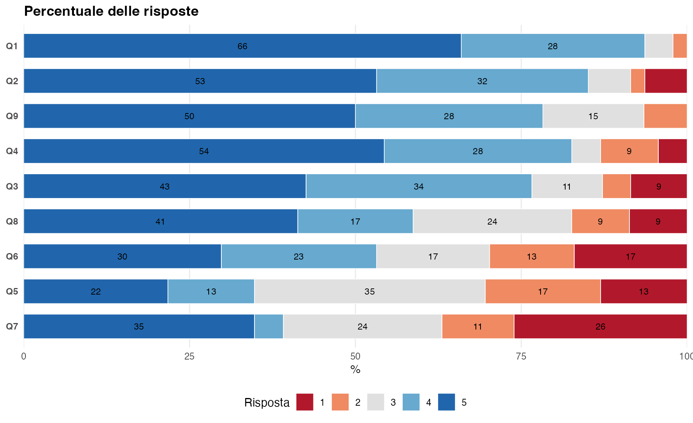
```

Per sintetizzare in un solo valore i giudizi dei partecipanti sulla Greenway è stato calcolato, per ogni persona, un punteggio composito: la media delle risposte alle domande da 2 a 9. Il punteggio va da 1 (giudizio minimo) a 5 (massimo) ed è calcolato per chi ha risposto ad almeno sei domande su otto. La domanda 1, sul legame personale con la natura, è esclusa perché descrive il soggetto partecipante e non un giudizio sull’area (Fig. \@ref(fig:composito)).

Dal quadro d’insieme emerge che in genere le valutazioni crescono con l'età: sotto i 45 anni il punteggio mediano è circa 3,3 su 5, sopra i 45 supera 4,1. Chi si ferma meno di 30 minuti ha un punteggio mediano di 3,3, contro 4,1–4,3 degli altri, e chi viene raramente o per la prima volta come era da attendersi ha valutazioni più basse (mediana 3,4, contro 4,1–4,3). Questi due effetti sono in parte sovrapposti e in parte dovuti alla poca familiarità con l'area: le domande su salute, vita quotidiana e identità presuppongono infatti un'esperienza ripetuta nel tempo.

```{r composito, fig.cap="Punteggio composito (media delle domande 2–9) per gruppi di partecipanti", out.width='\\linewidth', fig.align='center', echo=FALSE}
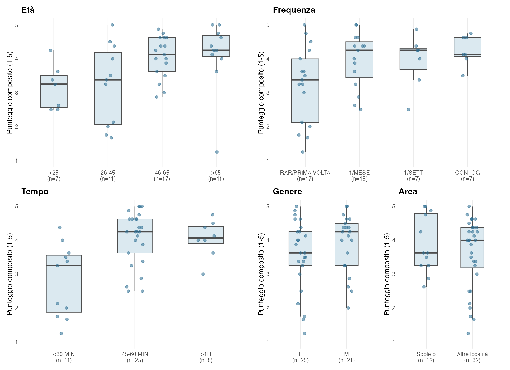
```

Quando al termine della giornata è stato sottoposto il nuovo questionario sono emerse queste valutazioni (Tab. \@ref(tab:questionarioPost)). 

|Post |etichetta                                         | si| no|  n| pct_si| ic_lo| ic_hi|
|:----|:-------------------------------------------------|--:|--:|--:|------:|-----:|-----:|
|P1   |Più legato alla natura                            | 37|  4| 41|   90.2|  76.9|  97.3|
|P2   |Più felice / sereno                               | 40|  1| 41|   97.6|  87.1|  99.9|
|P3   |Meglio fisicamente                                | 38|  3| 41|   92.7|  80.1|  98.5|
|P4   |Più rigenerato / rilassato                        | 38|  3| 41|   92.7|  80.1|  98.5|
|P5   |Può usarla per ritrovo e socialità                | 36|  5| 41|   87.8|  73.8|  95.9|
|P6   |Può usarla come rifugio climatico                 | 30| 11| 41|   73.2|  57.1|  85.8|
|P7   |Può diventare parte della propria vita quotidiana | 34|  7| 41|   82.9|  67.9|  92.8|
|P8   |Può diventare parte della vita degli spoletini    | 39|  2| 41|   95.1|  83.5|  99.4|
|P9   |La consiglierebbe ad altri                        | 40|  1| 41|   97.6|  87.1|  99.9|

: (#tab:questionarioPost) Risultati del questionario in fase di rientro dal walkshop.

Il questionario post, compilato da 41 persone al termine della camminata, mostra una prevalenza di risposte affermative (Fig. \@ref(fig:Qpost)). Quasi tutti dichiarano di sentirsi più sereni e consiglierebbero la Greenway ad altri (98%, 40 su 41); superano il 90% anche i «sì» su benessere fisico, rigenerazione e legame con la natura. Più bassi sono i valori sull’uso dell’area: l’88% la userebbe come luogo di ritrovo e l’83% la vede entrare nella propria vita quotidiana. Il valore minimo riguarda il rifugio climatico (73%, 30 su 41).

```{r Qpost, fig.cap="Quota di risposte affermative con intervallo di confidenza al 95%", out.width='\\linewidth', fig.align='center', echo=FALSE}
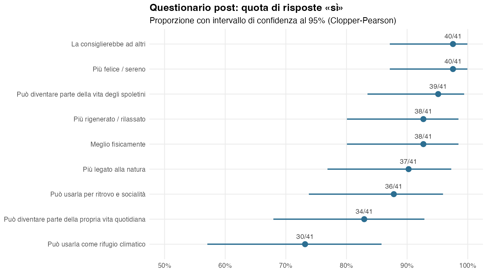
```

Infine, se esaminiamo le risposte aperte, i contributi vanno soprattutto nella direzione di preservare la vegetazione e potenziare le aree con più ombra e soprattutto i servizi di sosta nell’area (Fig. \@ref(fig:Qaperte)).

```{r Qaperte, fig.cap="Riepilogo del contenuto delle risposte aperte.", out.width='\\linewidth', fig.align='center', echo=FALSE}
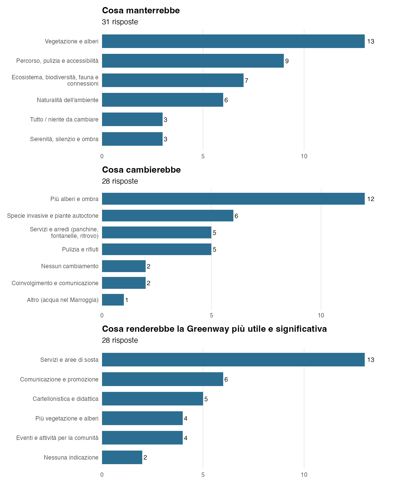
```
In dettaglio, appare chiaro che nella voce “**Da Mantenere**” la vegetazione è il tema più frequente (13 risposte su 31: «verde», «alberi», «piante spontanee», «specie autoctone»), seguita dal percorso così com'è, pulito e accessibile, dall'ecosistema, la biodiversità e i collegamenti tra ambienti, e dalla naturalità.

Tra le cose “**Da cambiare**”, la richiesta più frequente è avere più alberi e più ombra (12 su 28). Seguono il contrasto alle specie invasive a favore di quelle autoctone (6 risposte, di cui tre citano espressamente l'ailanto), servizi e arredi come panchine e fontanelle e pulizia con secchi per i rifiuti.

Nell’ottica di una prospezione “**Per il futuro**”, quasi la metà (13 su 28) chiede servizi e aree di sosta: panchine, aree picnic, fontanelle, ristoro, spazi per i bambini, attrezzature per l'attività fisica.
In misura minore sono state formulate anche altre richieste relativamente al potenziamento della comunicazione e promozione dell'area, attraverso l’installazione di cartellonistica specifica e pannelli didattici su piante e fauna.

Per concludere, appare evidente che i partecipanti al walkshop ritengono che la Greenway sia soprattutto un luogo di serenità, rigenerazione e contatto con la natura: oltre l'80% lo riconosce prima della camminata e il 93–98% dichiara di sentirsi meglio al termine dell'evento.
Meno riconosciuto è il suo ruolo sociale e quotidiano, e le valutazioni sono più basse tra gli under 45 e i visitatori occasionali, che conoscono meno l'area e che quindi non hanno ancora familiriazzato con il luogo.
Le risposte aperte indicano priorità concrete e convergenti: 

1. Più alberi e ombra lungo il percorso, e contrasto all'ailanto con piante autoctone.
2. Panchine, fontanelle, secchi per i rifiuti e aree di sosta, anche per bambini e picnic.
3. Cartellonistica e pannelli didattici su piante e fauna.
4. Più comunicazione sull'esistenza della Greenway e iniziative periodiche come questo walkshop.

In sintesi, i partecipanti vogliono preservare il carattere naturale della Greenway, fatto di vegetazione, percorso e connessioni ecologiche, e chiedono allo stesso tempo di renderla più accogliente e più comprensibile, con più ombra e servizi di sosta per chi la frequenta e una maggiore informazione sul suo valore naturalistico.