---
editor_options:
  markdown:
    wrap: sentence
  chunk_output_type: console
output: pdf_document
---

# Risultati

## Quadro conoscitivo di base

### Schede descrittive delle Unità Funzionali

L'applicazione della metodologia descritta in sezione \@ref(sec-UF) ha permesso di ridefinire l'assetto del territorio comunale, superando il disallineamento strutturale tra le precedenti Unità di Paesaggio e i confini amministrativi consolidati.
Il processo di integrazione dei supporti informativi ha condotto all'individuazione della nuova configurazione in Unità Funzionali (UF).
Di seguito vengono presentati i risultati dell'elaborazione per ciascuna Unità Funzionale, evidenziandone le sue caratteristiche principali.

#### UF Alto collinare montana dell'Appennino (19)

> Superficie: 131.6 km\^2
>
> Range altitudinale: 270 - 1328 m s.l.m.
>
> Quota mediana: 729 m s.l.m.

```{r UFAppennino, fig.cap="Unità Funzionale Alto collinare montana dell'Appennino. Elaborazione cartografica C. Arcangeli.", out.width='\\linewidth', fig.align='center', echo=FALSE}
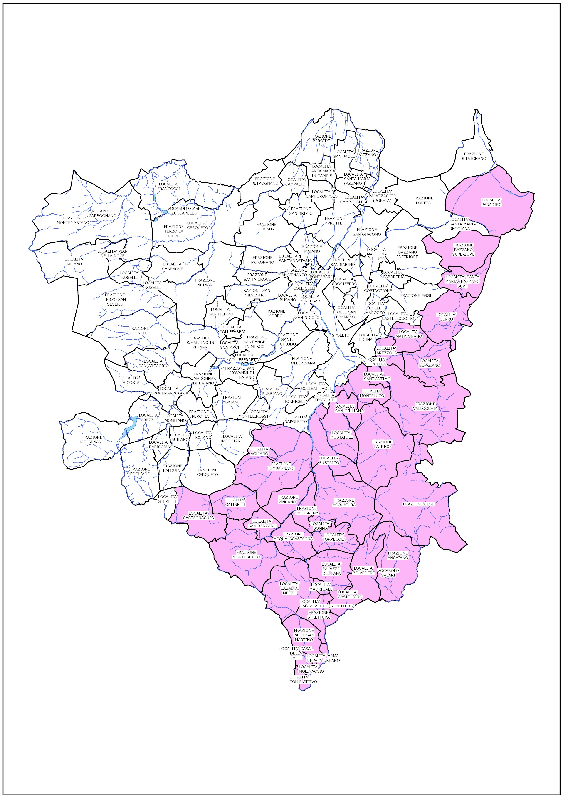
```

Questa unità funzionale potenzialmente raccoglie 16 frazioni e 3 località.

```         
FRAZIONE ACQUAIURA
FRAZIONE ACQUALACASTAGNA
FRAZIONE ANCAIANO
FRAZIONE BAZZANO SUPERIORE (BAZZANO SUPERIORE, SANTA MARIA)
FRAZIONE CERQUETO (CATINELLI, CASTAGNACUPA)
FRAZIONE CESE
FRAZIONE EGGI (MATRIGNANO, CERRO)
FRAZIONE MONTEBIBICO
FRAZIONE PATRICO
FRAZIONE PINCANO
FRAZIONE POMPAGNANO (POMPAGNANO, AGLIANO)
FRAZIONE SILVIGNANO
FRAZIONE STRETTURA
FRAZIONE VALDARENA
FRAZIONE VALLE SAN MARTINO
FRAZIONE VALLOCCHIA
LOCALITA' MONTELUCO
LOCALITA' SAN GIULIANO
LOCALITA' SANT'ANTIMO
```

#### UF Alto collinare montana dei Monti Martani (3)

> Superficie: 41.6 km\^2
>
> Range altitudinale: 345 - 1103 m s.l.m.
>
> Quota mediana: 608 m s.l.m.

```{r UFMMartani, fig.cap="Unità Funzionale Alto collinare montana dei Monti Martani. Elaborazione cartografica C. Arcangeli.", out.width='\\linewidth', fig.align='center', echo=FALSE}
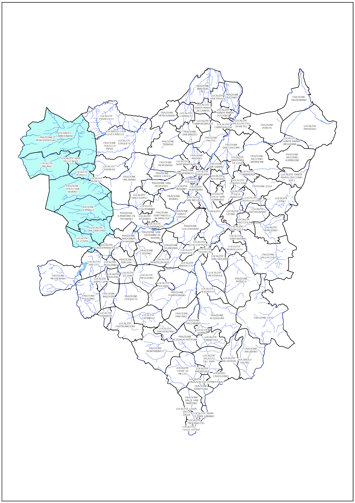
```

Questa unità funzionale potenzialmente si compone di 3 frazioni.

```         
FRAZIONE MONTEMARTANO
FRAZIONE OCENELLI
FRAZIONE TERZO SAN SEVERO
```

#### UF Collinare di Meggiano (12)

> Superficie: 26.8 km\^2
>
> Range altitudinale: 340 - 876 m s.l.m.
>
> Quota mediana: 541 m s.l.m.

```{r UFCollinareMeggiano, fig.cap="Unità Funzionale Collinare di Meggiano. Elaborazione cartografica C. Arcangeli.", out.width='\\linewidth', fig.align='center', echo=FALSE}
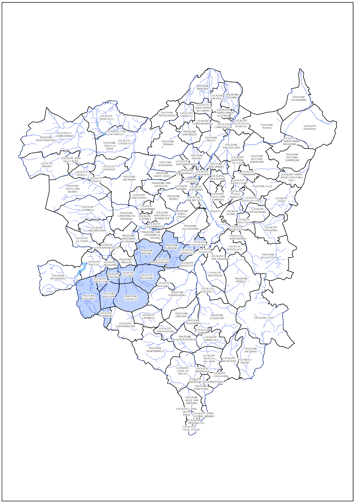
```

Questa unità funzionale potenzialmente raccoglie 8 frazioni e 2 località.

```         
FRAZIONE BAIANO
FRAZIONE BALDUINI
FRAZIONE CERQUETO (CERQUETO)
FRAZIONE FOGLIANO
FRAZIONE MESSENANO
FRAZIONE PERCHIA (ICCIANO)
FRAZIONE POMPAGNANO (MEGGIANO)
FRAZIONE RUBBIANO
LOCALITA' COLLEATTIVOLI
LOCALITA' TORRICELLA
```

#### UF Collinare - fascia olivata (8)

> Superficie: 24.4 km\^2
>
> Range altitudinale: 247 - 1000 m s.l.m.
>
> Quota mediana: 362 m s.l.m.

```{r UFCollinareOlivata, fig.cap="Unità Funzionale Collinare - fascia olivata. Elaborazione cartografica C. Arcangeli.", out.width='\\linewidth', fig.align='center', echo=FALSE}
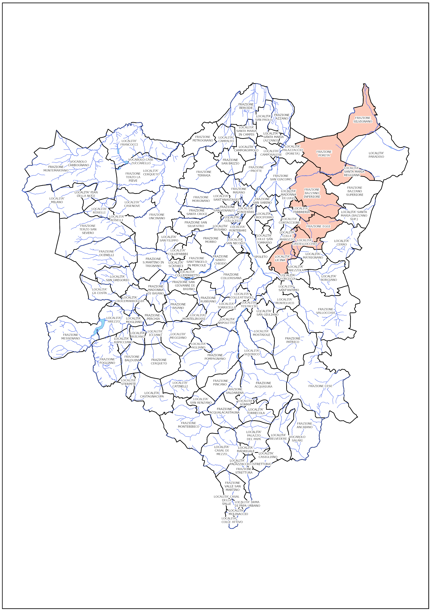
```

Questa unità funzionale potenzialmente raccoglie 5 frazioni e 2 località.

```         
FRAZIONE BAZZANO INFERIORE
FRAZIONE BAZZANO SUPERIORE (SANTA MARIA REGGIANA)
FRAZIONE EGGI (FABBRERIA, EGGI, CASTELLOCCHIO, COLLE MAROZZO)
FRAZIONE PORETA (PORETA)
FRAZIONE SILVIGNANO
LOCALITA' FORCELLA
LOCALITA' LICINA
```

#### UF Collinare dei Monti Martani (10)

> Superficie: 43.7 km\^2
>
> Range altitudinale: 238 - 527 m s.l.m.
>
> Quota mediana: 337 m s.l.m.

```{r UFCollinareMMartani, fig.cap="Unità Funzionale Collinare dei Monti Martani. Elaborazione cartografica C. Arcangeli.", out.width='\\linewidth', fig.align='center', echo=FALSE}
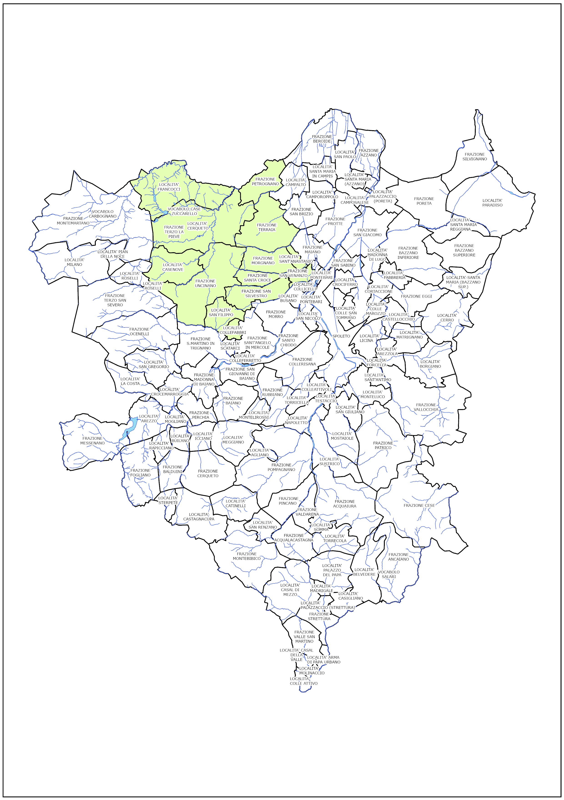
```

Questa unità funzionale potenzialmente si compone di 10 frazioni.

```         
FRAZIONE MORGNANO
FRAZIONE PETROGNANO
FRAZIONE SAN SILVESTRO
FRAZIONE SAN VENANZO (SANT'ANASTASIO, SAN VENANZO)
FRAZIONE SANT'ANGELO IN MERCOLE (COLLEFABBRI, SAN FILIPPO)
FRAZIONE SANTA CROCE
FRAZIONE TERRAIA
FRAZIONE TERZO LA PIEVE
FRAZIONE TERZO SAN SEVERO
FRAZIONE UNCINANO
```

#### UF di pianura e di Valle del T. Marroggia (15)

> Superficie: 58.6 km\^2
>
> Range altitudinale: 222 - 752 m s.l.m.
>
> Quota mediana: 275 m s.l.m.

```{r UFValle, fig.cap="Unità Funzionale di pianura e di Valle del T. Marroggia. Elaborazione cartografica C. Arcangeli.", out.width='\\linewidth', fig.align='center', echo=FALSE}
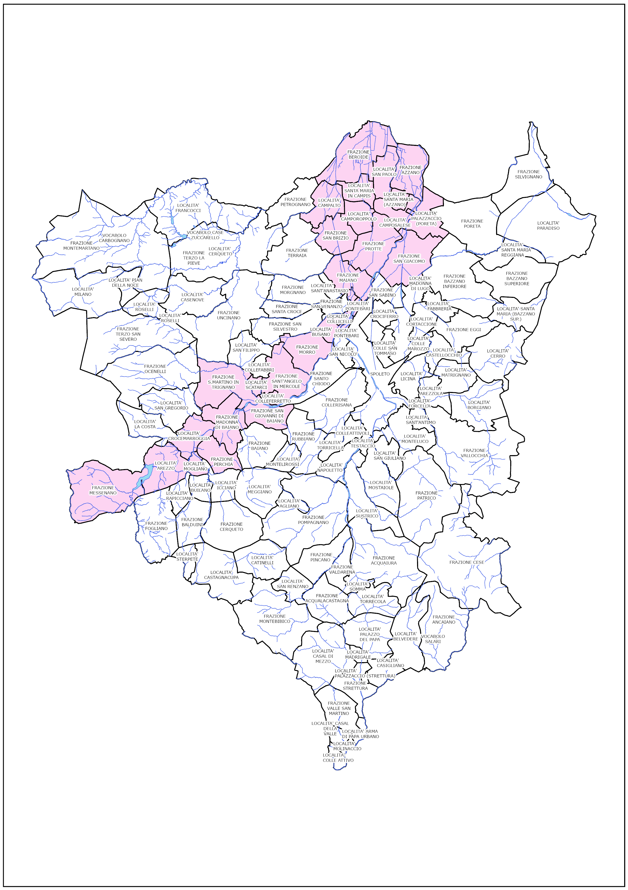
```

Questa unità funzionale potenzialmente si compone di 15 frazioni.

```         
FRAZIONE AZZANO
FRAZIONE BEROIDE
FRAZIONE MADONNA DI BAIANO
FRAZIONE MAIANO
FRAZIONE MESSENANO
FRAZIONE MORRO (BUSANO, MORRO)
FRAZIONE PERCHIA (PERCHIA, MOGLIANO, CROCEMARROGGIA)
FRAZIONE PORETA (PALAZZACCIO)
FRAZIONE PROTTE
FRAZIONE S.MARTINO IN TRIGNANO
FRAZIONE SAN BRIZIO
FRAZIONE SAN GIACOMO
FRAZIONE SAN GIOVANNI DI BAIANO
FRAZIONE SAN VENANZO (MALFONDO, PONTEBARI, COLLICELLI)
FRAZIONE SANT'ANGELO IN MERCOLE (SCATARCI, COLLEFERRETTO, SANT'ANGELO IN MERCOLE)
```

#### Urbana (6)

> Superficie: 23 km\^2
>
> Range altitudinale: 245 - 651 m s.l.m.
>
> Quota mediana: 300 m s.l.m.

```{r UFUrbana, fig.cap="Unità Funzionale Urbana. Elaborazione cartografica C. Arcangeli.", out.width='\\linewidth', fig.align='center', echo=FALSE}
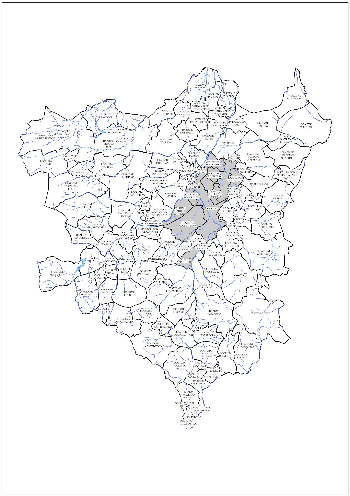
```

Questa unità funzionale potenzialmente si compone di 5 frazioni, 2 località e il nucleo della città di Spoleto.

```         
FRAZIONE COLLERISANA
FRAZIONE EGGI (CORTACCIONE)
FRAZIONE MORRO (SAN NICOLO')
FRAZIONE SAN SABINO
FRAZIONE SANTO CHIODO
LOCALITA' NAPOLETTO
LOCALITA' TESTACCIO
SPOLETO
```

### Elaborati cartografici UF

==[descrizione integrativa]==


## Connettività per Unità Funzionali (MSPA)

La valutazione della struttura e della connettività del paesaggio, ottenuta combinando la metodologia MSPA e gli indici di frammentazione [@jaeger2000a], è presentata di seguito con specifico riferimento alle Unità Funzionali. L'approccio disaggregato rende possibile un confronto puntuale tra le condizioni ecologiche dei diversi contesti, ponendosi come base conoscitiva per orientare gli interventi finalizzati all'incremento della permeabilità territoriale e di salvaguardia della biodiversità (Fig. \@ref(fig:mspaUnitaFunzionali)).

```{r mspaUnitaFunzionali, fig.cap='Riclassificazione del territorio comunale secondo il metodo MSPA e ripartizione in unità funzionali.', out.width='\\linewidth', fig.align='center', echo=FALSE}
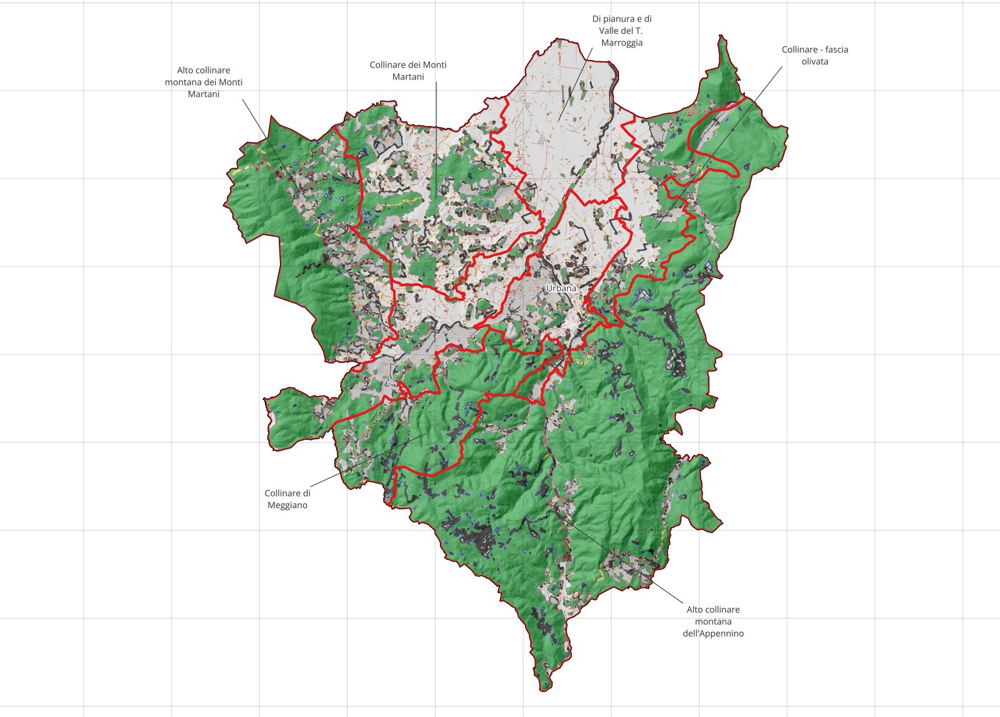
```

### Aree Montane e Dorsali Appenniniche (UF Alto collinare montana dell'Appennino e Alto collinare montana dei Monti Martani)

In queste unità come era atteso sono presenti i valori di gran lunga più elevati di Area Totale e Effective Mesh Size per la classe *Core* (Fig. \@ref(fig:mspaUnitaFunzionaliMontana))(Tab x).
Questo evidenzia un paesaggio a matrice prevalentemente naturale, dove l'habitat è continuo e poco frammentato.
Queste unità presentano i valori di gran lunga più elevati di Area Totale e Effective Mesh Size per la classe *Core*.
Questo evidenzia un paesaggio a matrice prevalentemente naturale, dove l'habitat è continuo e poco frammentato.
Inoltre, l’elevato valore di $S_{eff}$ corrispondente a XX nei *Core* conferma che le aree core non sono solo estese, ma strutturate in macro-blocchi compatti, ideali per la conservazione della biodiversità ad ampio raggio.

Riguardo le Componenti di Margine e i Corridoi, i valori di *Bridge* ed *Edge* mostrano un'estensione significativa ma un $S_{eff}$ contenuto rispetto ai *Core*, indicando che la matrice boschiva è continua e presenta margini esterni ben definiti senza eccessiva perforazione interna.

```{r mspaUnitaFunzionaliMontana, fig.cap="Carta geobotanica e analisi MSPA delle unità funzionali Alto collinare montana dell'Appennino e Alto collinare montana dei Monti Martani", out.width='\\linewidth', fig.align='center', echo=FALSE}
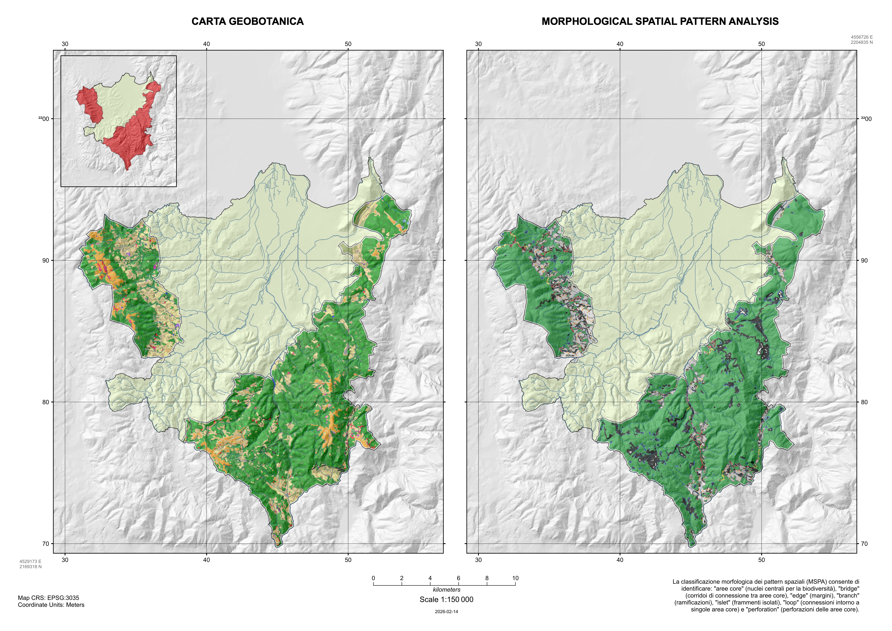
```

### Fasce di Transizione Pedemontane e Collinari (UF Collinare fascia olivata, Collinare dei Monti Martani, Collinare di Meggiano)

In queste aree l'area *Core* si riduce notevolmente a favore di una maggiore presenza proporzionale di *Edge*, *Branch*, *Loop* e *Bridge* (Figg. \@ref(fig:mspaUnitaFunzionaliOlivata); \@ref(fig:mspaUnitaFunzionaliCollinare); Tab x).
Infatti, la presenza diffusa di *Bridge* e *Branch* testimonia una rete di siepi, formazioni ripariali e lembi boschivi interconnessi con la matrice agricola/olivicola.
Tuttavia, il basso valore di $S_{eff}$ segnala che tali elementi sono frequentemente suddivisi in brevi tratti, vulnerabili all'effetto margine e all'interruzione di continuità.
Inoltre, la presenza di *Perforation* evidenzia l'effetto dell'attività antropica o dell'uso agricolo che penetra all'interno dei margini boschivi residui.

```{r mspaUnitaFunzionaliOlivata, fig.cap="Carta geobotanica e analisi MSPA dell'unità funzionale Collinare fascia olivata", out.width='\\linewidth', fig.align='center', echo=FALSE}
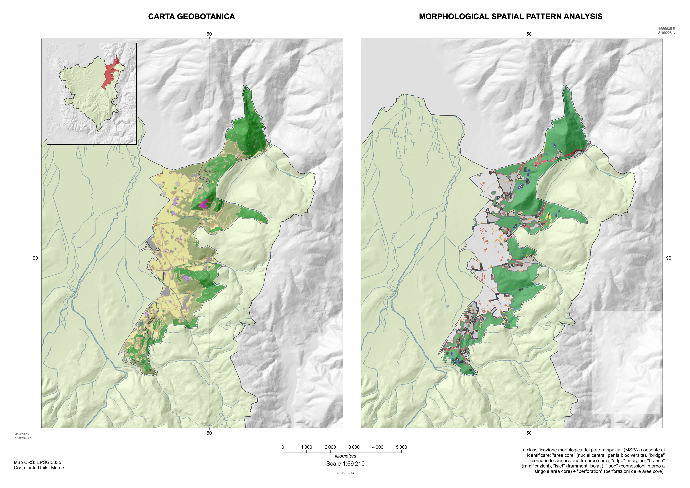
```

```{r mspaUnitaFunzionaliCollinare, fig.cap="Carta geobotanica e analisi MSPA delle unità funzionali Collinare dei Monti Martani, Collinare di Meggiano", out.width='\\linewidth', fig.align='center', echo=FALSE}
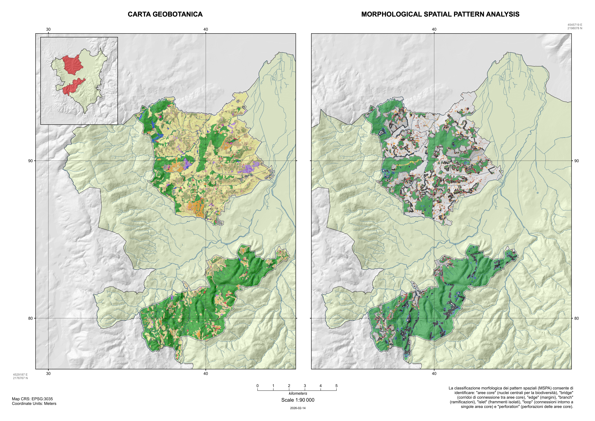
```

### Area di pianura e di valle (UF di pianura e di Valle del T. Marroggia)

In quest'area si osserva una presenza marcata della classe *Islet* (piccole patches isolate) unitamente a significativi valori di *Bridge* rappresentati dai corridoi fluviali e dal reticolo idrografico minore (Fig. \@ref(fig:mspaUnitaFunzionaliValle); Tab.
x).
Nonostante l'Area Totale per *Bridge* o *Islet* sia rilevante, il relativo $S_{eff}$ è decisamente basso.
Ciò dimostra che la connettività ecologica in fondo valle è affidata a corridoi stretti e frammentati, fortemente condizionati dalla pressione delle infrastrutture e dell'urbanizzazione.

```{r mspaUnitaFunzionaliValle, fig.cap="Carta geobotanica e analisi MSPA dell'unità funzionale di pianura e di Valle del T. Marroggia", out.width='\\linewidth', fig.align='center', echo=FALSE}
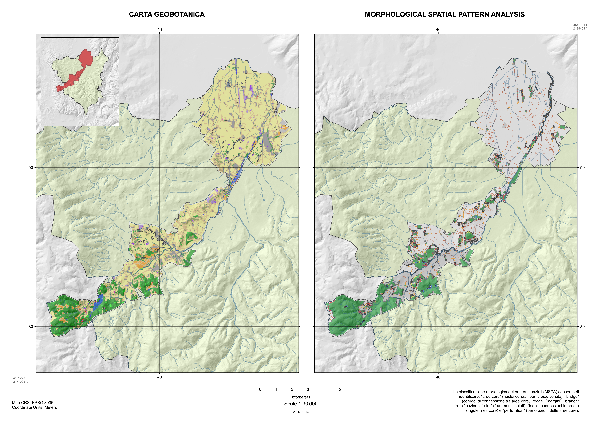
```

### Ambito Urbano / Antropizzato (UF Urbana)

Come atteso, l’area *Core* in questa UF è poco rappresentata.
Prevalgono elementi isolati (*Islet*) e i corridoi a fondo cieco (*Branch*) (Fig. \@ref(fig:mspaUnitaFunzionaliUrbana); Tab x).
L'Effective Mesh Size assume i valori più bassi dell'intero territorio comunale per quasi tutte le categorie ecologiche funzionali, confermando una matrice urbana poco permeabile al movimento della fauna con un basso livello di continuità degli habitat naturali.

```{r mspaUnitaFunzionaliUrbana, fig.cap="Carta geobotanica e analisi MSPA dell'unità funzionale urbana.", out.width='\\linewidth', fig.align='center', echo=FALSE}
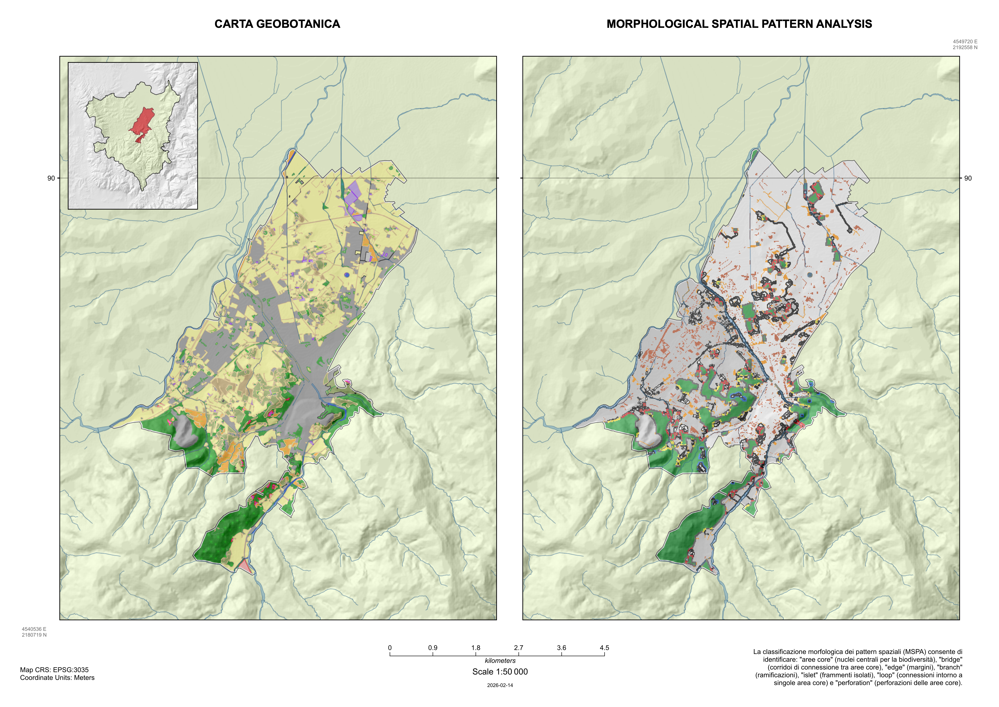
```

### Sintesi del confronto tra le Unità Funzionali

In sostanza, il confronto tra le Unità Funzionali evidenzia una qualche forma di polarizzazione del territorio:

1.  Unità Montane: Funzionano da serbatoi di connettività (*Source*) caratterizzati da elevate dimensioni della maglia utile ($S_{eff}$) e grandi blocchi *Core*.
2.  Unità Collinari e di fondo valle: Funzionano da vettori di transizione e corridoi ecologici (*Stepping stones* e *Bridges*), essenziali per il collegamento comunale e anche di scala regionale, ma soggetti a elevato rischio di frammentazione strutturale e funzionale.
3.  Ambito Urbano: Rappresenta il contesto a maggior grado di criticità ecologica e isolamento. La rete ecologica residua in ambito urbano si fonda quasi esclusivamente su piccole chiazze isolate (Islet) e bracci ciechi (Branch), evidenziando la necessità prioritario-gestionale di interventi di deframmentazione e re-infrastrutturazione verde (es. corridoi urbani, stepped stepping stones e forestazione urbana) per mantenere un minimo livello di permeabilità ecologica.

## Composizione e struttura del sistema verde e blu

### Estensione e composizione

Come anticipato nelle premesse metodologiche, lo studio ha previsto una valutazione puntuale delle infrastrutture verdi e blu, tenendo conto sia della componente privata che pubblica. La mappa della loro distribuzione spaziale complessiva è riportata in figura \@ref(fig:verdeSpoleto).

```{r verdeSpoleto, fig.cap="Carta del verde (pubblico in tonalità scura e privato in tonalità più chiara) e del reticolo fluviale. Sullo sfondo in sovrapposizione la mappa MSPA sfumata. Il confine dell'unità funzionale urbana è evidenziato in rosso.", out.width='\\linewidth', fig.align='center', echo=FALSE}
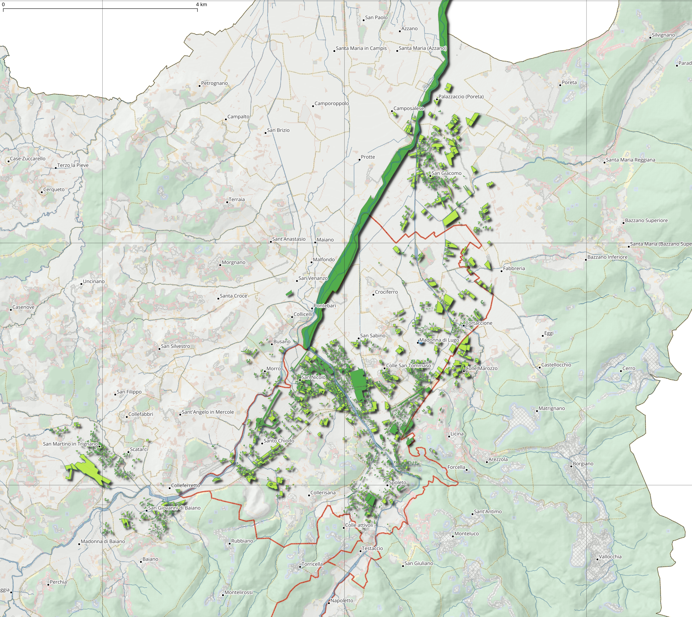
```

Focalizzando l’attenzione alla sola area urbana, definita secondo il modello delle unità funzionali (cfr. capitolo unità funzionali) e per la quale si dispone di una cartografia sufficientemente dettagliata e accurata nella rappresentazione degli elementi del verde, si nota che la composizione degli elementi delle infrastrutture verdi e blu occupano una superficie totale di quasi 200 ha.
Tale valore corrisponde a circa il 12.5% del territorio in esame.
Nella ripartizione tra verde pubblico/privato e aree blu la componente privata rappresenta il 61% del totale e il blu solamente il 7% (\@ref(tab:verdeBase)).^[L'analisi condotta mediante rasterizzazione della cartografia vettoriale mette in evidenza una lieve riduzione delle superfici rispetto ai valori originari. Tale differenza è piuttosto contenuta e imputabile alla trasformazione su maglia 5x5 m e alla successiva applicazione del limite dell'area di studio corrispondente all’unità funzionale urbana. Le differenze risultano contenute per il verde privato e per le componenti blu, mentre sono più evidenti per il verde pubblico, caratterizzato da numerosi elementi di piccola dimensione e geometrie articolate.]

| componente | proprieta | n_poligoni | area_ha |   PLAND |
|:-----------|:----------|-----------:|--------:|--------:|
| blu        | pubblico  |         19 |   14.54 |  0.92 % |
| verde      | privato   |       1171 |  117.83 |  7.67 % |
| verde      | pubblico  |        255 |   60.41 |  3.94 % |
| **Totale** | \-        |       1445 |  192.79 | 12.53 % |

: (#tab:verdeBase) Metriche della composizione del verde urbano per tipologia.

Complessivamente la mosaicatura di queste infrastrutture si compone di 1445 poligoni, la maggior parte dei quali assimilabili al verde privato (79%).

Dal punto di vista strutturale si osserva che le componenti verdi sono organizzate in un elevato numero di patch di piccole dimensioni, distribuite all'interno della matrice urbana, e caratterizzate da una superficie media di 0.84 ha.

#### Configurazione spaziale e connettività

L’indice LPI corrispondente al Largest Patch Index raggiunge un valore pari a 87.3%, indicando che la matrice territoriale dominante, costituita da infrastrutture grigie e da terreni agricoli, occupa gran parte della superficie totale.
In altre parole, come era atteso, il paesaggio risulta fortemente controllato dalla matrice urbana e dai seminativi che costituiscono lo sfondo all'interno del quale si distribuiscono gli elementi verdi e blu.

La superficie mediana delle patch di verde privato (3700 m\^2) è generalmente superiore a quella del verde pubblico (50 m\^2), suggerendo una maggiore presenza di nuclei vegetati continui all'interno delle proprietà private.
Nel verde pubblico e nei corsi d’acqua più della metà delle patch non supera due celle (circa 50 m\^2), e nel blu lo stesso vale per tre quarti delle patch.
Nel privato la mediana è 15 celle (circa 375 m\^2) e il terzo quartile 44 celle (circa 1100 m\^2).
La patch tipica del privato è dunque molto più grande di quella pubblica.
In aggiunta, la superficie pubblica si presenta organizzata in modo molto diverso: si concentrata in pochi patch grandi accompagnati da molti micro-patch (Fig. ).

Figura X - patches **show_patches()**

Nonostante questo assetto lasci prefigurare un elevato livello di frammentazione con una densità di patch di circa 120 ogni 100 ha (PD=119.5), le metriche di contiguità (AI = 95.4), aggregazione (CONTAG = 75.2) e coesione (COHESION = 99.9) mostrano valori elevati, indicando che le diverse componenti mantengono un livello significativo di continuità spaziale (tab paesaggio strati.csv).
Ciò a testimoniare una distribuzione delle classi organizzata in nuclei spazialmente riconoscibili piuttosto che in elementi completamente dispersi.
Questo suggerisce che il sistema del verde urbano, pur articolato in molteplici elementi, conserva una discreta capacità di funzionare come rete ecologica diffusa.
Purtroppo, le infrastrutture blu risultano quantitativamente marginali rispetto alle superfici verdi, ma contribuiscono comunque alla diversificazione del mosaico generale fornendo un importante supporto per la connettività complessiva del sistema.
È inoltre da notare che nel processo di rasterizzazione su maglia 5x5 m gli elementi di natura blu vengono suddivisi in numerosi nuclei distinti.
Conseguentemente, il numero di patch raster non rappresenta il numero di elementi realmente cartografati, ma il numero di porzioni che possono essere considerate funzionalmente connesse all'interno del mosaico paesaggistico.

Come anticipato il verde privato rappresenta la componente più estesa e diffusa, caratterizzata da un elevato numero di patch di dimensioni medio-piccole, con la presenza di alcuni nuclei di superficie rilevante che contribuiscono in modo significativo alla dotazione complessiva di copertura vegetale (Tab patch_strati.csv).

Al contrario, il verde pubblico mostra una configurazione differente: presenta anch'esso numerose piccole patch isolate derivanti da superfici lineari o marginali, ma sono presenti anche aree di grandi dimensioni che svolgono un ruolo centrale nella struttura complessiva del sistema.
In generale l’analisi delle metriche a livello di patch conferma che la maggior parte delle unità presenta valori di core area prossimi a zero, indicando che le dimensioni sono spesso insufficienti a contenere una porzione interna non influenzata dall'effetto margine.
Infatti, solo le patch di dimensioni maggiori conservano aree centrali significative e possono quindi svolgere funzioni ecologiche più stabili e strutturate (tab patch_strati.csv).

Le distanze tra patch (ENN) risultano generalmente contenute e inferiori ai 25 m per gran parte degli elementi (21.5 m nel verde privato; 18.2 m nel verde pubblico), suggerendo una buona prossimità spaziale tra le aree appartenenti alla stessa classe.
Tuttavia alcune patch mostrano valori sensibilmente più elevati, evidenziando situazioni di isolamento locale che possono ridurre la connettività funzionale del sistema (tab confronto strati).
Esaminando nel dettaglio anche gli indici AI, CLUMPY e COHESION emerge un quadro per cui il territorio appare contemporaneamente molto frammentato dal punto di vista numerico, ma relativamente connesso dal punto di vista spaziale.
Resta invece limitata la disponibilità di aree centrali effettivamente schermate dagli effetti di margine, che rappresentano meno del 2% della superficie territoriale nel caso del sistema verde-blu complessivo.

Sebbene le metriche di aggregazione e coesione evidenzino una buona continuità all'interno delle singole componenti, l'analisi dei contatti () mostra che le diverse tipologie di infrastruttura verde e blu interagiscono poco tra loro (tab contatti).
Le patch tendono infatti a confinare prevalentemente con elementi della stessa classe e, in misura secondaria, con la matrice territoriale circostante.
In particolare, le adiacenze tra verde privato e verde pubblico rappresentano una quota trascurabile dei contatti complessivi (\< 0,5%), mentre una parte consistente dei bordi delle patch è in contatto con la matrice territoriale (20,0% per il verde privato, 15,9% per il verde pubblico e 13,8% per il blu pubblico).
Tale configurazione evidenzia una limitata integrazione tra i diversi sottosistemi ecologici e una forte esposizione agli ambienti circostanti.
Ne deriva un sistema caratterizzato da una buona coerenza interna dei singoli sottosistemi, ma da una limitata integrazione spaziale tra verde pubblico, verde privato e componenti blu.

#### Dotazione per frazione e località

Disaggregando le informazioni sulla base della ripartizione dell’unità funzionale Urbana in frazioni e località emergono chiare differenze nella dotazione locale delle infrastrutture verdi e blu.
Le maggiori coperture si osservano a San Nicolò (21,4%) e Spoleto (20,4%), mentre Crociferro, San Sabino e Collerisana presentano dotazioni di verde sensibilmente inferiori (\<2.5%).
Indici di copertura intermedi compresi tra il 10-15% si osservano a Cortaccione, Madonna di Lugo e Santo Chiodo.
Differenziando l’analisi per componente pubblica-privata, emerge che in molte zone il verde è quasi esclusivamente privato.
A Santo Chiodo il verde pubblico è circa il 4.7% della superficie, contro un 10.7% di quello privato.
Analoga situazione si osserva a San Nicolò (5.9% contro 15.3%).
Il nucleo di Spoleto si distingue invece per l'elevato numero di patch e per il ruolo rilevante del verde pubblico, configurandosi come il sistema più articolato e diversificato.
I livelli di AI (--) e COHESION (--) evidenziano anche il mantenimento di un certo livello di continuità funzionale all’interno di questa unità, tra i più alti osservati.
Inoltre è in questa unità che possiamo ritrovare le patch più grandi (LPI=2.53%), a cui si affiancano le località di Cortaccione (3.68%), San Nicolò (2.63%) e Santo Chiodo (2.25%).

==[Tabelle e figure]==
==[Nota sul Laghetto dei Longobardi]

### Verifica regola 3–30–300

Interpretando questi dati analitici in chiave regola 3-30-300 appare chiaro che nel contesto urbano il nucleo cittadino riveste la maggiore importanza ed è quello che offre le maggiori possibilità per il potenziale raggiungimento gli obiettivi della regola.
Nodali in tal senso sono le aree verdi di: a) complesso areale di Piazza d’Armi e del campo di Atletica leggera, b) Villa Redenta e c) dell’area del Parco di Chico Mendez e della Spoleto Sfera.
A queste tre macro aree si aggiunge una porzione a sviluppo lineare adiacente il tracciato ferroviario in prossimità delle vie Primo Maggio e Tre Settembre e il corridoio blu del torrente Tessino.
In nessuna delle altre unità urbane sono presenti superfici di verde pubblico di dimensione vicina all’ettaro, se non a Santo Chiodo in un’area a sviluppo lineare prossimale alla strada statale 685 delle Tre Valli Umbre.
Riportando un buffer di 300 m intorno a queste aree si comprende la centralità e la grande grande rilevanza assunta dal corridoio fluviale del Torrente Tessino (Figg. \@ref(fig:rulebuf300); \@ref(fig:rulebuf300NT)). Tale elemento incrementa notevolmente la quota di territorio destinata alla connettività e alla funzionalità ambientale (l'estensione passa da 210 a 400 ha, interessando circa l’85% dell’unità urbana) e si configura come il naturale corridoio di collegamento verso la Greenway Valle Spoletana.

```{r rulebuf300, fig.cap="In rosso buffer di 300 m intorno alle aree verdi urbane di natura pubblica.", out.width='\\linewidth', fig.align='center', echo=FALSE}
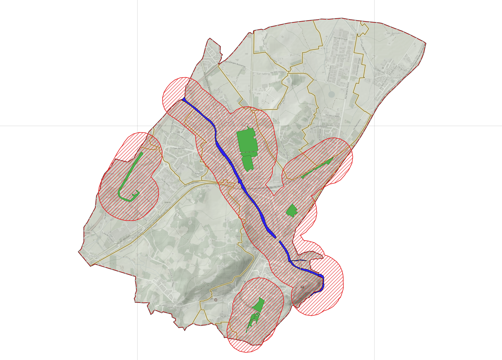
```

```{r rulebuf300NT, fig.cap="In rosso buffer di 300 m intorno alle aree verdi urbane di natura pubblica senza l'inclusione del corridoio fluviale del torrente Tessino.", out.width='\\linewidth', fig.align='center', echo=FALSE}
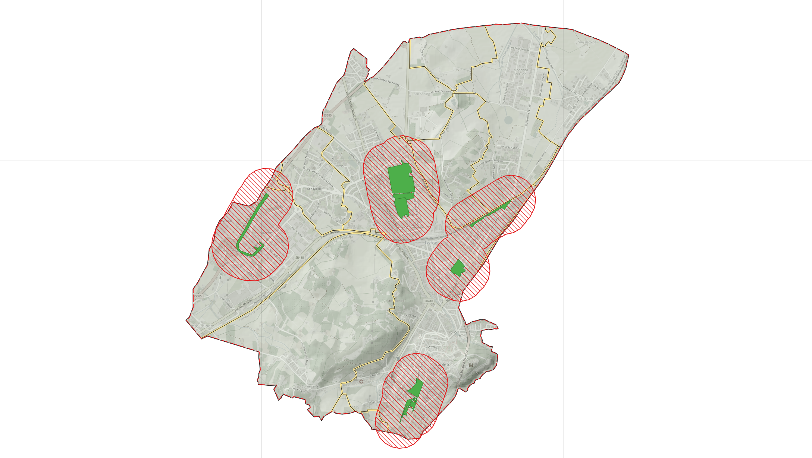
```

### Priorità di conservazione e connessione (Marxan)

==[da completare primo step]==

## Risultati del sondaggio Greenway

==[da elaborare]==
