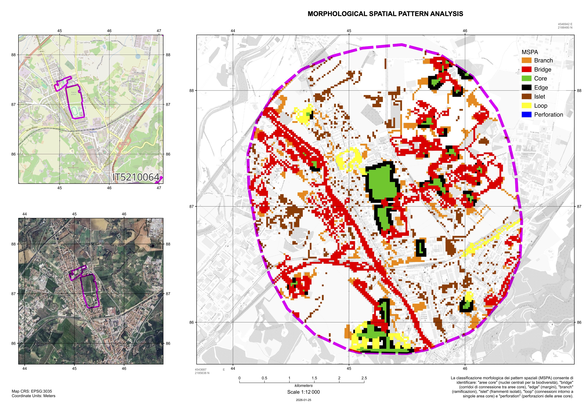
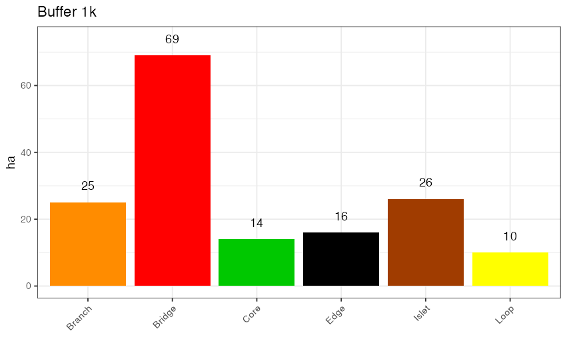
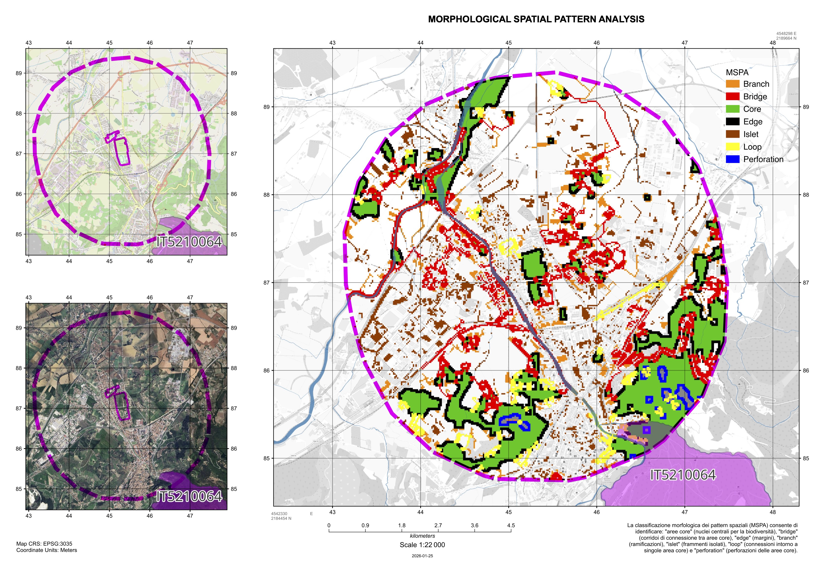
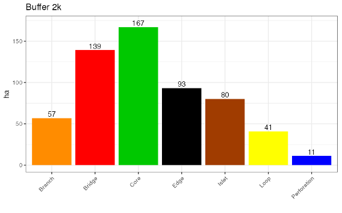
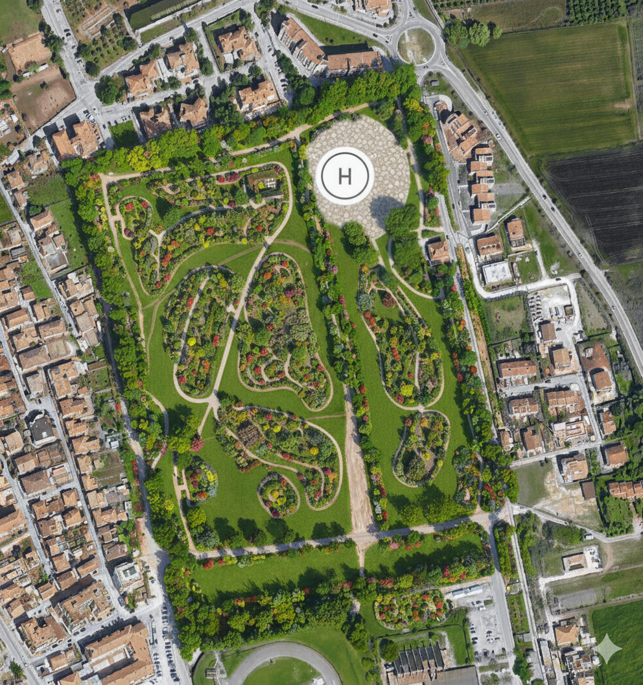
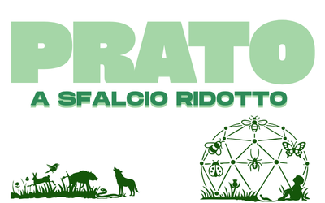
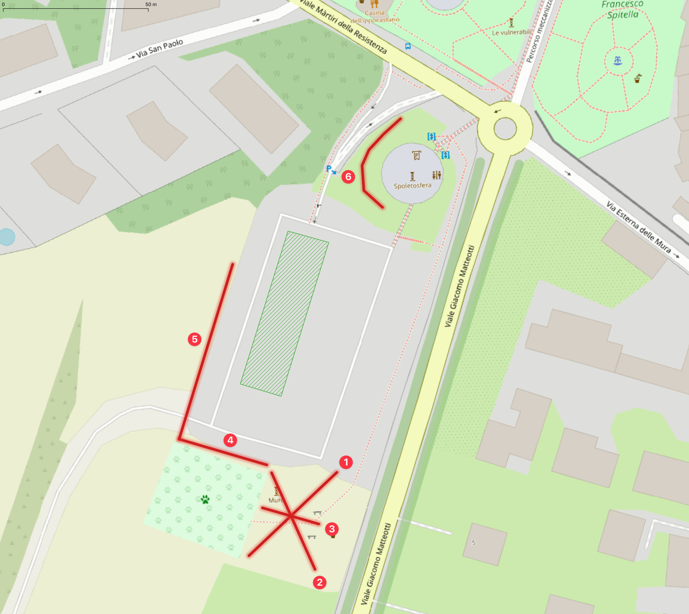
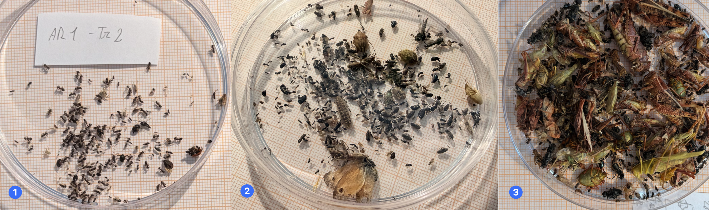
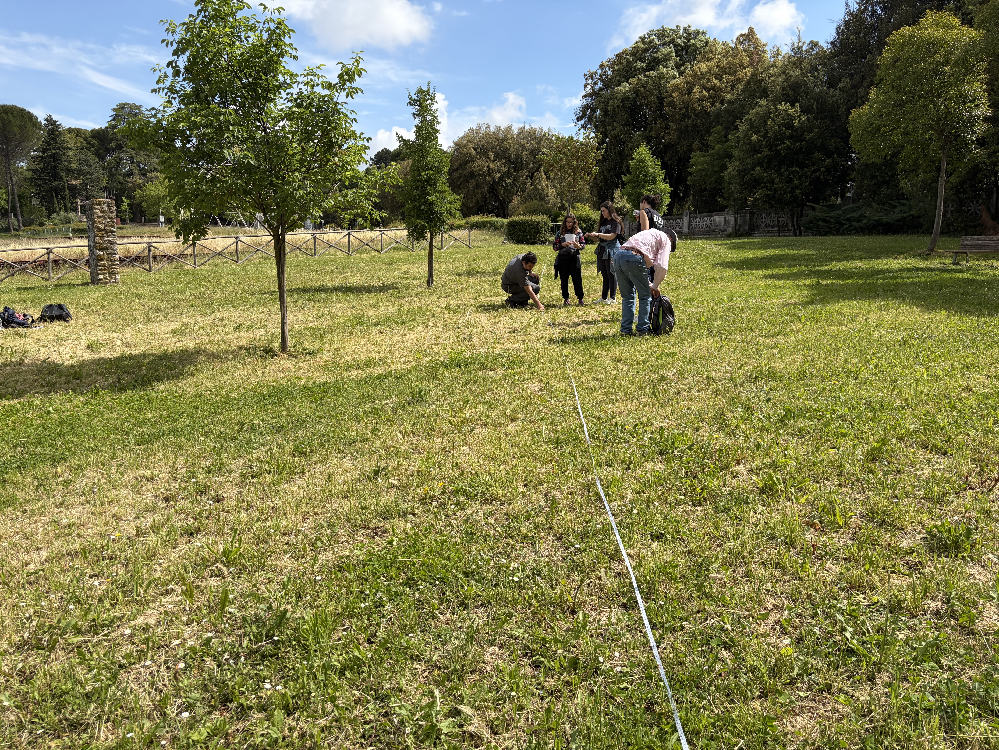

---
output:
  pdf_document: default
  html_document: default
---
# Indirizzi per la gestione e la progettazione

==[testo di raccordo: dalle analisi emerge che... quindi si propongono le seguenti azioni]==


## Analisi dei pattern morfologici spaziali dell’area di Piazza d’Armi e delle zone limitrofe

Al fine di valutare il contributo dell’area di Piazza d’Armi agli obiettivi di rinaturalizzazione e contrasto al consumo di suolo previsti dal Fondo Regionale Umbro, è stata condotta un’analisi morfologica spaziale mediante metodologia MSPA (Morphological Spatial Pattern Analysis). Questo approccio consente di esaminare il ruolo ecologico dell’area e di quantificare il suo potenziale nel contesto della rete ecologica locale (REL) e quella regionale (RERU).

### Approccio metodologico e basi dati

Nel dettaglio, l’analisi MSPA è stata utilizzata per valutare la connettività ecologica e la struttura del paesaggio impiegando due distinti buffer intorno all’area di Piazza d’Armi: il primo buffer di 1 km è stato utile per definire le caratteristiche di contesto immediato, il secondo di 2 km è stato funzionale alla valutazione del grado di biopermeabilità del territorio circostante e del ruolo dell’area all’interno della rete ecologica locale. In questo modo è stato possibile evidenziare come l’area di indagine si inserisca nei corridoi di connettività esistenti e contribuisca alla funzionalità ecosistemica a scala di paesaggio. In linea generale, il framework metodologico della metodica MSPA si basa su un sistema di operatori matematico-morfologici progettati per caratterizzare le geometrie spaziali e le relazioni di connettività presenti nella carta di uso del suolo. Si tratta di un processo di segmentazione dei dati di input che nel caso specifico è stato basato sui risultati dell’elaborazione della carta geobotanica regionale dell’Umbria, aggiornata alla scala comunale nell’ambito delle attività della convenzione “Studio della rete ecologica applicato al potenziamento della connettività del territorio spoletino attraverso esperienze pilota di gestione e interventi infrastrutturali su specifiche specie target e ambiti prioritari, oltre a percorsi didattico informativo promozionali” con l’Università degli Studi di Perugia.

Dall’esame della carta riportata in fig. \@ref(fig:mappaPaceBuf1k) e dalla distribuzione delle diverse classi MSPA nel territorio ricompreso nel buffer di 1 km (Fig. \@ref(fig:mappaPacePlotBuf1k)) emerge che circa il 75% di questo territorio si articola in:

- Bridge (69 ha): è la classe dominante con la maggiore estensione (43%). A questa classe corrisponde la categoria dei "ponti”, generalmente definiti come corridoi ecologici, che connettono aree core, fondamentali per la connettività della rete ecologica. In particolare, è evidente che ad assolvere questa funzione è soprattutto l’ecotono ripario del torrente Tessino e le sue zone prossimali a occidente, mentre nella porzione orientale tale funzione è svolta dall’insieme degli elementi dell’ecosistema di colle San Tommaso.
- Islet (26 ha): frammenti isolati di habitat, abbastanza presenti nell’area in esame e che soprattutto nella porzione settentrionale potrebbero svolgere una funzione importante per garantire ulteriore connettività verso l’area della Greenway.
- Branch (25 ha): ramificazioni che si estendono dalle aree core, ma con una sola connessione.
Altre categorie presenti nell’area (per una superficie complessiva pari a circa il 25%) sono:
- Edge (16 ha): bordi delle aree core, zone di transizione, note anche come aree ecotonali.
- Aree Core (14 ha): aree centrali di habitat. Ad assolvere questa funzione potrebbe essere solo l’area di Piazza d’Armi e le aree sportive contigue, attraverso la riprogettazione degli spazi e il miglioramento della loro funzionalità ecologica.
- Loop (10 ha): connessioni che creano percorsi circolari intorno a singole aree core.
In sintesi, questa configurazione suggerisce un sistema caratterizzato da una notevole frammentazione, dove le connessioni ecologiche (Bridge) prevalgono sulle aree core, ma con una notevole potenzialità che potrebbe essere sviluppata mettendo a sistema tutti gli elementi naturali già esistenti.

```{r mappaPaceBuf1k, fig.cap='Mappa del territorio ricompreso nel buffer di 1 km dall’area di indagine. A destra la riclassificazione del territorio secondo il metodo MSPA.', out.width='\\linewidth', fig.align='center', echo=FALSE}

```

```{r mappaPacePlotBuf1k, fig.cap='Distribuzione delle classi MSPA nel territorio ricompreso nel buffer di 1 km dall’area di indagine.', out.width='\\linewidth', fig.align='center', echo=FALSE}

```

Allargando il campo di valutazione e confrontando le analisi MSPA con buffer diversi (1 km vs 2 km), è possibile far emergere interessanti dinamiche sulla struttura ecologica del territorio alle due diverse scale spaziali \@ref(fig:mappaPaceBuf2k).

I principali cambiamenti tra il contesto immediato, rappresentato dal buffer 1k, e quello di scala locale proprio del buffer 2k (\@ref(fig:mappaPacePlotBuf2k)) sono:

- Aree Core (da 14 a 167 ha): estendendo l’area di indagine, molte aree classificate come aree core si aggiungono all’area di Piazza d’Armi. Questo indica che il territorio presenta un buon potenziale di habitat, soprattutto se si tiene conto che nella porzione meridionale è presente il sito Natura 2000 IT5210064 – Monteluco di Spoleto insieme alle aree pedemontane della dorsale appennica, mentre a nord si trova il sistema ecologico della Greenway. Da notare anche la vicinanza dell’area umida dei Pozzaccheri di Madonna di Lugo nell’area orientale che costituisce un’importante stepping stone per la biodiversità locale.
- Bridge (da 69 a 139 ha): le porzioni di territorio capaci di svolgere questa importante funzione ecologica nel passaggio di scala di buffer raddoppiano. Infatti, i corridoi ecologici si rafforzano, sebbene il nucleo centrale, rappresentato dal corridoio del torrente Tessino e dagli ecosistemi di colle San Tommaso, rimanga invariato. È da sottolineare che il corridoio ecologico tra il sistema di colle San Tommaso e l’area di Piazza d’Armi si presenta particolarmente stretto, rendendo indispensabile la salvaguardia del varco esistente per garantire la continuità della rete ecologica.
- Edge (da 16 a 93 ha): aumentando le aree core aumentano di conseguenza anche le zone di transizione attorno alle aree più estese.
- Islet (da 26 a 80 ha): anche i frammenti isolati aumentano, ma proporzionalmente in misura inferiore rispetto ad altre classi (passano infatti dal 16 al 14%), mantenendo un livello di frammentazione contenuto.
- Perforation (da 0 a 11 ha): a questa scala compaiono alcune “perforazioni” non particolarmente critiche nelle aree core in corrispondenza dell’area pedemontana appenninica.
- Branch e Loop: mantengono valori di superficie sostanzialmente immutati, rispettivamente 10 e 7%.


```{r mappaPaceBuf2k, fig.cap='Mappa del territorio ricompreso nel buffer di 2 km dall’area di indagine. A destra la riclassificazione del territorio secondo il metodo MSPA.', out.width='\\linewidth', fig.align='center', echo=FALSE}

```

```{r mappaPacePlotBuf2k, fig.cap='Distribuzione delle classi MSPA nel territorio ricompreso nel buffer di 2 km dall’area di indagine.', out.width='\\linewidth', fig.align='center', echo=FALSE}

```

### Considerazioni conclusive
Dall’analisi dei pattern spaziali emerge la rilevanza ecologica dell’area di Piazza d’Armi nella creazione di un sistema verde multifunzionale ad uso pubblico, capace di integrare obiettivi di conservazione della biodiversità, fruizione sociale e contrasto al degrado del suolo. L’area, per la sua configurazione e posizione strategica, si caratterizza come elemento chiave nel contesto della rete ecologica locale e in quella regionale attraverso la connessione dell’area Natura 2000 IT5210064 – Monteluco di Spoleto con la Greenway – Valle Spoletana. Inoltre, il miglioramento delle sue potenzialità ecologiche potrebbe fornire un notevole contributo alla rigenerazione ambientale e alla riduzione della frammentazione a scala di paesaggio urbano e periurbano. Di tutto ciò potrebbero beneficiare sia gli ecosistemi e la biodiversità locale sia la comunità spoletina che, in una visione olistica One Health fondata sul riconoscimento dell'interconnessione indissolubile tra salute umana, animale ed ecosistemica, sottolinea come il ripristino ecologico delle aree urbane rappresenti un investimento strategico per il benessere collettivo.

In questa prospettiva, la figura \@ref(fig:parcoPace) illustra un'ipotesi semplificata di assetto e riorganizzazione dell'area quale parco urbano multifunzionale (futuro Parco della Pace) con percorsi pedonali, aree alberate e siepi, concepite per coniugare l'erogazione dei servizi ecosistemici con spazi dedicati al tempo libero, alla socializzazione e all'educazione ambientale. Questa configurazione consente di massimizzare la permeabilità della matrice urbana e di rafforzare la funzione di cerniera ecologica dell'area tra il centro urbano e la zona periurbana.

```{r parcoPace, fig.cap="A titolo esemplificativo, la Figura 5.5 illustra un'ipotesi di riorganizzazione spaziale dell'ambito come parco urbano (futuro Parco della Pace).", out.width='\\linewidth', fig.align='center', echo=FALSE}

```

## Prati urbani

I prati urbani (urban lawns) rappresentano una delle componenti più diffuse delle infrastrutture verdi urbane a livello globale, arrivando a coprire fino al 70% delle aree verdi cittadine all'interno di parchi pubblici, giardini privati, campus, aree sportive e margini stradali (Ignatieva et al. 2020; Hedblom et al. 2017). Storicamente sono stati concepiti per scopi estetici, ricreativi e culturali, ma allo stesso tempo i prati urbani forniscono importanti servizi ecosistemici, tra cui il mitigamento dell'isola di calore, il sequestro del carbonio, la filtrazione dell'acqua, la creazione di spazi di habitat per la biodiversità e di aggregazione per i cittadini (Dushkova & Ignatieva 2020; Strohbach et al. 2012). Tuttavia, la loro gestione convenzionale, caratterizzata da sfalci intensivi, irrigazione e, talvolta, dall'impiego di fertilizzanti e fitofarmaci, comporta elevati costi economici e significativi impatti ambientali. Di fronte a queste evidenze, emerge quindi la necessità di ripensare la gestione di questi spazi attraverso le Nature-based Solutions e gli approcci di rewilding urbano. In questa prospettiva, la transizione verso forme di gestione ecologica si configura come una soluzione strategica per ripristinare le funzioni ecosistemiche, incrementare la biodiversità e rafforzare la resilienza delle comunità urbane (Nesshöver et al. 2017; Solcerova et al. 2023).
Ovviamente quando si tratta di ripensare alla loro gestione, non si tratta di abbandonare la manutenzione, ma di ricondurla a pratiche differenziate, in cui frequenza, altezza, periodo e porzione di superficie sfalciata sono variabili da calibrare in funzione dell’uso e del ruolo ecologico di ciascuna area (Kirby et al. 2025; Dushkova e Ignatieva 2025). L’idea di fondo è che una parte degli spazi verdi, soprattutto quelli in cui l’uso ricreativo è marginale, possa svolgere funzioni di habitat con costi gestionali inferiori, senza dover sostituire il prato con l’impianto di nuove specie.

I benefici ecologici della riduzione degli sfalci sono ampiamente documentati.

Nei prati urbani passati da sfalci ogni poche settimane a uno o due tagli per stagione, entro sei anni la ricchezza floristica è risultata superiore del 30% rispetto ai prati gestiti in modo intensivo, con una composizione che si sposta da specie comuni e tolleranti lo sfalcio verso specie tipiche dei prati (Sehrt et al. 2020). Chollet et al. (2018) riportano un aumento della diversità tassonomica, funzionale e filogenetica delle piante. Gli effetti riguardano anche gli insetti e altri artropodi: una meta-analisi su contesti urbani temperati indica che la riduzione dello sfalcio ha un effetto positivo medio sull’abbondanza (g = 0,54) e ampio sulla ricchezza di taxa (g = 1,25), mentre i prati curati favoriscono in modo sproporzionato le specie opportuniste e più antropofile (Proske et al. 2022). In un progetto sui prati per le farfalle (oltre 640 prati sfalciati solo in parte e al massimo tre volte l’anno), nove prati hanno mostrato biomassa e numero di specie di insetti più alti di nove prati intensivamente sfalciati, con la presenza di larve a indicare riproduzione in loco (Wintergerst et al. 2021).

La relazione tra sfalcio, biodiversità  e risorse per gli impollinatori non è però lineare. In un esperimento su sedici giardini del Massachusetts lo sfalcio ogni tre settimane ha prodotto fino a 2,5 volte più fiori rispetto alle altre frequenze, ma l’abbondanza massima di api selvatiche si è registrata con sfalci ogni due settimane, con ricchezza ed equitabilità più basse (Lerman et al. 2018). L’obiettivo, quindi, non è «non sfalciare», ma calibrare questa tipologie d’intervento.

Naturalmente, la riduzione degli interventi ha anche una ricaduta economica. In un caso studio canadese il passaggio da 15 a 10 sfalci annui nelle aree molto frequentate, e da tre a uno in quelle poco frequentate, è stato stimato in un risparmio del 36% dei costi di manutenzione, considerando i soli costi contrattuali. Lo stesso lavoro riporta che la gestione intensiva favorisce infestanti e parassiti dei prati, e che un’infestante allergenica come l’ambrosia (*Ambrosia artemisiifolia*) può essere contenuta riducendo la frequenza di sfalcio (Watson et al. 2020).

La riuscita di queste strategie dipende in larga misura dall'accettazione da parte dei cittadini. Per evitare che un prato a sfalcio ridotto venga percepito come un'area abbandonata o degradata, è fondamentale applicare i «segnali di cura» (*cues to care*, introdotti da Nassauer nel 1995), ovvero elementi di disegno e manutenzione perimetrale (come fasce sfalciate lungo i bordi) che rendano esplicita l'intenzionalità gestionale. Le evidenze di gradimento sono incoraggianti: in un parco inglese le strisce non sfalciate hanno avuto circa tre volte più fiori e cinque volte più insetti visitatori di fiori rispetto alle strisce sfalciate regolarmente, e il 97% dei visitatori intervistati si è detto favorevole a favorire insetti e fiori spontanei (Garbuzov et al. 2015). Riscontri analoghi emergono dai lavori di Norton et al. (2019), che evidenziano una maggiore soddisfazione dei residenti in presenza di coperture vegetali diversificate.

In sostanza, l'approccio per sua natura deve essere adattivo e spazialmente disaggregato. Aree sportive, percorsi e zone ad alta visibilità richiedono sfalci frequenti per garantire sicurezza e fruibilità, mentre i prati a sfalcio ridotto trovano collocazione ideale laddove la funzione ecologica può prevalere. L'organizzazione in un mosaico multifunzionale massimizza i benefici complessivi per la biodiversità (Norton et al. 2019).
Nel quadro normativo europeo, l’art. 8 del Regolamento (UE) 2024/1991 sulla ripristino della natura (Nature Restoration Law) impone che la superficie a verde e la copertura arborea urbana non diminuiscano rispetto ai livelli del 2024 entro il 2030, per poi registrare una crescita progressiva (ISPRA). Poiché i vincoli quantitativi devono essere supportati da una reale qualità ecologica, la gestione mirata dello sfalcio diventa uno strumento strategico fondamentale.


### Prato a sfalcio ridotto presso la Spoletosfera

Nel caso di Spoleto è stata avviata una sperimentazione presso l'area della Spoletosfera (Fig. \@ref(fig:spoletoSferaSign)), in cui viene proposta una gestione sostenibile del patrimonio naturale cittadino con l'idea di arricchire gli habitat, incrementare gli impollinatori e tutelare la biodiversità, in particolare della piccola fauna. Nello stesso tempo con un riequilibrio delle diverse componenti ecologiche ci si attende un contenimento degli insetti antropofili, una mitigazione dell'isola di calore, grazie al miglioramento della ritenzione idrica dei suoli.  

```{r spoletoSferaSign, fig.cap="Logo progettato per la segnaletica 'di cura' presso l'area della Spoletosfera.", out.width='\\linewidth', fig.align='center', echo=FALSE}

```

Per la caratterizzazione della comunità entomologica presente nell'area a sfalcio ridotto, nel periodo primaverile è stata condotta una campagna di campionamento mirata a rilevare la ricchezza e la composizione dei taxa di insetti associati alla matrice erbacea. Il disegno di campionamento ha previsto l'individuazione di 6 transetti rappresentativi dell'area di studio (Fig. \@ref(fig:spoletoSferaTransetti)). Per ciascun transetto la raccolta del materiale entomologico è stata eseguita mediante l'impiego di un retino da sfalcio (sweep net), adottando una metodologia di tipo semiquantitativo basata sullo sforzo temporale (standardizzato in circa 5 minuti di sfalcio attivo per transetto). Tutti i campioni raccolti sul campo sono stati immediatamente stoccati, catalogati e trasferiti in laboratorio per le fasi successive di lavorazione consistenti in: i) sorting ed estrazione: separazione del materiale biologico dai detriti vegetali e smistamento degli esemplari in base ai principali gruppi morfo-funzionali; ii) fissazione e conservazione dei reperti in soluzione alcolica (alcool etilico al 70%), predisponendo il materiale per le successive analisi e determinazioni tassonomiche di dettaglio per un riconoscimento tassonomico a livello di famiglia, genere o specie.


```{r spoletoSferaTransetti, fig.cap="Transetti del monitoraggio entomologico presso l'area della Spoletosfera.", out.width='\\linewidth', fig.align='center', echo=FALSE}

```

### Risultati preliminari

L'efficacia del prato a sfalcio ridotto nella promozione della biodiversità è resa evidente dal confronto visivo tra la composizione dei campioni raccolti nei due differenti regimi gestionali (Fig. \@ref(fig:sfalcioContinuativo) - 1 e 2) e in un prato naturale (Fig. \@ref(fig:sfalcioContinuativo) - 3). Mentre nel prato soggetto a sfalcio continuativo ed intensivo la comunità di insetti risulta fortemente impoverita e dominata da poche specie opportuniste e tolleranti il disturbo frequente, l'area a sfalcio ridotto mostra una sensibile diversificazione dei gruppi tassonomici. In quest'ultimo contesto si osserva non solo un incremento generale dell'abbondanza di individui, ma soprattutto una spiccata ricchezza di taxa guida, tra cui impollinatori (Imenotteri e Lepidotteri), Ortotteri, Eterotteri e Coleotteri predatori, a conferma del ruolo di refugium ecologico svolto dalle superfici a gestione differenziata.

```{r sfalcioContinuativo, fig.cap="In 1 e 2 i campioni raccolti durante il monitoraggio entomologico presso l'area della Spoletosfera. In 3 il risultato dello stesso sforzo di campionamento in un prato naturale periurbano.", out.width='\\linewidth', fig.align='center', echo=FALSE}

```

Sebbene la determinazione tassonomica di dettaglio sia tuttora in corso d'opera e richieda le tempistiche necessarie alla corretta identificazione dei singoli esemplari, le differenze tra i contesti appaiono già estremamente evidenti. I dati preliminari evidenziano uno scarto netto non solo in termini di ricchezza specifica, ma anche di abbondanza numerica e biomassa totale a favore delle superfici a sfalcio ridotto.
Parallelamente al monitoraggio entomologico, un gruppo di lavoro botanico sta completando l'elaborazione dei dati floristici rilevati nel medesimo periodo di campionamento (Fig. \@ref(fig:sfalcioStudenti)). L'integrazione di tali banche dati permetterà di analizzare in modo combinato le relazioni tra la componente floristica e quella faunistica associata. In un'ottica di pianificazione a scala urbana, sarebbe di rilevante interesse estendere la rete di monitoraggio ad altre aree della città, al fine di effettuare confronti spaziali e temporali più ampi e verificare la risposta della biodiversità in contesti urbani caratterizzati da differenti gradi di frammentazione e pressione antropica. Presso la Spoletosfera le attività di monitoraggio proseguiranno nei prossimi mesi per coprire l'intero ciclo stagionale e i risultati delle analisi integrate verranno disseminati non appena disponibili.

```{r sfalcioStudenti, fig.cap="Il gruppo botanico al lavoro presso l'area della Spoletosfera.", out.width='\\linewidth', fig.align='center', echo=FALSE}

```

==[Nota sull'esperienza di Villa Redenta]==


## Linee guida

==[da inserire bozza sul comparto terrestre]==

### Linee guida per la gestione del reticolo secondario (Abaco interventi)

==[da collegare al doc lifeIMAGINE]==
