---
output:
  html_document: default
bibliography: references.bib
---

# Indirizzi per la gestione e la progettazione

Le analisi condotte nei capitoli precedenti restituiscono un quadro coerente, dal quale discendono gli indirizzi di gestione e progettazione presentati di seguito.
A scala comunale la struttura ecologica del territorio risulta polarizzata: le unità montane svolgono la funzione di serbatoi di biodiversità e connettività, le fasce collinari e di fondovalle quella di corridoi esposti al rischio di frammentazione, mentre l'unità funzionale Urbana, che ospita circa la metà della popolazione residente, presenta i valori più bassi di Effective Mesh Size e una rete ecologica residua affidata a piccoli elementi isolati e a corridoi in gran parte a fondo cieco.
All'interno di questa unità le infrastrutture verdi e blu occupano appena l'8% circa del territorio e sono in prevalenza di natura privata.
Si tratta di patch di dimensioni ridotte, con una quota trascurabile di aree centrali e scarsi contatti tra componente pubblica, privata e blu.
Il sistema è quindi coeso al proprio interno ma poco integrato, e proprio per questo le poche aree pubbliche di dimensione prossima all'ettaro (Piazza d'Armi, Villa Redenta, il Parco Chico Mendez con la Spoletosfera) e il corridoio del Torrente Tessino assumono un ruolo strategico.

Gli indirizzi seguono questa logica e si articolano su quattro livelli.
Il primo riguarda l'area di Piazza d'Armi, di cui è valutato con l'MSPA il ruolo di nodo tra il sito Natura 2000 di Monteluco e la Greenway, insieme a un'ipotesi di sua riorganizzazione come parco urbano multifunzionale.
Il secondo riguarda la gestione dei prati urbani, dove la differenziazione degli sfalci, sperimentata alla Spoletosfera, offre un modo a basso costo per incrementare habitat e biodiversità soprattutto per la fauna tradizionalmente codificata come 'minore' negli spazi pubblici esistenti, purché accompagnata da segnali di cura che ne garantiscano l'accettazione.
Il terzo è operativo e raccoglie alcune linee guida per il comparto terrestre con possibili interventi.
Il quarto propone Marxan come strumento di supporto decisionale per individuare le aree prioritarie sulla base di obiettivi di conservazione e di costi.

Tali indirizzi vanno intesi come un contributo alle decisioni di pianificazione e non come prescrizioni definitive.
Il loro valore dipenderà dalla capacità di essere verificati nel tempo attraverso il monitoraggio e di restare aperti alla sensibilità della cittadinanza, in coerenza con gli obiettivi di non riduzione del verde urbano fissati dal Regolamento (UE) 2024/1991 sul ripristino della natura.

## Analisi dei pattern morfologici spaziali dell’area di Piazza d’Armi e delle zone limitrofe

Al fine di valutare il contributo dell’area di Piazza d’Armi agli obiettivi di rinaturalizzazione e contrasto al consumo di suolo previsti dal Fondo Regionale Umbro, è stata condotta un’analisi morfologica spaziale mediante metodologia MSPA (Morphological Spatial Pattern Analysis).
Questo approccio consente di esaminare il ruolo ecologico dell’area e di quantificare il suo potenziale nel contesto della rete ecologica locale (REL) e quella regionale (RERU).

### Approccio metodologico e basi dati

Nel dettaglio, l’analisi MSPA è stata utilizzata per valutare la connettività ecologica e la struttura del paesaggio impiegando due distinti buffer intorno all’area di Piazza d’Armi: il primo buffer di 1 km è stato utile per definire le caratteristiche di contesto immediato, il secondo di 2 km è stato funzionale alla valutazione del grado di biopermeabilità del territorio circostante e del ruolo dell’area all’interno della rete ecologica locale.
In questo modo è stato possibile evidenziare come l’area di indagine si inserisca nei corridoi di connettività esistenti e contribuisca alla funzionalità ecosistemica a scala di paesaggio.
In linea generale, il framework metodologico della metodica MSPA si basa su un sistema di operatori matematico-morfologici progettati per caratterizzare le geometrie spaziali e le relazioni di connettività presenti nella carta di uso del suolo.
Si tratta di un processo di segmentazione dei dati di input che nel caso specifico è stato basato sui risultati dell’elaborazione della carta geobotanica regionale dell’Umbria, aggiornata alla scala comunale nell’ambito delle attività della convenzione “Studio della rete ecologica applicato al potenziamento della connettività del territorio spoletino attraverso esperienze pilota di gestione e interventi infrastrutturali su specifiche specie target e ambiti prioritari, oltre a percorsi didattico informativo promozionali” con l’Università degli Studi di Perugia.

Dall’esame della carta riportata in fig.
\@ref(fig:mappaPaceBuf1k) e dalla distribuzione delle diverse classi MSPA nel territorio ricompreso nel buffer di 1 km (Fig. \@ref(fig:mappaPacePlotBuf1k)) emerge che circa il 75% di questo territorio si articola in:

- Bridge (69 ha): è la classe dominante con la maggiore estensione (43%). A questa classe corrisponde la categoria dei "ponti”, generalmente definiti come corridoi ecologici, che connettono aree core, fondamentali per la connettività della rete ecologica. In particolare, è evidente che ad assolvere questa funzione è soprattutto l’ecotono ripario del torrente Tessino e le sue zone prossimali a occidente, mentre nella porzione orientale tale funzione è svolta dall’insieme degli elementi dell’ecosistema di colle San Tommaso.
- Islet (26 ha): frammenti isolati di habitat, abbastanza presenti nell’area in esame e che soprattutto nella porzione settentrionale potrebbero svolgere una funzione importante per garantire ulteriore connettività verso l’area della Greenway.
- Branch (25 ha): ramificazioni che si estendono dalle aree core, ma con una sola connessione. Altre categorie presenti nell’area (per una superficie complessiva pari a circa il 25%) sono:
- Edge (16 ha): bordi delle aree core, zone di transizione, note anche come aree ecotonali.
- Aree Core (14 ha): aree centrali di habitat. Ad assolvere questa funzione potrebbe essere solo l’area di Piazza d’Armi e le aree sportive contigue, attraverso la riprogettazione degli spazi e il miglioramento della loro funzionalità ecologica.
- Loop (10 ha): connessioni che creano percorsi circolari intorno a singole aree core. In sintesi, questa configurazione suggerisce un sistema caratterizzato da una notevole frammentazione, dove le connessioni ecologiche (Bridge) prevalgono sulle aree core, ma con una notevole potenzialità che potrebbe essere sviluppata mettendo a sistema tutti gli elementi naturali già esistenti.

```{r mappaPaceBuf1k, fig.cap='Mappa del territorio ricompreso nel buffer di 1 km dall’area di indagine. A destra la riclassificazione del territorio secondo il metodo MSPA.', out.width='\\linewidth', fig.align='center', echo=FALSE}
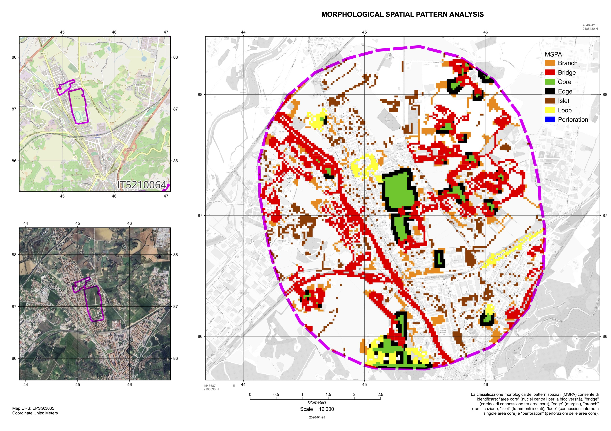
```

```{r mappaPacePlotBuf1k, fig.cap='Distribuzione delle classi MSPA nel territorio ricompreso nel buffer di 1 km dall’area di indagine.', out.width='\\linewidth', fig.align='center', echo=FALSE}
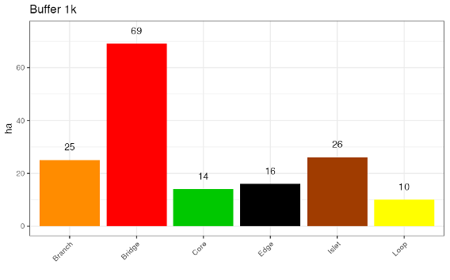
```

Allargando il campo di valutazione e confrontando le analisi MSPA con buffer diversi (1 km vs 2 km), è possibile far emergere interessanti dinamiche sulla struttura ecologica del territorio alle due diverse scale spaziali \@ref(fig:mappaPaceBuf2k).

I principali cambiamenti tra il contesto immediato, rappresentato dal buffer 1k, e quello di scala locale proprio del buffer 2k (\@ref(fig:mappaPacePlotBuf2k)) sono:

- Aree Core (da 14 a 167 ha): estendendo l’area di indagine, molte aree classificate come aree core si aggiungono all’area di Piazza d’Armi. Questo indica che il territorio presenta un buon potenziale di habitat, soprattutto se si tiene conto che nella porzione meridionale è presente il sito Natura 2000 IT5210064 – Monteluco di Spoleto insieme alle aree pedemontane della dorsale appennica, mentre a nord si trova il sistema ecologico della Greenway. Da notare anche la vicinanza dell’area umida dei Pozzaccheri di Madonna di Lugo nell’area orientale che costituisce un’importante stepping stone per la biodiversità locale.
- Bridge (da 69 a 139 ha): le porzioni di territorio capaci di svolgere questa importante funzione ecologica nel passaggio di scala di buffer raddoppiano. Infatti, i corridoi ecologici si rafforzano, sebbene il nucleo centrale, rappresentato dal corridoio del torrente Tessino e dagli ecosistemi di colle San Tommaso, rimanga invariato. È da sottolineare che il corridoio ecologico tra il sistema di colle San Tommaso e l’area di Piazza d’Armi si presenta particolarmente stretto, rendendo indispensabile la salvaguardia del varco esistente per garantire la continuità della rete ecologica.
- Edge (da 16 a 93 ha): aumentando le aree core aumentano di conseguenza anche le zone di transizione attorno alle aree più estese.
- Islet (da 26 a 80 ha): anche i frammenti isolati aumentano, ma proporzionalmente in misura inferiore rispetto ad altre classi (passano infatti dal 16 al 14%), mantenendo un livello di frammentazione contenuto.
- Perforation (da 0 a 11 ha): a questa scala compaiono alcune “perforazioni” non particolarmente critiche nelle aree core in corrispondenza dell’area pedemontana appenninica.
- Branch e Loop: mantengono valori di superficie sostanzialmente immutati, rispettivamente 10 e 7%.

```{r mappaPaceBuf2k, fig.cap='Mappa del territorio ricompreso nel buffer di 2 km dall’area di indagine. A destra la riclassificazione del territorio secondo il metodo MSPA.', out.width='\\linewidth', fig.align='center', echo=FALSE}
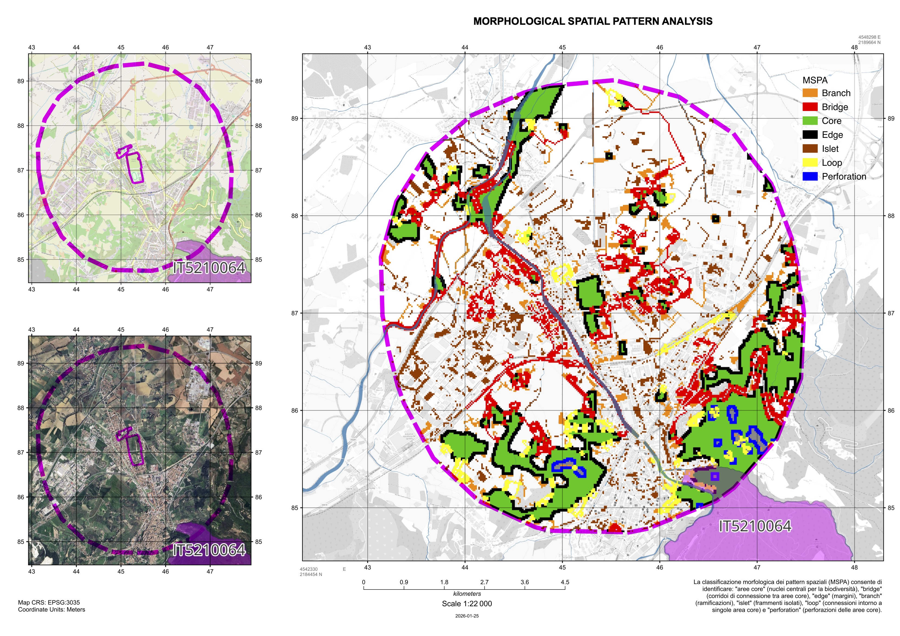
```

```{r mappaPacePlotBuf2k, fig.cap='Distribuzione delle classi MSPA nel territorio ricompreso nel buffer di 2 km dall’area di indagine.', out.width='\\linewidth', fig.align='center', echo=FALSE}
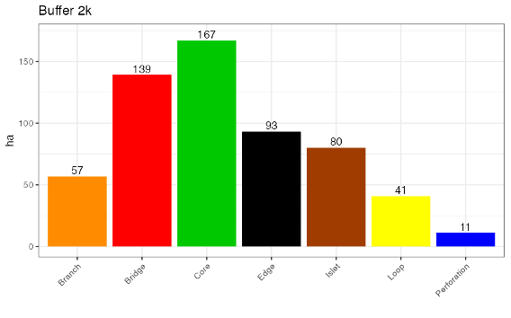
```

### Considerazioni conclusive

Dall’analisi dei pattern spaziali emerge il valore ecologico di Piazza d’Armi nella realizzazione di un sistema verde multifunzionale ad uso pubblico, capace di integrare la conservazione della biodiversità e la fruizione sociale con il contrasto al degrado del suolo e l'adattamento climatico.
L’area, per la sua configurazione e posizione strategica, si caratterizza come elemento chiave nel contesto della rete ecologica locale e in quella regionale attraverso la connessione dell’area Natura 2000 IT5210064 – Monteluco di Spoleto con la Greenway – Valle Spoletana.
Inoltre, il miglioramento delle sue potenzialità ecologiche potrebbe fornire un notevole contributo alla rigenerazione ambientale e alla riduzione della frammentazione a scala di paesaggio urbano e periurbano.
Di tutto ciò potrebbero beneficiare sia gli ecosistemi e la biodiversità locale sia la comunità spoletina che, in una visione olistica One Health fondata sul riconoscimento dell'interconnessione indissolubile tra salute umana, animale ed ecosistemica, sottolinea come il ripristino ecologico delle aree urbane rappresenti un investimento strategico per il benessere collettivo.

In questa prospettiva, la figura \@ref(fig:parcoPace) illustra un'ipotesi semplificata di assetto e riorganizzazione dell'area quale parco urbano multifunzionale (futuro Parco della Pace) con percorsi pedonali, aree alberate e siepi, concepite per coniugare l'erogazione dei servizi ecosistemici con spazi dedicati al tempo libero, alla socializzazione e all'educazione ambientale.
Questa configurazione consente di massimizzare la permeabilità della matrice urbana e di rafforzare la funzione di cerniera ecologica dell'area tra il centro urbano e la zona periurbana.
Al contempo, l'area assume una funzione chiave come rifugio climatico, contribuendo all'adattamento microclimatico e alla mitigazione dello stress termico urbano.

```{r parcoPace, fig.cap="A titolo esemplificativo, la Figura 5.5 illustra un'ipotesi di riorganizzazione spaziale dell'area come parco urbano (futuro Parco della Pace) generata da un modello di AI.", out.width='\\linewidth', fig.align='center', echo=FALSE}
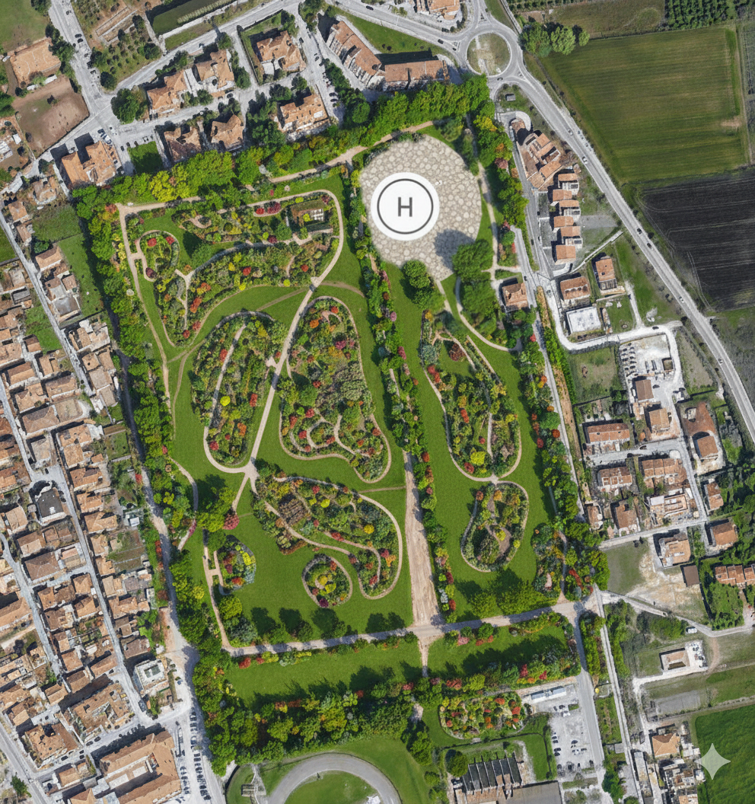
```

## Prati urbani

I prati urbani (nella letteratura scientifica *urban lawns*) rappresentano una delle componenti più diffuse delle infrastrutture verdi urbane a livello globale, arrivando a coprire fino al 70% delle aree verdi cittadine all'interno di parchi pubblici, giardini privati, campus, aree sportive e margini stradali [@dushkova2025; @ignatieva2018].
Storicamente sono stati concepiti per scopi estetici, ricreativi e culturali, ma allo stesso tempo i prati urbani forniscono importanti servizi ecosistemici, tra cui il mitigamento dell'isola di calore, il sequestro del carbonio, la filtrazione dell'acqua, la creazione di spazi di habitat per la biodiversità e di aggregazione per i cittadini [@strohbach2012; @dushkova2020].
Tuttavia, la loro gestione convenzionale, caratterizzata da sfalci intensivi, irrigazione e, talvolta, dall'impiego di fertilizzanti e fitofarmaci, comporta elevati costi economici e significativi impatti ambientali.
Di fronte a queste evidenze, emerge quindi la necessità di ripensare la gestione di questi spazi attraverso le Nature-based Solutions e gli approcci di rewilding urbano.
In questa prospettiva, la transizione verso forme di gestione ecologica si configura come una soluzione strategica per ripristinare le funzioni ecosistemiche, incrementare la biodiversità e rafforzare la resilienza delle comunità urbane [@nesshöver2017; @föllmi2023].
Ovviamente quando si tratta di ripensare alla loro gestione, non si tratta di abbandonare la manutenzione, ma di ricondurla a pratiche differenziate, in cui frequenza, altezza, periodo e porzione di superficie sfalciata sono variabili da calibrare in funzione dell’uso e del ruolo ecologico di ciascuna area [@dushkova2025; @kirby2025].
L’idea di fondo è che una parte degli spazi verdi, soprattutto quelli in cui l’uso ricreativo è marginale, possa svolgere funzioni di habitat con costi gestionali inferiori, senza dover sostituire il prato con l’impianto di nuove specie.

I benefici ecologici della riduzione degli sfalci sono ampiamente documentati.

Nei prati urbani passati da sfalci ogni poche settimane a uno o due tagli per stagione, entro sei anni la ricchezza floristica è risultata superiore del 30% rispetto ai prati gestiti in modo intensivo, con una composizione che si sposta da specie comuni e tolleranti lo sfalcio verso specie tipiche dei prati [@sehrt2020].
@chollet2018 riportano un aumento della diversità tassonomica, funzionale e filogenetica delle piante.
Gli effetti riguardano anche gli insetti e altri artropodi: una meta-analisi su contesti urbani temperati indica che la riduzione dello sfalcio ha un effetto positivo medio sull’abbondanza (g = 0,54) e ampio sulla ricchezza di taxa (g = 1,25), mentre i prati curati favoriscono in modo sproporzionato le specie opportuniste e più antropofile [@proske2022].
In un progetto sui prati per le farfalle (oltre 640 prati sfalciati solo in parte e al massimo tre volte l’anno), nove prati hanno mostrato biomassa e numero di specie di insetti più alti di nove prati intensivamente sfalciati, con la presenza di larve a indicare riproduzione in loco [@wintergerst2021].

La relazione tra sfalcio, biodiversità e risorse per gli impollinatori non è però lineare.
In un esperimento su sedici giardini del Massachusetts lo sfalcio ogni tre settimane ha prodotto fino a 2,5 volte più fiori rispetto alle altre frequenze, ma l’abbondanza massima di api selvatiche si è registrata con sfalci ogni due settimane, con ricchezza ed equitabilità più basse [@lerman2018].
L’obiettivo, quindi, non è «non sfalciare», ma calibrare questa tipologie d’intervento.

Naturalmente, la riduzione degli interventi ha anche una ricaduta economica.
In un caso studio canadese il passaggio da 15 a 10 sfalci annui nelle aree molto frequentate, e da tre a uno in quelle poco frequentate, è stato stimato in un risparmio del 36% dei costi di manutenzione, considerando i soli costi contrattuali.
Lo stesso lavoro riporta che la gestione intensiva favorisce infestanti e parassiti dei prati, e che un’infestante allergenica come l’ambrosia (*Ambrosia artemisiifolia*) può essere contenuta riducendo la frequenza di sfalcio [@watson2020].

La riuscita di queste strategie dipende in larga misura dall'accettazione da parte dei cittadini.
Per evitare che un prato a sfalcio ridotto venga percepito come un'area abbandonata o degradata, è fondamentale applicare i «segnali di cura» (*cues to care*, introdotti da Nassauer nel 1995), ovvero elementi di disegno e manutenzione perimetrale (come fasce sfalciate lungo i bordi) che rendano esplicita l'intenzionalità gestionale.
Le evidenze di gradimento sono incoraggianti: in un parco inglese le strisce non sfalciate hanno avuto circa tre volte più fiori e cinque volte più insetti visitatori di fiori rispetto alle strisce sfalciate regolarmente, e il 97% dei visitatori intervistati si è detto favorevole a favorire insetti e fiori spontanei [@garbuzov2015].
Riscontri analoghi emergono dai lavori di @norton2019, che evidenziano una maggiore soddisfazione dei residenti in presenza di coperture vegetali diversificate.

In sostanza, l'approccio per sua natura deve essere adattivo e spazialmente disaggregato.
Aree sportive, percorsi e zone ad alta visibilità richiedono sfalci frequenti per garantire sicurezza e fruibilità, mentre i prati a sfalcio ridotto trovano collocazione ideale laddove la funzione ecologica può prevalere.
L'organizzazione in un mosaico multifunzionale massimizza i benefici complessivi per la biodiversità [@norton2019].
Nel quadro normativo europeo, l’art.
8 del Regolamento (UE) 2024/1991 sulla ripristino della natura (Nature Restoration Law) impone che la superficie a verde e la copertura arborea urbana non diminuiscano rispetto ai livelli del 2024 entro il 2030, per poi registrare una crescita progressiva (ISPRA).
Poiché i vincoli quantitativi devono essere supportati da una reale qualità ecologica, la gestione mirata dello sfalcio diventa uno strumento strategico fondamentale.

### Prato a sfalcio ridotto presso la Spoletosfera

Nel caso di Spoleto è stata avviata una sperimentazione presso l'area della Spoletosfera (Fig. \@ref(fig:spoletoSferaSign)), in cui viene proposta una gestione sostenibile del patrimonio naturale cittadino con l'idea di arricchire gli habitat, incrementare gli impollinatori e tutelare la biodiversità, in particolare della piccola fauna.
Nello stesso tempo con un riequilibrio delle diverse componenti ecologiche ci si attende una riduzione degli effetti di omogenizzazione della flora, il contenimento degli insetti antropofili, una mitigazione dell'isola di calore, grazie al miglioramento della ritenzione idrica dei suoli.
<!-- da [Dushkova. 2025. *Rethinking urban lawns: rewilding and other nature-based alternatives*](zotero://select/items/1_TCIGG633) -->

```{r spoletoSferaSign, fig.cap="Logo progettato per la segnaletica 'di cura' presso l'area della Spoletosfera.", out.width='\\linewidth', fig.align='center', echo=FALSE}
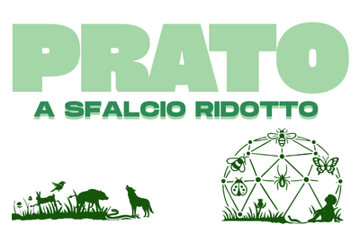
```

Per la caratterizzazione della comunità entomologica presente nell'area a sfalcio ridotto, nel periodo primaverile è stata condotta una campagna di campionamento mirata a rilevare la ricchezza e la composizione dei taxa di insetti associati alla matrice erbacea.
Il disegno di campionamento ha previsto l'individuazione di 6 transetti rappresentativi dell'area di studio (Fig. \@ref(fig:spoletoSferaTransetti)).
Per ciascun transetto la raccolta del materiale entomologico è stata eseguita mediante l'impiego di un retino da sfalcio (sweep net), adottando una metodologia di tipo semiquantitativo basata sullo sforzo temporale (standardizzato in circa 5 minuti di sfalcio attivo per transetto).
Tutti i campioni raccolti sul campo sono stati immediatamente stoccati, catalogati e trasferiti in laboratorio per le fasi successive di lavorazione consistenti in: i) sorting ed estrazione: separazione del materiale biologico dai detriti vegetali e smistamento degli esemplari in base ai principali gruppi morfo-funzionali; ii) fissazione e conservazione dei reperti in soluzione alcolica (alcool etilico al 70%), predisponendo il materiale per le successive analisi e determinazioni tassonomiche di dettaglio per un riconoscimento tassonomico a livello di famiglia, genere o specie.

```{r spoletoSferaTransetti, fig.cap="Transetti del monitoraggio entomologico presso l'area della Spoletosfera.", out.width='\\linewidth', fig.align='center', echo=FALSE}
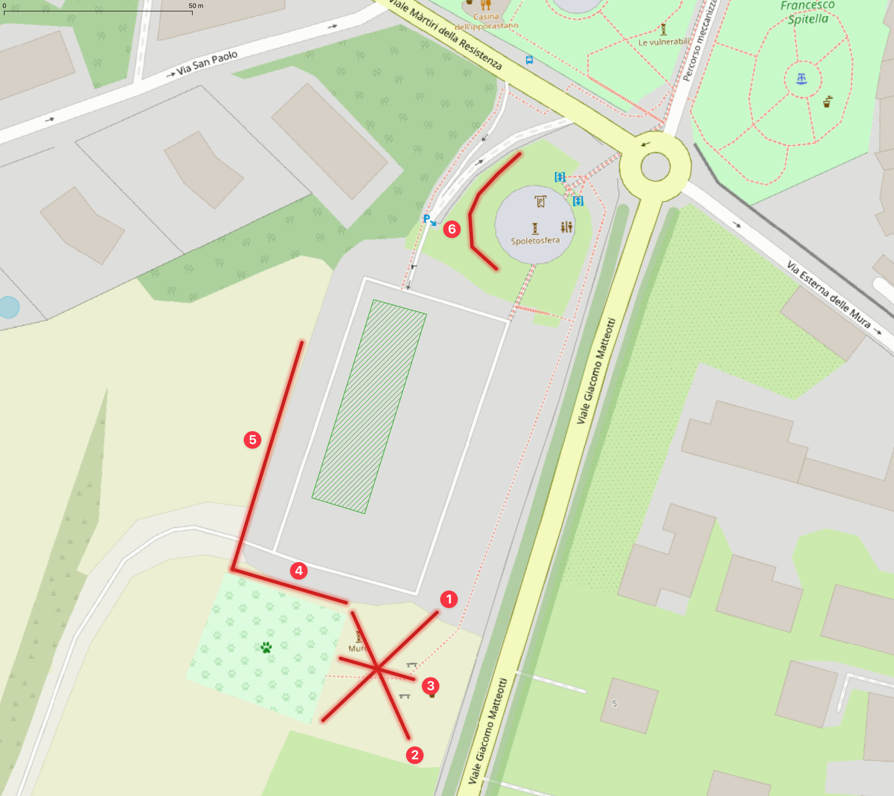
```

### Risultati preliminari

L'efficacia del prato a sfalcio ridotto nella promozione della biodiversità è resa evidente dal confronto visivo tra la composizione dei campioni raccolti nei due differenti regimi gestionali (Fig. \@ref(fig:sfalcioContinuativo) - 1 e 2) e in un prato naturale (Fig. \@ref(fig:sfalcioContinuativo) - 3).
Mentre nel prato soggetto a sfalcio continuativo ed intensivo la comunità di insetti risulta fortemente impoverita e dominata da poche specie opportuniste e tolleranti il disturbo frequente, l'area a sfalcio ridotto mostra una sensibile diversificazione dei gruppi tassonomici.
In quest'ultimo contesto si osserva non solo un incremento generale dell'abbondanza di individui, ma soprattutto una spiccata ricchezza di taxa guida, tra cui impollinatori (Imenotteri e Lepidotteri), Ortotteri, Eterotteri e Coleotteri predatori, a conferma del ruolo di refugium ecologico svolto dalle superfici a gestione differenziata.

```{r sfalcioContinuativo, fig.cap="In 1 e 2 i campioni raccolti durante il monitoraggio entomologico presso l'area della Spoletosfera. In 3 il risultato dello stesso sforzo di campionamento in un prato naturale periurbano.", out.width='\\linewidth', fig.align='center', echo=FALSE}
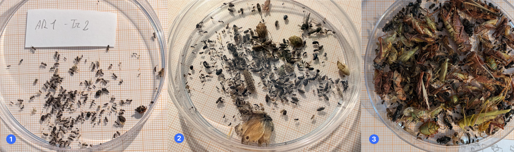
```

Sebbene la determinazione tassonomica di dettaglio sia tuttora in corso d'opera e richieda le tempistiche necessarie alla corretta identificazione dei singoli esemplari, le differenze tra i contesti appaiono già estremamente evidenti.
I dati preliminari evidenziano uno scarto netto non solo in termini di ricchezza specifica, ma anche di abbondanza numerica e biomassa totale a favore delle superfici a sfalcio ridotto.
Parallelamente al monitoraggio entomologico, un gruppo di lavoro botanico sta completando l'elaborazione dei dati floristici rilevati nel medesimo periodo di campionamento (Fig. \@ref(fig:sfalcioStudenti)).
L'integrazione di tali banche dati permetterà di analizzare in modo combinato le relazioni tra la componente floristica e quella faunistica associata.
In un'ottica di pianificazione a scala urbana, sarebbe di rilevante interesse estendere la rete di monitoraggio ad altre aree della città, al fine di effettuare confronti spaziali e temporali più ampi e verificare la risposta della biodiversità in contesti urbani caratterizzati da differenti gradi di frammentazione e pressione antropica.
Presso la Spoletosfera le attività di monitoraggio proseguiranno nei prossimi mesi per coprire l'intero ciclo stagionale e i risultati delle analisi integrate verranno disseminati non appena disponibili.

```{r sfalcioStudenti, fig.cap="Il gruppo botanico al lavoro presso l'area della Spoletosfera.", out.width='\\linewidth', fig.align='center', echo=FALSE}
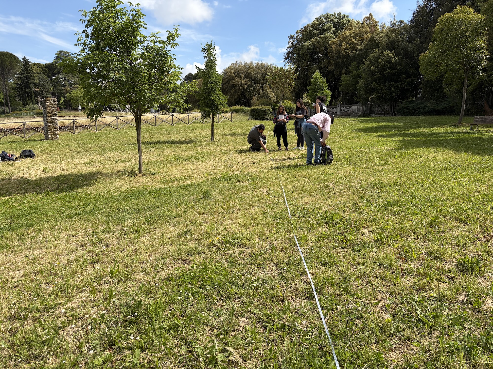
```

### Villa Redenta

Un’esperienza di monitoraggio analoga a quella della Spoletosfera è stata condotta anche nel giardino di Villa Redenta nel mese di agosto 2026. L’attività era finalizzata alla redazione di una checklist preliminare delle specie più facilmente contattabili e visibili a tutti i frequentatori dell’area.
A partire da questo elenco sono stati realizzati due pannelli didattico-informativi di esempio, dedicati rispettivamente alle farfalle diurne e ai ditteri e imenotteri presenti nel giardino.
I pannelli hanno la finalità di far conoscere ai visitatori la biodiversità del luogo e il ruolo ecologico di questi insetti, ma anche di sottolineare l’importanza di creare spazi con un’offerta di habitat per queste specie: un prato sfalciato di frequente offre infatti risorse limitate, mentre un’offerta più ricca di fioriture e rifugi porterebbe un beneficio condiviso, per la biodiversità e per chi frequenta il giardino.

```{r schedaInv1, fig.cap="Esempio di pannello informativo per i lepidotteri.", out.width='\\linewidth', fig.align='center', echo=FALSE}
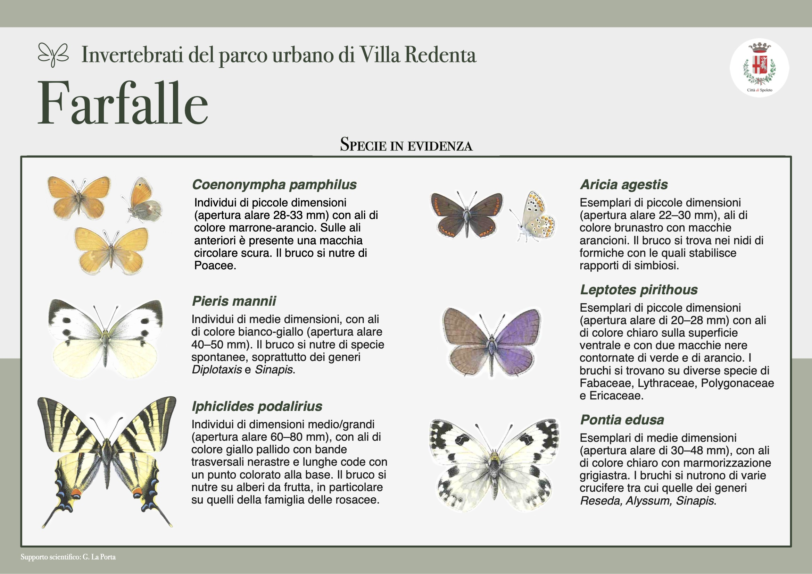
```

```{r schedaInv2, fig.cap="Esempio di pannello informativo per ditteri e imenotteri", out.width='\\linewidth', fig.align='center', echo=FALSE}
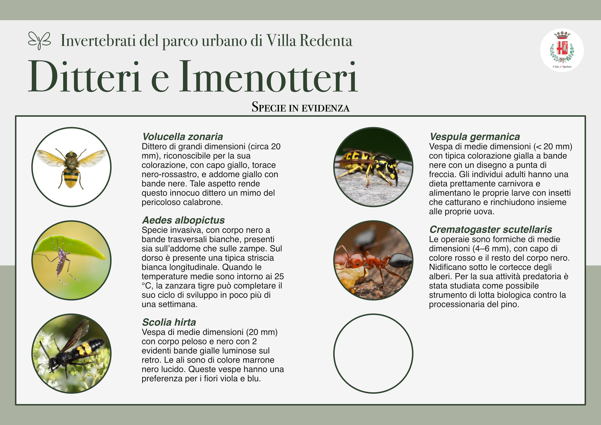
```

## Linee guida per il comparto terrestre

Le linee guida che seguono hanno carattere indicativo e intendono supportare il progetto sulla biodiversità urbana di Spoleto.
Naturalmente non intendono sostituirsi o interferire con il vigente Piano Comunale del Verde, che richiede competenze specifiche di pianificazione e progettazione del paesaggio.
Il verde pubblico (aree naturali, parchi, giardini, prati, alberature stradali, siepi, aree idriche) è una componente fondamentale dell'infrastruttura urbana: contribuisce alla qualità paesaggistica, al benessere dei cittadini, al mantenimento della biodiversità e alla regolazione dei processi ecologici.
La sua gestione va quindi integrata nella pianificazione urbanistica locale e non limitata alla manutenzione delle singole aree, concependola come un sistema urbano e periurbano in cui funzioni ecologiche, sociali e paesaggistiche siano considerate insieme.
Ciò implica una governance multilivello, che coinvolga competenze tecniche, scientifiche e politiche e la popolazione, favorendo il dialogo tra attori istituzionali, tecnici e sociali.

Le indicazioni che vengono qui proposte richiamano gli obiettivi della Urban Nature Plan Guidance della Commissione Europea [@urbanna2024], della Strategia europea per la biodiversità al 2030, della Strategia nazionale del verde urbano (2018) e della Legge 10/2013, e sono orientate a tre finalità: i) tutelare la biodiversità e i servizi ecosistemici; ii) contrastare il cambiamento climatico e le isole di calore; iii) aumentare il benessere e la qualità della vita della collettività.
Rispondono inoltre a parte dei risultati che sono emersi in conseguenza delle analisi svolte.
Ad esempio, nell'unità funzionale Urbana il verde è in prevalenza privato, organizzato in patch di piccole dimensioni e poco integrate tra loro, la soglia del 30% di copertura è lontana in tutte le frazioni e la componente dei 300 m è la meno soddisfatta nelle località a minore densità.
Dal walkshop alla Greenway sono emerse come priorità maggiore ombra, più alberi, servizi di sosta e più informazione.

Le linee guida si articolano in sei ambiti: conoscere il patrimonio verde (censimento e indicatori), connetterlo, diversificarne la copertura arborea, migliorare la qualità ecologica dei prati, gestire le acque meteoriche e coinvolgere la popolazione.

#### Censimento e indicatori

Una conoscenza completa, aggiornata e georeferenziata del patrimonio verde è indispensabile per pianificare, monitorare e riqualificare, e per stimare gli investimenti necessari al mantenimento e al rafforzamento del verde urbano e periurbano.
La cartografia utilizzata in questo studio descrive il verde per poligoni e il patrimonio arboreo è stato censito solo parzialmente.
Per questo non è stato possibile verificare la componente 3 della regola 3-30-300, che richiede di sapere quanti alberi sono visibili da ogni abitazione.
Si indica pertanto come obiettivo programmatico la realizzazione, nel medio periodo, di un censimento del patrimonio verde comunale che comprenda alberi, parchi, giardini, prati, siepi, aree naturali e gli altri elementi vegetazionali del tessuto urbano e periurbano.
Il censimento, costruito con criteri omogenei e aggiornabili nel tempo, consentirebbe al Comune di disporre di un sistema informativo più efficiente a supporto della pianificazione, della gestione ordinaria e della valutazione degli interventi.
Per ciascun albero il censimento dovrebbe prevedere almeno le seguenti informazioni:

- Identificazione: codice univoco e posizione GPS, in un sistema GIS.
- Tassonomia: nome scientifico, nome comune e varietà.
- Dati biometrici: altezza e diametro della chioma, diametro e altezza del tronco.
- Condizioni: stato fitosanitario, fase di sviluppo ed eventuali necessità di intervento.
- Contesto e gestione: ubicazione, data del rilievo, fotografie e storico degli interventi.

Per le aree verdi si propone un censimento per poligoni o per linee (Tab. \@ref(tab:censimentoVerde)).

| Elemento | Geometria | Dati biometrici | Tassonomia | Indicatori di stato | Gestione |
|:-----------|:-----------|:-----------|:-----------|:-----------|:-----------|
| Prati | Poligoni | Superficie (m²) | Specie seminate; classe (ornamentale, sportivo, fiorito) | Grado di copertura (%); presenza di invasive | Frequenza di sfalci e irrigazione |
| Siepi e filari | Linee o poligoni | Lunghezza, altezza e spessore (m) | Specie (mono- o plurispecifica) | Fase di sviluppo, compattezza, stato fitosanitario | Siepe formale o informale; frequenza di potatura |
| Aiuole e arbusti | Poligoni | Superficie (m²), altezza e densità | Specie e periodo di fioritura | Fase di sviluppo, vigore vegetativo, stato di conservazione | Fabbisogno idrico; frequenza di potatura |
| Aree naturali | Poligoni | Superficie (ha), densità della copertura forestale | Specie dominanti, tipo di habitat | Condizioni di biodiversità, presenza di legno morto | Livello di fruizione; interventi selvicolturali |

: (#tab:censimentoVerde) Informazioni proposte per il censimento delle aree verdi.

I dati potrebbero confluire in un Sistema Informativo del Verde (SIV), una piattaforma per raccogliere, aggiornare e consultare le informazioni, dotata di una mappa web aperta ai cittadini che riporti anche le aree di "rifugio climatico".
Un riferimento possibile sono gli open data ambientali del Comune di Bologna ([OpenData](https://opendata.comune.bologna.it)).
L'integrazione dei dati floristici e faunistici con le informazioni territoriali consentirebbe inoltre di riconoscere gli habitat presenti e le relazioni tra gli spazi verdi urbani e gli ambienti naturali circostanti, come avvenuto in altre esperienze (esempio di Lignano Sabbiadoro).

Il censimento va accompagnato da un monitoraggio periodico basato su indicatori, che permettano di valutare lo stato e la consistenza del patrimonio verde e di verificare gli esiti degli interventi.
Si propone una selezione ispirata allo European Urban Biodiversity Index (EUBI), agli indicatori ISPRA e alla regola 3-30-300:

- Consistenza del verde: percentuale di verde pubblico sulla superficie comunale, con valore di partenza ricavabile dalla Tab. \@ref(tab:verdeBase).
- Alberi monumentali: numero di alberi monumentali censiti o tutelati ai sensi dell'art. 7 della Legge 10/2013.
- Copertura arborea: rapporto percentuale tra la superficie di proiezione a terra delle chiome (stimata o rilevata) e la superficie totale degli spazi verdi gestiti, utile anche per la componente 30 della regola. Poiché la percentuale di verde e blu qui utilizzata sovrastima la copertura arborea, il monitoraggio dovrebbe usare una misura diretta.
- Accessibilità alle aree verdi (città inclusive e dei 15 minuti): quota di popolazione entro 300 m da uno spazio verde adeguato, come nella verifica preliminare già svolta.
- Superficie permeabile: percentuale di aree urbane permeabili.
- Dotazione ludica: rapporto tra il numero di abitanti di 0-14 anni e il numero di aree ludiche, calcolato al 31 dicembre di ogni anno.
- Ricchezza floristica e presenza di elementi vegetazionali di interesse ecologico (EUBI).
- Costi di gestione: da valutare caso per caso e integrandoli in un'analisi costi-benefici.

#### Connettività e viali alberati

La pianificazione del verde pubblico dovrebbe mirare anche a mantenere la continuità ecologica tra gli spazi verdi urbani e gli habitat naturali e seminaturali.
Gli strumenti sono viali alberati, zone ombreggiate e percorsi ciclopedonali che colleghino le aree *Core* individuate negli studi precedenti, e la tutela degli elementi che già svolgono una funzione di connessione, evitando che nuove infrastrutture o trasformazioni urbanistiche ne compromettano la continuità.
Siepi, fasce erbacee, filari e aiuole possono funzionare come *stepping stones* nel tessuto urbano, favorendo lo spostamento delle specie.
L'analisi MSPA ha evidenziato alcune aree essenziali per la connettività del territorio spoletino:

- Torrente Tessino e Colle San Tommaso: costituiscono gli elementi di connessione con l'area *Core* di Piazza d'Armi. Il collegamento presenta una configurazione spaziale stretta, per cui è importante tutelare i varchi esistenti e rafforzare i punti di connessione più deboli.
- Piazza d'Armi: individuata come area *Core* e come elemento di raccordo tra il sistema di Monteluco (sito Natura 2000 IT5210064) e la Greenway della Valle Spoletana. La sua riqualificazione dovrebbe prevedere la diversificazione degli habitat, siepi e aiuole che aumentino la mobilità delle specie e zone a sfalcio ridotto, mantenendo spazi per la socializzazione, lo sport e il tempo libero, come nell'ipotesi del Parco della Pace.
- Elementi *Branch* e zone umide: i tratti che si interrompono a fondo cieco sono candidati prioritari a interventi di completamento, che potrebbero accrescere la connettività con costi contenuti. La zona umida dei Pozzaccheri è invece una *stepping stone* da salvaguardare.

#### Copertura arborea: diversificazione e specie autoctone

Un verde urbano resiliente richiede la diversificazione della vegetazione e degli habitat.
Nella scelta delle specie vanno considerati le condizioni pedoclimatiche, la resistenza a parassiti e fitopatie, la disponibilità idrica, la funzione dell'area (evitando caratteri indesiderati come frutti velenosi, spine o apparati radicali superficiali) e gli scenari climatici futuri.
È opportuno evitare gli impianti monospecifici e favorire una copertura equilibrata di specie arboree, arbustive ed erbacee perenni, con fioriture distribuite nell'arco dell'anno, per offrire risorse trofiche, rifugi e siti di riproduzione a impollinatori e fauna urbana.
Una copertura arborea estesa protegge anche l'avifauna, e le potature vanno evitate durante la nidificazione e la crescita dei pulcini.

Naturalmente, sono da preferire le specie autoctone, più adatte al contesto e con minor rischio di diffusione di specie aliene, considerando comunque le esigenze di fruizione, sicurezza e manutenzione degli spazi pubblici.
Il contrasto alle specie invasive, in particolare all'ailanto, è stato indicato anche da diversi partecipanti al walkshop dell'ottobre 2026. Esperienze ispirate al metodo Miyawaki possono suggerire interventi pilota in alcune aree verdi comunali.
Questo metodo prevede l'impiego di specie autoctone scelte sulla base delle comunità vegetali di riferimento (approccio fitosociologico), una lavorazione profonda del suolo e la partecipazione attiva dei cittadini nelle fasi di progetto e di impianto [@miyawaki1998].
Tali interventi andrebbero accompagnati da un monitoraggio di vegetazione e fauna, per confrontare regimi di manutenzione diversi e orientare applicazioni in altri spazi pubblici.

#### Qualità ecologica dei prati: sfalcio differenziato e oasi di fioritura

I prati urbani sono tra le componenti più diffuse del verde cittadino ma, se gestiti in modo intensivo, offrono poche risorse alla biodiversità.
Come illustrato nella sezione sui prati urbani (\@ref(sec-prati)), una gestione differenziata della vegetazione erbacea, che calibri frequenza, intensità, altezza e periodo degli sfalci in funzione dell'uso, porta benefici a flora e insetti [@sehrt2020; @proske2022], con effetti non lineari rispetto alla frequenza di sfalcio [@lerman2018] e un possibile risparmio sui costi di manutenzione [@watson2020].
Ogni area può quindi avere una gestione diversa secondo la destinazione d'uso.
Gli sfalci frequenti restano adatti ad aree di gioco, sport e fruizione intensiva.
Sfalci ridotti, con fasce e oasi di fioritura spontanea, sono indicati dove prevale la funzione ecologica, evitando di sfalciare tutta la superficie nello stesso momento.
Le aree a sfalcio ridotto possono inoltre ospitare specie erbacee spontanee e aromatiche a fioritura scalare, concepite come aree rifugio per gli impollinatori, da accompagnare con un monitoraggio che ne verifichi l'efficacia.

Perché queste aree siano accettate dai cittadini servono "segnali di cura", come bordi sfalciati e cartelli informativi [@nassauer1995; @garbuzov2015].
A Spoleto è in corso una sperimentazione presso la Spoletosfera, con monitoraggio di insetti e flora.
I primi risultati, ancora preliminari, indicano una comunità più ricca rispetto al prato gestito in modo intensivo.
Si suggerisce di estendere il monitoraggio ad altre aree della città, così da confrontare contesti con diversi gradi di frammentazione e pressione antropica.

#### Acque meteoriche e superfici permeabili

Le superfici impermeabili aumentano il ruscellamento e le isole di calore.
Negli ultimi anni, per effetto del cambiamento climatico e della forte urbanizzazione, piogge intense e concentrate hanno inoltre causato danni ambientali ed economici rilevanti alla popolazione urbana.
Si suggerisce di favorire l'infiltrazione e la ritenzione delle acque piovane, limitando compattamento e impermeabilizzazione del suolo, con tecniche come:

- Pavimentazioni permeabili o drenanti, per esempio grigliati inerbiti o ghiaie stabilizzate, in parcheggi, piazze e percorsi non carrabili.
- Piccoli bacini di ritenzione e infiltrazione (*rain garden*) in prossimità di ampie superfici impermeabili, come strade, parcheggi e piazzali. Sono aree verdi leggermente ribassate che raccolgono le acque meteoriche, le filtrano e le infiltrano lentamente nel terreno, riducendo il deflusso verso le condotte fognarie.
- Aiuole e fossati vegetati che raccolgono e filtrano l'acqua delle strade, e che possono diventare habitat per anfibi e insetti e collegarsi alle fasce ripariali e alle aree umide.

L'efficacia degli interventi può essere valutata con l'indicatore della percentuale di superficie permeabile.

#### Paesaggio storico, sicurezza, accessibilità e fruizione

Le richieste espresse nel walkshop (panchine, fontanelle, aree di sosta e picnic, cestini per i rifiuti, spazi per i bambini e per l'attività fisica, ombra lungo i percorsi) indicano che accessibilità e comfort sono condizioni per la frequentazione degli spazi verdi e vanno considerati insieme agli obiettivi ecologici.
Gli arredi e la segnaletica dovrebbero essere inseriti con attenzione al contesto storico e paesaggistico e garantire sicurezza e fruibilità a tutte le fasce di popolazione.

#### Coinvolgimento della popolazione e sensibilizzazione

Si propone di predisporre una strategia di comunicazione per sensibilizzare i cittadini sui benefici della natura e della biodiversità, in continuità con l'approccio dialogico del walkshop.
Le azioni suggerite sono:

1.  costruire una mappa degli stakeholder (amministratori, uffici comunali, scuole, associazioni, agricoltori, proprietari, cittadini) secondo rilevanza e interesse, per definire obiettivi, azioni e strumenti della strategia;
2.  coinvolgere i cittadini nella raccolta di dati (citizen science, segnalazioni georeferenziate con fotografie), anche tramite la mappa web del SIV;
3.  spiegare le scelte di gestione con segnaletica e momenti informativi, come i cartelli "di cura" della Spoletosfera;
4.  coinvolgere le scuole in attività educative e di monitoraggio;
5.  prevedere interviste o consultazioni per comprendere come la popolazione percepisce gli interventi, soprattutto se l'accesso ad alcune aree viene limitato.

## Marxan

## Approccio all'analisi del territorio con Marxan

Tra gli strumenti utili per sviluppare una rete ecologica resiliente rientra Marxan, un software di supporto decisionale alla pianificazione spaziale per la conservazione della natura.
La progettazione di una rete ecologica deve infatti soddisfare esigenze di natura ambientale, conservazionistica, economica e sociale.
Attraverso algoritmi di ottimizzazione, Marxan individua la configurazione spaziale che consente di raggiungere gli obiettivi di conservazione al minor costo possibile [@ball2009].
Nei paragrafi seguenti ne vengono illustrati il funzionamento e l'applicabilità al territorio di Spoleto, in particolare attraverso:

- la descrizione dei principi e delle funzionalità dello strumento;
- un esempio applicativo riferito al territorio di Spoleto;
- l'individuazione dei dati, delle risorse e delle competenze tecniche necessarie per un'applicazione approfondita;
- l'analisi dei limiti dello strumento, per chiarire la portata dei risultati ottenibili e le condizioni per un loro corretto utilizzo.

L'elaborazione si fonda su tre criteri: il raggiungimento dei target di conservazione, la minimizzazione dei costi e la costruzione di reti compatte.
Marxan consente così di identificare le unità territoriali essenziali per soddisfare specifici obiettivi di conservazione, riducendo costi e frammentazione [@ball2009].
Il risultato non va inteso come una soluzione definitiva, ma come un supporto al processo decisionale dei pianificatori, ai quali spetta perfezionarlo e interpretarlo alla luce dei fattori politici, socioeconomici e delle condizioni amministrative e operative del territorio.
Per favorire la negoziazione tra le parti interessate vengono inoltre elaborate numerose soluzioni alternative, che offrono diverse configurazioni territoriali possibili [@ardron2010; @serra-sogas2020].
Trattandosi di un processo rigoroso e ripetibile, l'analisi favorisce la trasparenza delle scelte e riduce il rischio di decisioni basate su valutazioni soggettive.

Il funzionamento di Marxan prevede le seguenti fasi [@serra-sogas2020].
Come primo passo si individuano gli elementi di interesse conservazionistico, quali specie, habitat o siti culturali, a ciascuno dei quali viene assegnato un obiettivo di conservazione (*target*), ossia la quantità minima che deve essere inclusa nella pianificazione finale (ad esempio il 30% di ogni habitat).
Il territorio viene poi suddiviso mediante una griglia di unità quadrate, esagonali o a poligoni irregolari, denominate unità di pianificazione (UP), le cui dimensioni dipendono dalla scala del progetto, dall'obiettivo e dall'uso previsto dei risultati.
A ciascuna UP viene quindi attribuito un costo, economico o sociale, che esprime l'onere necessario per includerla nella rete.
Infine, gli algoritmi di Marxan elaborano la configurazione spaziale che permette di raggiungere tutti gli obiettivi al costo minimo \[ @cudlín2020; @daigle2020\], restituendo l'insieme delle UP che costituiscono la base della rete proposta.

### Logica dell'algoritmo

L'algoritmo ha l'obiettivo di minimizzare un punteggio costituito da tre componenti (Fig. \@ref(fig:marxanEquazione)) [@watts2009].
In forma semplificata:

$$\text{Punteggio} = \text{Costo delle UP selezionate} + BLM \times \text{Lunghezza del confine} + \text{Penalità per i target non raggiunti}$$

```{r marxanEquazione, fig.cap="Funzione obiettivo di Marxan.", out.width='\\linewidth', fig.align='center', echo=FALSE}
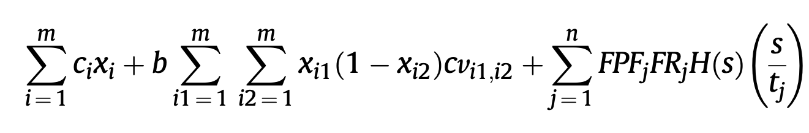
```

- Costi: possono essere fissi, con valore costante per ogni UP, oppure variabili, assegnati in funzione del costo opportunità, del costo di azione o di un indicatore sostitutivo [@ardron2010].
- BLM (Boundary Length Modifier): parametro scelto dall'utente che regola la compattezza della rete, penalizzando la lunghezza dei suoi confini esterni. Un BLM nullo o prossimo a zero accetta soluzioni frammentate, mentre valori più alti favoriscono soluzioni più compatte, anche se più costose. I confini estesi sono considerati problematici perché aumentano i costi di gestione e l'effetto margine e riducono la connettività [@wen2024].
- Penalità: costo attribuito a ciascun target che non viene raggiunto.

### File di input e output

Marxan lavora su tabelle di testo, sia in ingresso sia in uscita (Fig. \@ref(fig:marxanFile)).

```{r marxanFile, fig.cap="Struttura dei file di input e di output di Marxan.", out.width='\\linewidth', fig.align='center', echo=FALSE}
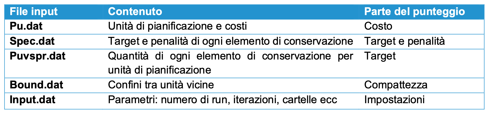
```

Una volta caricati gli input, il software esplora l'enorme numero di combinazioni possibili.
Il processo viene ripetuto più volte (si raccomandano almeno 100 ripetizioni, così da leggere la frequenza di selezione come percentuale) e restituisce numerosi output.
I più utili sono:

- la soluzione migliore;
- la frequenza di selezione di ciascuna UP, tanto più alta quanto maggiore è l'insostituibilità dell'unità;
- il riepilogo di ogni ripetizione, con costo, confine e target raggiunti.

Le soluzioni sono file di testo scritti come elenchi binari, in cui a ciascuna UP è assegnato 0 (esclusa) o 1 (inclusa).
Il software non produce mappe: l'integrazione con sistemi GIS e plugin dedicati (come ad es. QMarxan, CLUZ) consente tuttavia di preparare gli input e visualizzare gli output in modo intuitivo [@ardron2010; @ball2009; @serra-sogas2020].

### Potenziale uso di Marxan sul territorio comunale di Spoleto

Questa sezione propone un esempio di applicazione al territorio di Spoleto, utilizzando i dati ricavati dalla precedente relazione [@laporta2025].
Le scelte relative agli input sono ipotesi di lavoro e i risultati descritti non derivano da un'analisi effettivamente eseguita, ma costituiscono esempi indicativi degli output ottenibili.

#### Valutazione degli input disponibili

- Livello territoriale: il comune si estende per 349.2 km² e comprende 8 siti Natura 2000, che occupano il 9.8% della superficie totale.
- Dati faunistici: sono presenti 113 specie di interesse comunitario ai sensi della Direttiva Habitat, nell'ambito di un patrimonio faunistico di 533 taxa, ripartiti in egual misura tra vertebrati e invertebrati.
- Carta geobotanica: comprende 29 categorie, tra cui boschi (41.3% di caducifoglie e 4.5% di sclerofille), seminativi semplici (24.2%), oliveti (6.9%), praterie secondarie (6.6%) e aree urbanizzate (\<6%).
- MSPA: a scala comunale le aree *Core* costituiscono il 70.8% della superficie totale, con un indice di splitting pari a 6.88, indicativo di una buona connettività. Nella fascia collinare scendono al 38.8% e lo splitting sale a 157.79, a indicare un territorio meno coeso.
- Carte di idoneità e di permeabilità: non sono indispensabili per le analisi, ma possono essere usate in forma esplorativa per individuare la distribuzione delle specie forestali.

Il quadro evidenzia una criticità nella fascia collinare produttiva e urbana, dove una rete più compatta e coesa potrebbe essere progettata con il supporto di Marxan, che fornirebbe indicazioni spaziali più mirate.

#### Ipotesi di lavoro

- Unità di pianificazione: griglia con celle di 1 km², che suddivide il territorio in circa 350 UP. Per un intervento più mirato la dimensione potrebbe essere ridotta a 0.5 km².
- Elementi di conservazione: le categorie della carta geobotanica, integrate con gli habitat di interesse comunitario della rete Natura 2000 e con la distribuzione spaziale delle specie, assegnando a ogni UP un valore di biodiversità.
- Target: scenari al 20%, 30% e 40%, da graduare in base all'importanza del sito e agli impatti socioeconomici derivanti dalla sua inclusione nella rete.
- Unità bloccate: i siti Natura 2000 sono inclusi obbligatoriamente, mentre le aree edificate lo sono solo qualora siano previsti interventi urbanistici finalizzati al rafforzamento della connettività urbana.
- Costi: data la difficoltà di attribuzione, potrebbero essere valutati due scenari. Nel primo i costi sono fissi, e la rete tende quindi a minimizzare il numero di UP selezionate. Nel secondo variano per tipologia di area in funzione del conflitto con le attività umane (a titolo di esempio: aree urbane 3, agricole 2, naturali 1).
- Compattezza: il BLM va calibrato per individuare l'equilibrio tra compattezza e costi, mentre la carta di permeabilità può essere utilizzata come base per valutazioni di connettività.

#### Possibili risultati

L'analisi potrebbe rispondere ad alcuni quesiti, ciascuno associato a uno specifico output di Marxan:

1.  Quali UP conviene selezionare? La soluzione migliore, cioè la configurazione con il punteggio minore, offre una prima ipotesi su cui avviare la discussione.
2.  Quali aree sono insostituibili? La frequenza di selezione permette di individuare le UP indispensabili per costruire la struttura portante della rete.
3.  Dove si concentrano i costi maggiori? È possibile riconoscere le aree in cui gli interventi risultano più difficili, sotto il profilo sia economico sia sociale.
4.  Quanto è robusta la rete al variare dei target? Il confronto tra gli scenari al 20%, 30% e 40% mostra quanto la configurazione si modifichi.
5.  Che cosa aggiunge la rete rispetto ai siti già designati? Il confronto tra la soluzione con i siti Natura 2000 bloccati e quella senza vincoli evidenzia il contributo aggiuntivo rispetto alle aree già tutelate.

### Dati, risorse e competenze necessarie

Un'analisi approfondita e realistica del territorio spoletino richiederebbe, oltre ai dati già disponibili, informazioni aggiuntive, strumenti e competenze specifiche, da organizzare nelle diverse fasi di lavoro.

#### Dati e strumenti

- Carta geobotanica e uso del suolo: da integrare con i perimetri dei siti Natura 2000, i limiti amministrativi e tutti gli habitat di interesse conservazionistico indicati dalle direttive.
- Dati faunistici: quelli disponibili sono solo parzialmente sufficienti, ed è quindi necessario organizzare nuove attivatà di monitoraggio (diretto o mediato dalla promozione di attività di Citizen Science che coinvolgano tutti i cittadini) per stimare occorrenza e distribuzione delle specie, da cui ricavare mappe di distribuzione e target di conservazione.
- Costi: da assegnare sulla base dell'uso agricolo, dei valori fondiari o delle stime di reddito, della distanza da strade e centri abitati e delle previsioni urbanistiche.
- Impatto sociale: interviste alla popolazione per comprendere come vengono valutati gli interventi di tutela e conservazione, in particolare qualora l'accesso ai siti di interesse conservazionistico venisse limitato.
- Soggetti da coinvolgere: gruppo di ricerca, uffici comunali, agricoltori e proprietari per la stima dei costi, cittadinanza per la valutazione degli impatti sociali.
- Risorse: tempi e fondi per i monitoraggi, oltre ad accordi tra Comune, Università e Osservatorio Faunistico Regionale per l'accesso ai dati e la loro validazione.

#### Fasi di lavoro

1.  Definire con l'amministrazione e con il gruppo di ricerca gli obiettivi della rete e il panel di specie e habitat target.
2.  Raccogliere e uniformare i dati, svolgendo le attività di monitoraggio e censimento necessarie.
3.  Coinvolgere i soggetti interessati, creare le UP e assegnare i costi (`pu.dat`).
4.  Calcolare la quantità di ciascun elemento per UP (`puvspr.dat`) e fissare target e penalità (`spec.dat`).
5.  Calcolare i confini (`bound.dat`) e impostare i parametri (`input.dat`).
6.  Eseguire una prova con 10 ripetizioni per verificare il raggiungimento dei target.
7.  Calibrare il BLM ripetendo l'analisi con valori crescenti, cercando l'equilibrio tra confine e costo.
8.  Eseguire gli scenari finali con circa 100 ripetizioni ciascuno, cambiando il nome dello scenario a ogni prova.
9.  Esaminare la soluzione migliore, la frequenza di selezione e i target raggiunti, e confrontare gli scenari.
10. Validare i risultati con la MSPA e con sopralluoghi nelle aree chiave, discuterli con i decisori e produrre mappe e schede per il Piano del Verde, il Piano Regolatore e l'abaco degli interventi.

### Limiti

- Marxan non garantisce una soluzione ottimale in senso assoluto: produce un insieme di soluzioni quasi ottimali, tra le quali i decisori possono negoziare [@game2013a].
- I dati di ingresso sono spesso imprecisi: in particolare quelli sugli invertebrati sono certamente incompleti, a causa della difficoltà di condurre monitoraggi sistematici ed estensivi [@ardron2010].
- Target e costi sono scelti in modo discrezionale e non sono grandezze misurate: al loro variare cambia la soluzione, e per questo si lavora per scenari [@daigle2020; @game2013a].
- Marxan indica dove agire ma non quale tipo di intervento realizzare, che va definito con altri strumenti.

I limiti richiamati non ne sminuiscono il valore, ma ne definiscono le condizioni d'uso.
Marxan offre un processo trasparente e ripetibile, i cui risultati possono essere integrati con le conoscenze pregresse del territorio e con il giudizio dei decisori, e si presta per questo a costituire la base di un percorso di lavoro condiviso con l'Amministrazione comunale.
Un'applicazione esplorativa a scala locale, sviluppata anche attraverso il confronto con i portatori di interesse, potrebbe contribuire a orientare in modo più mirato gli interventi di rafforzamento della rete ecologica urbana e periurbana.